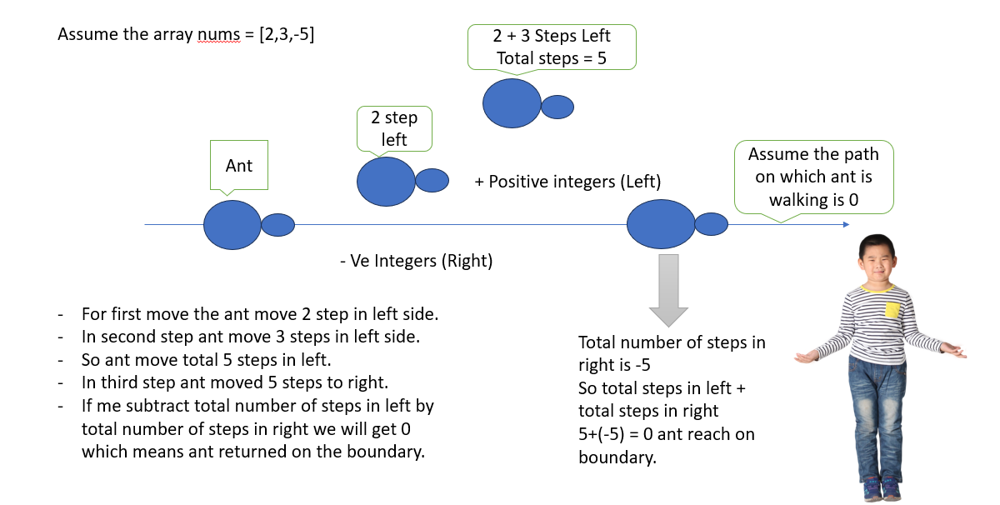

# Simple, Beginner Friendly & Dry run || Time Complexity O(N) & Space Complexity O(1) || Gites✅✅😎😎❤️

**Author:** GiteshSK_12
**Votes:** 2
**Link:** [https://leetcode.com/problems/ant-on-the-boundary/solutions/4871976/](https://leetcode.com/problems/ant-on-the-boundary/solutions/4871976/)

---


# Intuition \u2705


In the question, we are given an array of positive and negative integers, and an ant walking on a number line. We have to return the number of times the ant returns to the boundary.


# Approach \u2705


# Code Explanation \u2705
*   **Method Signature**: Inside the `Solution` class, there\u2019s a method `returnToBoundaryCount` with public access. This method takes an array of integers (`int[] nums`) as input and returns an integer (`int`). The method's purpose is described by its name: to count how many times the cumulative sum of the array's elements returns to the boundary condition of zero.
    
*   **Variable Initialization**:
    
    *   `int count = 0;` initializes a counter variable `count` to zero. This variable will keep track of how many times the cumulative sum returns to zero.
    *   `int sum = 0;` initializes a variable `sum` to zero. This variable will be used to calculate the running sum of the array's elements as we iterate through them.
*   **Iterating Through the Array**:
    
    *   The method uses an enhanced for-loop (`for(int i : nums)`) to iterate through each element `i` of the array `nums`.
    *   Inside the loop, `sum += i;` updates the running sum by adding the current element `i` to `sum`.
*   **Checking the Boundary Condition**:
    
    *   Within the loop, there's an if-statement `if (sum == 0)`, which checks if the running sum `sum` has returned to zero after adding the current element.
    *   If the condition is true, it increments the counter `count++`. This step counts the occurrence of the cumulative sum returning to zero.
*   **Returning the Result**:
    
    *   After the loop finishes iterating through all elements in the array, the method returns the count `return count;`. This is the total number of times the cumulative sum of the elements has returned to zero.
*   **Example Usage**: To use this method, you would create an instance of the `Solution` class and call the `returnToBoundaryCount` method, passing an integer array as an argument. The method would then return the count of how many times the cumulative sum of the elements in the provided array returns to zero.

# Complexity \u2705
- Time complexity: O(N)
- Space complexity:n O(1)

# Code \u2705
```C []
int returnToBoundaryCount(int* nums, int numsSize) {
    int count = 0;
    int sum = 0;
    for(int i = 0; i < numsSize; i++) {
        sum += nums[i];
        if (sum == 0) {
            count++;
        }
    }
    return count;
}
```
```C++ []
class Solution {
public:
    int returnToBoundaryCount(vector<int>& nums) {
        int count = 0;
        int sum = 0;
        for(int i : nums){
            sum += i;
            if (sum == 0) {
                count++;
            }
        }
        return count;
    }
};
```
```Java []
class Solution {
    public int returnToBoundaryCount(int[] nums) {
        int count = 0;
        int sum = 0;
        for(int i : nums){
            sum += i;
            if (sum == 0) {
                count++;
            }
        }
        return count;
    }
}
```
```javascript []
/**
 * @param {number[]} nums
 * @return {number}
 */
var returnToBoundaryCount = function(nums) {
     let count = 0;
        let sum = 0;
        for(let i of nums){
            sum += i;
            if (sum === 0) {
                count++;
            }
        }
        return count;
};
```
```C# []
public class Solution {
    public int ReturnToBoundaryCount(int[] nums) {
        int count = 0;
        int sum = 0;
        foreach (int num in nums) {
            sum += num;
            if (sum == 0) {
                count++;
            }
        }
        return count;
    }
}
```
```Python []
class Solution(object):
    def returnToBoundaryCount(self, nums):
        """
        :type nums: List[int]
        :rtype: int
        """
        count = 0
        sum = 0
        for i in nums:
            sum += i
            if sum == 0:
                count+=1
        return count
```
```Ruby []
# @param {Integer[]} nums
# @return {Integer}
def return_to_boundary_count(nums)
    count = 0
    sum = 0
    for i in nums
        sum += i
        if sum == 0
            count+=1
        end
    end
    return count
end
```
```TypeScript []
function returnToBoundaryCount(nums: number[]): number {

     let count = 0;
        let sum = 0;
        for(let i of nums){
            sum += i;
            if (sum === 0) {
                count++;
            }
        }
        return count;
};
```
```PHP []
class Solution {

    /**
     * @param Integer[] $nums
     * @return Integer
     */
    function returnToBoundaryCount($nums) {
    $count = 0;
    $sum = 0;
    foreach ($nums as $num) {
        $sum += $num;
        if ($sum == 0) {
            $count++;
        }
    }
    return $count;
    }
}
```

# Dry Run \u2705\uD83D\uDE0E

*   **Initialization**:
    
    *   The `count` variable is initialized to `0`.
    *   The `sum` variable is also initialized to `0`.
*   **First Iteration (i = 2)**:
    
    *   `sum += i;` \u21D2 `sum = 0 + 2 = 2`
    *   Check if `sum == 0`: This condition is false.
    *   The values now are: `sum = 2`, `count = 0`.
*   **Second Iteration (i = 3)**:
    
    *   `sum += i;` \u21D2 `sum = 2 + 3 = 5`
    *   Check if `sum == 0`: This condition is false.
    *   The values now are: `sum = 5`, `count = 0`.
*   **Third Iteration (i = -5)**:
    
    *   `sum += i;` \u21D2 `sum = 5 + (-5) = 0`
    *   Check if `sum == 0`: This condition is true.
    *   Since the condition is true, increment `count` by 1 (`count++`).
    *   The values now are: `sum = 0`, `count = 1`.
*   **End of Iteration**:
    
    *   The loop has iterated through all elements in the array.
*   **Return Statement**:
    
    *   The method returns the value of `count`, which is `1`.

# Guys if the solution and explanation is helpful then upvote me please.\u2764\uFE0F\u2764\uFE0F\u2764\uFE0F\u2764\uFE0F\u2764\uFE0F\u2764\uFE0F\u2764\uFE0F\u2764\uFE0F


