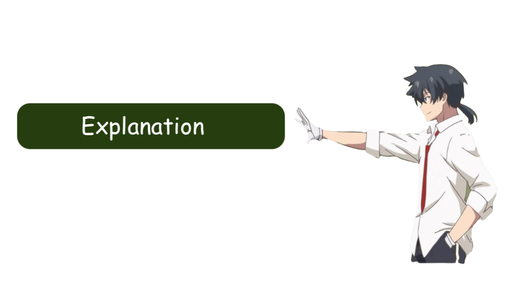
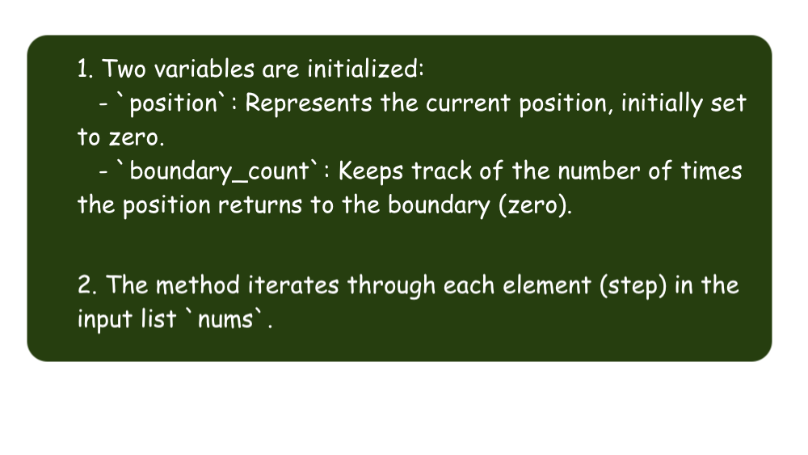
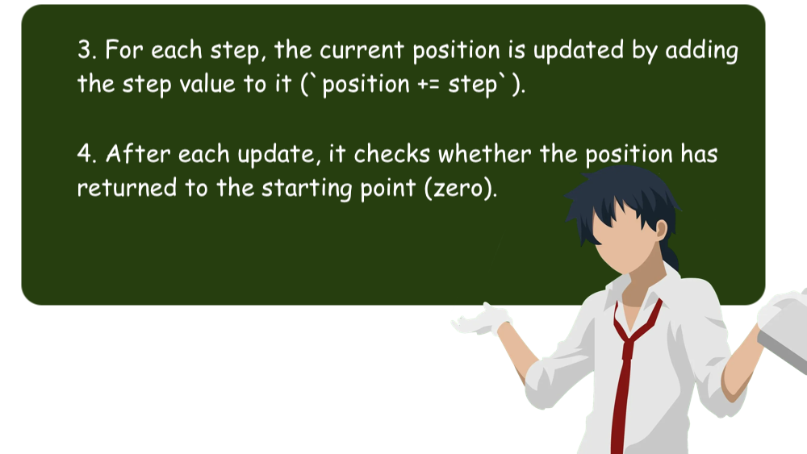
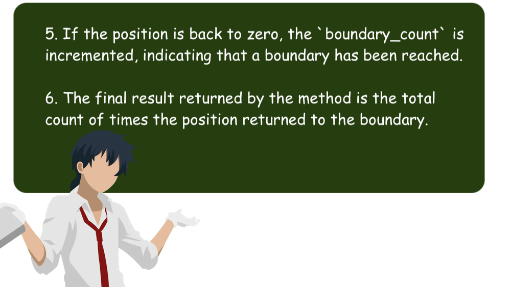

# 🔥✅✅ Full explanation with pictures ✅✅🔥

**Author:** DevOgabek
**Votes:** 4
**Link:** [https://leetcode.com/problems/ant-on-the-boundary/solutions/4837433/](https://leetcode.com/problems/ant-on-the-boundary/solutions/4837433/)

---











```python []
class Solution(object):
    def returnToBoundaryCount(self, nums):
        position = 0
        boundary_count = 0

        for step in nums:
            position += step

            if position == 0:
                boundary_count += 1

        return boundary_count
```
```python3 []
class Solution:
    def returnToBoundaryCount(self, nums: List[int]) -> int:
        position = 0
        boundary_count = 0

        for step in nums:
            position += step

            if position == 0:
                boundary_count += 1

        return boundary_count
```
```C++ []
class Solution {
public:
    int returnToBoundaryCount(vector<int>& nums) {
        int position = 0;
        int boundary_count = 0;

        for (int step : nums) {
            position += step;

            if (position == 0) {
                boundary_count++;
            }
        }

        return boundary_count;
    }
};
```
```javascript []
var returnToBoundaryCount = function(nums) {
    let position = 0;
    let boundaryCount = 0;

    for (let step of nums) {
        position += step;

        if (position === 0) {
            boundaryCount++;
        }
    }

    return boundaryCount;
};
```


## **My solutions**

\uD83D\uDFE2 - $$easy$$  
\uD83D\uDFE1 - $$medium$$ 
\uD83D\uDD34 - $$hard$$

\uD83D\uDFE1 [17. Letter Combinations of a Phone Number](https://leetcode.com/problems/letter-combinations-of-a-phone-number/solutions/4845532/there-is-an-80-chance-of-being-in-the-interview-full-problem-explanation)
\uD83D\uDFE1 [22. Generate Parentheses](https://leetcode.com/problems/generate-parentheses/solutions/4845742/simple-explanation-with-pictures)
\uD83D\uDFE1 [39. Combination Sum](https://leetcode.com/problems/combination-sum/solutions/4847482/beat-8292-full-explanation-with-pictures)
\uD83D\uDFE2 [2540. Minimum Common Value](https://leetcode.com/problems/minimum-common-value/solutions/4845076/beat-9759-full-explanation-with-pictures)
\uD83D\uDFE2 [3005. Count Elements With Maximum Frequency](https://leetcode.com/problems/count-elements-with-maximum-frequency/solutions/4839796/beat-8369-full-explanation-with-pictures)
\uD83D\uDFE2 [3028. Ant on the Boundary](https://leetcode.com/problems/ant-on-the-boundary/solutions/4837433/full-explanation-with-pictures)
\uD83D\uDFE2 [876. Middle of the Linked List](https://leetcode.com/problems/middle-of-the-linked-list/solutions/4834682/beat-10000-full-explanation-with-pictures)
\uD83D\uDFE1 [1750. Minimum Length of String After Deleting Similar Ends](https://leetcode.com/problems/minimum-length-of-string-after-deleting-similar-ends/solutions/4824224/beat-10000-full-explanation-with-pictures)
\uD83D\uDFE1 [948. Bag of Tokens](https://leetcode.com/problems/bag-of-tokens/solutions/4818912/beat-10000-full-explanation-with-pictures)
\uD83D\uDFE1 [19. Remove Nth Node From End of List](https://leetcode.com/problems/remove-nth-node-from-end-of-list/solutions/4813340/beat-10000-full-explanation-with-pictures)
\uD83D\uDFE2 [977. Squares of a Sorted Array](https://leetcode.com/problems/squares-of-a-sorted-array/solutions/4807704/square-sorter-python-python3-javascript-c)
\uD83D\uDFE2 [2864. Maximum Odd Binary Number](https://leetcode.com/problems/maximum-odd-binary-number/solutions/4802402/visual-max-odd-binary-solver-python-python3-javascript-c)
\uD83D\uDFE1 [1609. Even Odd Tree](https://leetcode.com/problems/even-odd-tree/solutions/4797529/even-odd-tree-validator-python-python3-javascript-c)
\uD83D\uDFE2 [9. Palindrome Number](https://leetcode.com/problems/palindrome-number/solutions/4795373/why-not-1-line-of-code-python-python3-c-everyone-can-understand)
\uD83D\uDFE1 [513. Find Bottom Left Tree Value](https://leetcode.com/problems/find-bottom-left-tree-value/solutions/4792022/binary-tree-explorer-mastered-javascript-python-python3-c-10000-efficiency-seeker)
\uD83D\uDFE2 [1. Two Sum](https://leetcode.com/problems/two-sum/solutions/4791305/5-methods-python-c-python3-from-easy-to-difficult)
\uD83D\uDFE2 [543. Diameter of Binary Tree](https://leetcode.com/problems/diameter-of-binary-tree/solutions/4787634/surpassing-9793-memory-magician-excelling-at-9723)
[More...](https://leetcode.com/DevOgabek/)
