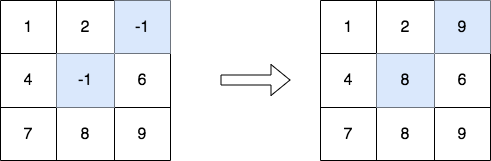
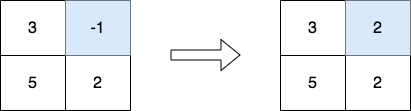

# [3033. Modify the Matrix](https://leetcode.com/problems/modify-the-matrix/)

| Category | Difficulty | Likes | Dislikes |
| :------: | :--------: | :---: | :------: |
| Algorithms | Easy | 150 | 9 |

**Tags:** [`array`](https://leetcode.com/tag/array), [`matrix`](https://leetcode.com/tag/matrix)

**Companies:** `fidelity`

## Description

Given a **0-indexed** `m x n` integer matrix `matrix`, create a new **0-indexed** matrix called `answer`. Make `answer` equal to `matrix`, then replace each element with the value `-1` with the **maximum** element in its respective column.

Return *the matrix* `answer`.

 

**Example 1:**


```

Input: matrix = [[1,2,-1],[4,-1,6],[7,8,9]]
Output: [[1,2,9],[4,8,6],[7,8,9]]
Explanation: The diagram above shows the elements that are changed (in blue).
- We replace the value in the cell [1][1] with the maximum value in the column 1, that is 8.
- We replace the value in the cell [0][2] with the maximum value in the column 2, that is 9.

```

**Example 2:**


```

Input: matrix = [[3,-1],[5,2]]
Output: [[3,2],[5,2]]
Explanation: The diagram above shows the elements that are changed (in blue).

```

 

**Constraints:**

	- `m == matrix.length`

	- `n == matrix[i].length`

	- `2 <= m, n <= 50`

	- `-1 <= matrix[i][j] <= 100`

	- The input is generated such that each column contains at least one non-negative integer.

---

**Links:** [Submissions](https://leetcode.com/problems/modify-the-matrix/) | [Solutions](https://leetcode.com/problems/modify-the-matrix/)
