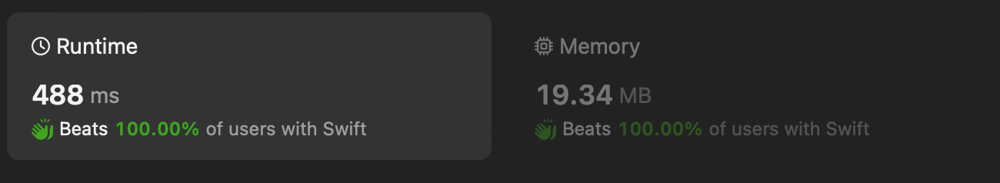

# ✅ Rolling Hash Solution

**Author:** eleev
**Votes:** 0
**Link:** [https://leetcode.com/problems/find-pattern-in-infinite-stream-ii/solutions/4833075/](https://leetcode.com/problems/find-pattern-in-infinite-stream-ii/solutions/4833075/)

---



# Solution
```swift
/**
 * Definition for an infinite stream.
 * class InfiniteStream {
 *     init(bits: [Int]) {}
 *     func next() -> Int {}
 * }
 */
final class Solution {
    @_optimize(speed)
    func findPattern(_ stream: InfiniteStream, _ pattern: [Int]) -> Int {
        let n = pattern.count
        let patternHash = pattern.reduce(0) { ($0 << 1) + $1 }
        var windowHash = (0..<n).reduce(0) { hash, _ in (hash << 1) + stream.next() }
        
        guard windowHash != patternHash else { return 0 }
        var currentIndex = 0
        let unsetMask = (1..<n).reduce(0) { acc, _ in (acc << 1) + 1 }

        repeat {
            windowHash = ((windowHash & unsetMask) << 1) + stream.next()
            currentIndex += 1
        } while windowHash != patternHash
        return currentIndex
    }
}
```