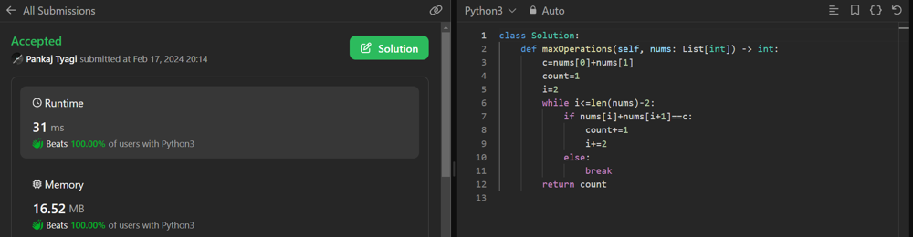

# Simple and Beginner Friendly | Beat 💯% users

**Author:** Pankaj_Tyagi
**Votes:** 2
**Link:** [https://leetcode.com/problems/maximum-number-of-operations-with-the-same-score-i/solutions/4742523/](https://leetcode.com/problems/maximum-number-of-operations-with-the-same-score-i/solutions/4742523/)

---



```python []
class Solution:
    def maxOperations(self, nums: List[int]) -> int:
        c=nums[0]+nums[1]
        count=1
        i=2
        while i<=len(nums)-2:
            if nums[i]+nums[i+1]==c:
                count+=1
                i+=2
            else:
                break
        return count
                    
```
```C++ []
class Solution {
public:
    int maxOperations(vector<int>& nums) {
        int c = nums[0] + nums[1];
        int count = 1;
        int i = 2;
        while (i <= nums.size() - 2) {
            if (nums[i] + nums[i + 1] == c) {
                count++;
                i += 2;
            } else {
                break;
            }
        }
        return count;
    }
};
```
