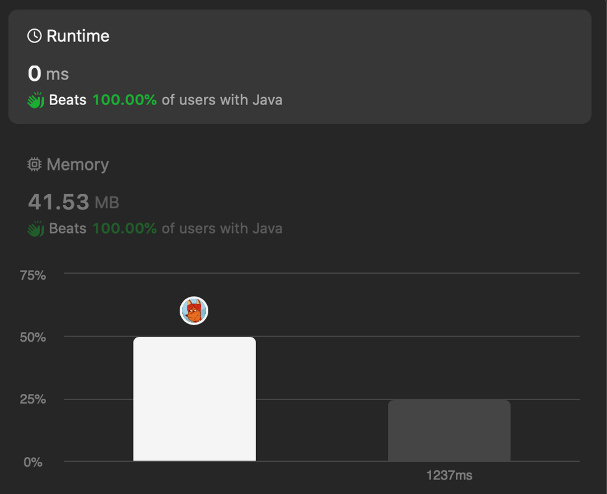

# ✅0ms O(n/2) solution in Java || C || JavaScript || Python || Go || PHP || Racket 👍

**Author:** codeninja8
**Votes:** 0
**Link:** [https://leetcode.com/problems/maximum-number-of-operations-with-the-same-score-i/solutions/4751821/](https://leetcode.com/problems/maximum-number-of-operations-with-the-same-score-i/solutions/4751821/)

---

The algorithm is simple
1. take the first sum `nums[0] + nums[1]`
2. take next sums until `nums[i] + nums[i - 1] == sum`
3. return count

# Code
``` java []
class Solution {
    public int maxOperations(int[] nums) {
        if (nums.length < 2) return 0;

        int sum = nums[0] + nums[1];
        int count = 1;
        for (int i = 3; i < nums.length; i += 2) {
            if (nums[i] + nums[i - 1] == sum) {
                count++;
            } else {
                break;
            }
        }
        return count;
    }
}
```
``` c []
int maxOperations(int* nums, int numsSize) {
    if (numsSize < 2) return 0;
    int count = 1;
    int sum = nums[0] + nums[1];

    for (int i = 3; i < numsSize; i += 2) {
        if (nums[i] + nums[i-1] == sum) {
            count++;
        } else {
            break;
        }
    }

    return count;
}
```
``` javascript []
var maxOperations = function(nums) {
    if (nums.length < 2) return 0;
    var count = 1;
    var sum = nums[0] + nums[1];

    for (var i = 3; i < nums.length; i += 2) {
        if (nums[i] + nums[i - 1] == sum) {
            count++;
        } else {
            break;
        }
    }

    return count;
};
```
``` python []
class Solution(object):
    def maxOperations(self, nums):
        if len(nums) < 2:
            return 0
        count = 1
        sum = nums[0] + nums[1]

        for i in range(3, len(nums), 2):
            if nums[i] + nums[i-1] == sum:
                count += 1
            else:
                break;
        return count
```
``` php []
class Solution {
    function maxOperations($nums) {
        if ($nums < 2) return 0;
        $count = 1;
        $sum = $nums[0] + $nums[1];

        for ($i = 3; $i < count($nums); $i += 2) {
            if ($nums[$i] + $nums[$i - 1] == $sum) {
                $count++;
            } else {
                break;
            }
        }

        return $count;
    }
}
```
``` golang []
func maxOperations(nums []int) int {
    if len(nums) < 2 {
        return 0
    }

    count := 1
    sum := nums[0] + nums[1]

    for i := 3; i < len(nums); i += 2 {
        if (nums[i] + nums[i - 1] == sum) {
            count++;
        } else {
            break;
        }
    }

    return count;
}
```
``` racket []
(define (max-operations nums)
  (cond [(< (length nums) 2) 0]
        [else
         (add1 (let loop ([sum (+ (first nums) (second nums))]
               [next (cddr nums)])
           (cond [(< (length next) 2) 0]
                 [(= sum (+ (first next) (second next))) (add1 (loop sum (cddr next)))]
                 [else 0])))]))
```
like \uD83D\uDC4D

