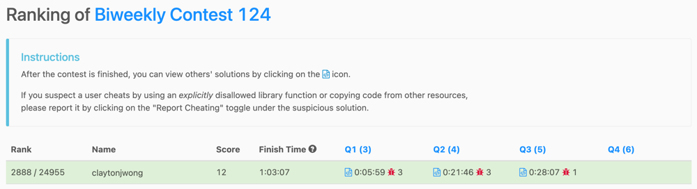

# 🎨 The ART of Dynamic Programming

**Author:** claytonjwong
**Votes:** 5
**Link:** [https://leetcode.com/problems/maximum-number-of-operations-with-the-same-score-ii/solutions/4742383/](https://leetcode.com/problems/maximum-number-of-operations-with-the-same-score-ii/solutions/4742383/)

---

# Game Plan

## [\uD83C\uDFA8 The ART of Dynamic Programming:](https://leetcode.com/discuss/general-discussion/712010/The-ART-of-Dynamic-Programming-An-Intuitive-Approach%3A-from-Apprentice-to-Master)

### DFS + Memo to optimally choose the maximum of 3 possibilities per `i..j` search-space of the input array `A`

* **a)** Choose the first two elements of nums and delete them.
* **b)** Choose the last two elements of nums and delete them.
* **c)** Choose the first and the last elements of nums and delete them.

# Code



*Kotlin*
```
class Solution {
    fun maxOperations(A: IntArray): Int {
        var N = A.size
        var dp = Array(N){ IntArray(N){ -1} }
        fun go(i: Int = 0, j: Int = N - 1, last: Int = 0): Int {
            if (j <= i)
                return 0
            if (dp[i][j] == -1) {
                var a = if (last == 0 || last == A[i] + A[i + 1]) 1 + go(i + 2, j, A[i] + A[i + 1]) else 0
                var b = if (last == 0 || last == A[j - 1] + A[j]) 1 + go(i, j - 2, A[j - 1] + A[j]) else 0
                var c = if (last == 0 || last == A[i] + A[j]) 1 + go(i + 1, j - 1, A[i] + A[j]) else 0
                dp[i][j] = listOf(a, b, c).max()
            }
            return dp[i][j]
        }
        return go()
    }
}
```

*Javascript*
```
let maxOperations = (A, N = A.length, dp = [...Array(N)].map(_ => Array(N).fill(-1))) => {
    let go = (i = 0, j = N - 1, last = 0) => {
        if (j <= i)
            return 0;
        if (dp[i][j] != -1)
            return dp[i][j];
        let a = (!last || last == A[i] + A[i + 1]) ? 1 + go(i + 2, j, A[i] + A[i + 1]) : 0,
            b = (!last || last == A[j - 1] + A[j]) ? 1 + go(i, j - 2, A[j - 1] + A[j]) : 0,
            c = (!last || last == A[i] + A[j]) ? 1 + go(i + 1, j - 1, A[i] + A[j]) : 0;
        return dp[i][j] = Math.max(a, b, c);
    };
    return go();
};
```

*Python3*
```
class Solution:
    def maxOperations(self, A: List[int]) -> int:
        @cache
        def go(i = 0, j = len(A) - 1, last = 0):
            if j <= i:
                return 0
            a = 1 + go(i + 2, j, A[i] + A[i + 1]) if not last or last == A[i] + A[i + 1] else 0
            b = 1 + go(i, j - 2, A[j - 1] + A[j]) if not last or last == A[j - 1] + A[j] else 0
            c = 1 + go(i + 1, j - 1, A[i] + A[j]) if not last or last == A[i] + A[j] else 0
            return max(a, b, c)
        return go()
```

*Rust*
```
type VI = Vec<i32>;
type VVI = Vec<VI>;
impl Solution {
    pub fn max_operations(A: VI) -> i32 {
        let N = A.len();
        let mut dp = vec![vec![-1; N]; N];
        fn go(A: &VI, i: i32, j: i32, last: i32, dp: &mut VVI) -> i32 {
            if j <= i {
                return 0;
            }
            if dp[i as usize][j as usize] == -1 {
                let a = if last == 0 || last == A[i as usize] + A[i as usize + 1] { 1 + go(A, i + 2, j, A[i as usize] + A[i as usize + 1], dp) } else { 0 };
                let b = if last == 0 || last == A[j as usize- 1] + A[j as usize] { 1 + go(A, i, j - 2, A[j as usize - 1] + A[j as usize], dp) } else { 0 };
                let c = if last == 0 || last == A[i as usize] + A[j as usize] { 1 + go(A, i + 1, j - 1, A[i as usize] + A[j as usize], dp) } else { 0 };
                dp[i as usize][j as usize] = vec![a, b, c].into_iter().max().unwrap();
            }
            dp[i as usize][j as usize]
        }
        go(&A, 0, N as i32 - 1, 0, &mut dp)
    }
}
```

*C++*
```
class Solution {
public:
    using VI = vector<int>;
    using VVI = vector<VI>;
    using fun = function<int(int, int, int)>;
    int maxOperations(VI& A) {
        int N = A.size();
        VVI dp(N, VI(N, -1));
        fun go = [&](auto i, auto j, auto last) {
            if (j <= i)
                return 0;
            if (dp[i][j] != -1)
                return dp[i][j];
            auto a = (!last || last == A[i] + A[i + 1]) ? 1 + go(i + 2, j, A[i] + A[i + 1]) : 0,
                 b = (!last || last == A[j - 1] + A[j]) ? 1 + go(i, j - 2, A[j - 1] + A[j]) : 0,
                 c = (!last || last == A[i] + A[j]) ? 1 + go(i + 1, j - 1, A[i] + A[j]) : 0;
            return dp[i][j] = max({a, b, c});
        };
        return go(0, N - 1, 0);
    }
};
```

---

# Supplemental: \uD83C\uDF5E "Breadcrumbs" for how we arrived "here" \uD83C\uDFAF
```
# Submission Result: Wrong Answer 
# Input:
# [1,9,7,3,2,7,4,12,2,6]
# Output:
# 3
# Expected:
# 2

# class Solution:
#     def maxOperations(self, A: List[int]) -> int:
#         N = len(A)
#         @cache
#         def go(i = 0, j = N - 1, last = 0):
#             if j <= i:
#                 return 0
#             a = go(i + 2, j, A[i] + A[i + 1]) if not last or last == A[i] + A[i + 1] else 0
#             b = go(i, j - 2, A[j - 1] + A[j]) if not last or last == A[j - 1] + A[j] else 0
#             c = go(i + 1, j - 1, A[i] + A[j]) if not last or last == A[i] + A[j] else 0
#             return 1 + max(a, b, c)
#         return go()

# Game Plan
# [\uD83C\uDFA8 The ART of Dynamic Programming:](https://leetcode.com/discuss/general-discussion/712010/The-ART-of-Dynamic-Programming-An-Intuitive-Approach%3A-from-Apprentice-to-Master)

# Use DFS + Memo to optimally choose from 3 possibilities:

# a. Choose the first two elements of nums and delete them.
# b. Choose the last two elements of nums and delete them.
# c. Choose the first and the last elements of nums and delete them.

# # Implementations
# *Python3*
class Solution:
    def maxOperations(self, A: List[int]) -> int:
        N = len(A)
        @cache
        def go(i = 0, j = N - 1, last = 0):
            if j <= i:
                return 0
            a = 1 + go(i + 2, j, A[i] + A[i + 1]) if not last or last == A[i] + A[i + 1] else 0
            b = 1 + go(i, j - 2, A[j - 1] + A[j]) if not last or last == A[j - 1] + A[j] else 0
            c = 1 + go(i + 1, j - 1, A[i] + A[j]) if not last or last == A[i] + A[j] else 0
            return max(a, b, c)
        return go()

# this is kinda silly, right?

# class Solution:
#     def maxOperations(self, A: List[int], T = 2000, best = 0) -> int:
#         N = len(A)
#         dp = [[[0] * (T + 1) for _ in range(N)] for _ in range(N)]
#         for last in range(T + 1):
#             for i in range(N):
#                 for j in reversed(range(i + 1, N)):
#                     a = 1 + (dp[i + 2][j][A[i] + A[i + 1]] if i + 2 < N else 0) if not last or (i + 1 < N and last == A[i] + A[i + 1]) else 0
#                     b = 1 + (dp[i][j - 2][A[j - 1] + A[j]] if 0 <= j - 2 else 0) if not last or (0 <= j - 1 and last == A[j - 1] + A[j]) else 0
#                     c = 1 + (dp[i + 1][j - 1][A[i] + A[j]] if 0 <= j - 1 and i + 1 < N else 0) if not last or last == A[i] + A[j] else 0
#                     dp[i][j][last] = max(a, b, c)
#                     best = max(best, dp[i][j][last])
#         return best
```