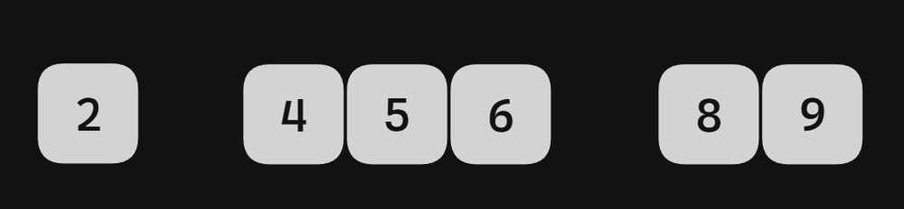
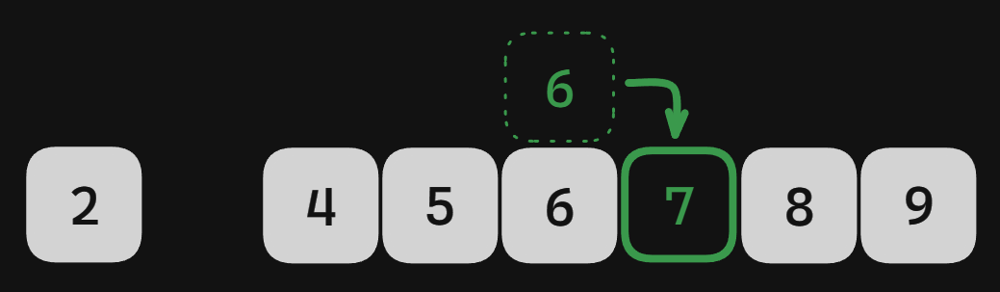
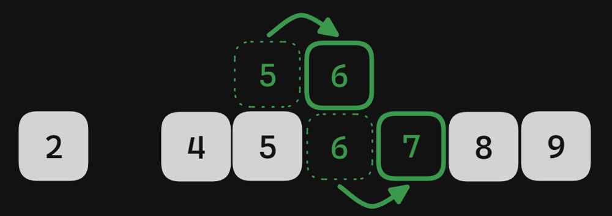
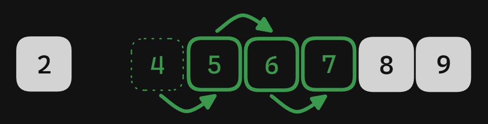

# Python / Kotlin / JavaScript Map O(n) Time O(n) Space

**Author:** ektegjetost
**Votes:** 0
**Link:** [https://leetcode.com/problems/maximize-consecutive-elements-in-an-array-after-modification/solutions/4748785/](https://leetcode.com/problems/maximize-consecutive-elements-in-an-array-after-modification/solutions/4748785/)

---

# Intuition
<!-- Describe your first thoughts on how to solve this problem. -->
Similar to [128. Longest Consecutive Sequence](https://leetcode.com/problems/longest-consecutive-sequence/description/) with some additional logic.
- We put all the numbers into a map (number to count of number) and look for the start of a sequence. The start of a sequence is a number where the previous two numbers don't exist in the map (previous 2 because n - 2 could be increased to become the start of the sequence)
- Then we start processing. Instead of just looking for the next number in the map, we have to consider whether we can increase the current number to continue the sequence if there's a break. Consider the following sequence:



  - If we have a duplicate number, we can safely increase
  

  - If some previous number was increased, we can safely increase
  
  

  - We can increase a continuous block of numbers (but obviously, this changes the length of the current sequence)
  
    Note that it doesn't matter if the ```2``` was increased, we still would create a gap, so we just need to track the current continugous block of numbers

- If the current and next numbers don't exist, we stop processing since there's no way to continue the sequence.
- As we process each number, mark it in the map so we know not to process it again. This means we'll process each sequence starting from the beginning, and skip over all other numbers, so we'll visit each number at most twice.


# Approach
<!-- Describe your approach to solving the problem. -->

- Initialize a map containing the counts of all numbers
- Loop through the num and count of each entry in the map. If we've already processed this num, we'll mark the count 0 so we can skip it.
- If the num is the start of a sequence (we haven't marked it and the two numbers before it don't exist), begin processing
  - Loop to infinity starting from the current num. Track the current streak along with the count of contiguous numbers
  - We can safely increase the current num if it exists and we either we have multiples of it, or we were able to increase the previous number
  - If the current and next numbers aren't in the map, break
  - If the next number doesn't exist and we can't safely increase the current number, we've found a situation where we need to increase the entire contiguous block. Our streak restarts to be the count of the current contiguous block because it won't be able to connect with the previous block (if one exists)
  - If the current number is in the map, mark its count as 0 so we can skip it if we see it again in the outer loop.
  - If the current streak is > the max streak, update the max streak

# Complexity
- Time complexity: $$O(n)$$
<!-- Add your time complexity here, e.g. $$O(n)$$ -->

- Space complexity: $$O(n)$$
<!-- Add your space complexity here, e.g. $$O(n)$$ -->

# Code
``` python []
from collections import Counter
class Solution:
    def maxSelectedElements(self, nums: List[int]) -> int:
        counts = Counter(nums)

        max_streak = 1
        for num, count in counts.items():
            if not count or num - 1 in counts or num - 2 in counts: continue

            streak, consecutive = 0, 0
            prev_increase = False

            for curr in range(num, 2_000_000):
                streak += 1
                max_streak = max(max_streak, streak)

                has_curr, has_next = curr in counts, curr + 1 in counts
                safely_increase = has_curr and (prev_increase or counts[curr] > 1)

                if not has_next and not has_curr: break

                if not has_next and not safely_increase: streak = consecutive

                prev_increase = safely_increase if has_next else True

                if has_curr: counts[num] = 0

                consecutive = consecutive + 1 if has_curr else 0
        
        return max_streak
```
``` kotlin []
class Solution {
    fun maxSelectedElements(nums: IntArray): Int {
        val counts = nums.toList().groupingBy { it }.eachCount().toMutableMap()

        var maxStreak = 1
        for ((num, count) in counts) {
            if (count == 0 || num - 1 in counts || num - 2 in counts) continue

            var (streak, consecutive) = listOf(0, 0)
            var prevIncrease = false

            for (curr in num..2_000_000) {
                streak += 1
                maxStreak = max(maxStreak, streak)

                val (hasCurr, hasNext) = listOf(curr in counts, curr + 1 in counts)
                val safelyIncrease = hasCurr && (prevIncrease || (counts[curr] ?: 0) > 1)

                if (!hasNext && !hasCurr) break

                if (!hasNext && !safelyIncrease) streak = consecutive

                prevIncrease = if (hasNext) safelyIncrease else true

                if (hasCurr) counts[curr] = 0

                consecutive = if (hasCurr) consecutive + 1 else 0
            }
        }

        return maxStreak
    }
}
```
``` javascript []
var maxSelectedElements = function(nums) {
  const counts = nums.reduce((counts, num) => {
    counts.set(num, counts.get(num) + 1 || 1);
    return counts;
  }, new Map());

  let max = 1;
  for (const [num, count] of counts) {
    if (count === 0 || counts.has(num - 1) || counts.has(num - 2)) continue;
    let [streak, consecutive] = [0, 0];
    let previousIncrease = false;
    
    for (let curr = num; true; curr += 1) {
      streak += 1;
      max = Math.max(max, streak);

      const [hasCurr, hasNext] = [counts.has(curr), counts.has(curr + 1)];
      const safelyIncrease = hasCurr && (previousIncrease || counts.get(curr) > 1);

      if (!hasNext && !hasCurr) break;

      if (!hasNext && !safelyIncrease) streak = consecutive;

      previousIncrease = hasNext ? safelyIncrease : true;

      if (hasCurr) counts.set(curr, 0);
      consecutive = hasCurr ? consecutive + 1 : 0;
    }
  }

  return max;
};
```