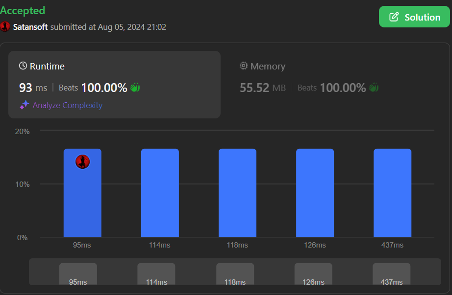

# ✅ Javascript | Fastest Solution | 🏆HashMap, DFS🏆 |🔥Beats 100%🔥

**Author:** Satansoft
**Votes:** 0
**Link:** [https://leetcode.com/problems/most-frequent-prime/solutions/5594044/](https://leetcode.com/problems/most-frequent-prime/solutions/5594044/)

---



# Intuition
Build optimal `isPrime` check function, run double loop to traverse through the `mat` and on each cell run `dfs` with controlling dirrection. Most frequent number calculating in `dfs`.

# Approach
`m` - `mat` rows number;
`n` - `mat` cols number;
`directions` - array of dfs move directions ([1, 0] is top, [0, 1] is right, etc.);
`nums` - map of nums frequencies;
`mostFrequentPrime` - most frequent prime number, -1 by default;
`mostFrequentCount` - frequency of most frequent prime number;

Define optimal `isPrime` check function (Sieve of Eratosthenes);

Iterate through `mat` with double loop and on each cell run `dfs` with passing current `i`, `j` and empty string as `path`;

In `dfs`: 
- use border condition to exit recursion, 
- form `path` as concate each number from cell in 8 directions (top, bottom, left, right, bottom - right, top - right, top - left and bottom - left), 
- check for it's `> 10` and check for `isPrime` and if yes, add it to `nums` and check for most frequent or one of the most frequent and biggest `num`, then update `mostFrequentPrime` and `mostFrequentCount` if conditions satisfied.
- use `dfs` in 2 ways: if call is first, run loop of `directions` to start move through `mat` in 8 directions, if `dfs` call isn't first, it get `direction` param to move through `mat` as start direction; 

At the end return `mostFrequentPrime` and if no most frequent there, -1 will be returned.


# Complexity
- Time complexity:
$$O(m * n * k)$$

- Space complexity:
$$O(nums)$$

# Code
```
/**
 * @param {number[][]} mat
 * @return {number}
 */
function isPrime(n) {
    if (n <= 1) return false;
    if (n <= 3) return true;

    if (n % 2 === 0 || n % 3 === 0) return false;

    for (let i = 5; i * i <= n; i += 6) {
        if (n % i === 0 || n % (i + 2) === 0) return false;
    }

    return true;
}

var mostFrequentPrime = function(mat) {
    const m = mat.length;
    const n = mat[0].length;
    
    const directions = [[1, 0], [-1, 0], [0, 1], [0, -1], [1, 1], [1, -1], [-1, -1], [-1, 1]];
    const nums = new Map();

    let mostFrequentPrime = -1;
    let mostFrequentCount = 0;

    function dfs(i, j, path, direction) {
        if (i < 0 || i >= m || j < 0 || j >= n) return;

        path += mat[i][j];
        const num = parseInt(path);

        if (num > 10 && isPrime(num)) {
            const prev = nums.get(num) || 0;
            nums.set(num, prev + 1);
            const curr = prev + 1;

            if (curr > mostFrequentCount || curr === mostFrequentCount && num > mostFrequentPrime) {
                mostFrequentCount = curr;
                mostFrequentPrime = num;
            }
        }

        if (direction) {
            const [di, dj] = direction;
            dfs(i + di, j + dj, path, direction);
        } else {

            for(dir of directions) {
                const [di, dj] = dir;
                dfs(i + di, j + dj, path, dir);
            }
        }
    }

    for(let i = 0; i < m; i++) {
        for(let j = 0; j < n; j++) {
            dfs(i, j, '');
        }
    }

    return mostFrequentPrime;
};
```