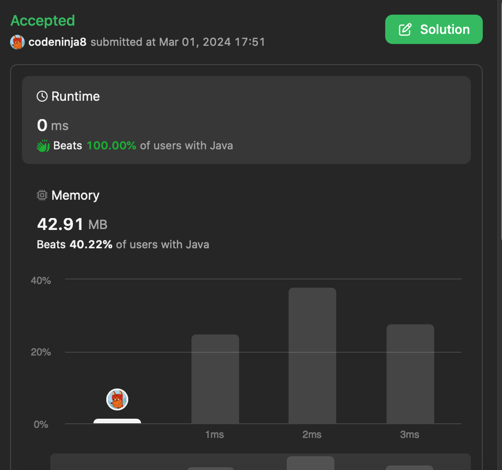

# 0ms the best solution in 9 languages (explained)

**Author:** codeninja8
**Votes:** 0
**Link:** [https://leetcode.com/problems/split-the-array/solutions/4806849/](https://leetcode.com/problems/split-the-array/solutions/4806849/)

---

The array can be split if all numbers occur one or two times.

Algorithm
1. Count the occurrence of numbers using the `count` array
2. If there is a number that is presented more than twice, then return false
3. Otherwise, return true

Note: instead of `count` you can use some HashMap but array is faster
``` java []
class Solution {
    public boolean isPossibleToSplit(int[] nums) {
        int[] count = new int[101];

        for (int val : nums) {
            count[val]++;
            if (count[val] > 2) {
                return false;
            }            
        }

        return true;
    }
}
```
``` javascript []
var isPossibleToSplit = function(nums) {
    var count = Array(101).fill(0);

    for (var i = 0; i < nums.length; i++) {
        var val = nums[i];
        count[val]++;
        if (count[val] > 2) {
            return false;
        }
    }

    return true;    
};
```
``` c []
bool isPossibleToSplit(int* nums, int numsSize) {
    int count[101] = {0};
    for (int i = 0; i < numsSize; i++) {
        count[nums[i]]++;
        if (count[nums[i]] > 2) {
            return false;
        }
    }

    return true;
}
```
``` python []
class Solution(object):
    def isPossibleToSplit(self, nums):
        count = [0] * 101
        for val in nums:
            count[val] += 1
            if count[val] > 2:
                return False
        return True
```
``` ruby []
def is_possible_to_split(nums)
    count = Hash.new(0)

    nums.each do |v| 
        count[v] += 1
        return false if count[v] > 2
    end

    return true
end
```
``` golang []
func isPossibleToSplit(nums []int) bool {
    count := make([]int, 101)
    for _, v := range nums {
        count[v]++
        if count[v] > 2 {
            return false
        }
    }

    return true
}
```
``` php []
class Solution {
    function isPossibleToSplit($nums) {
        $count = array_fill(1, 100, 0);
        foreach ($nums as $val) {
            $count[$val]++;
            if ($count[$val] > 2) {
                return false;
            }
        }

        return true;
    }
}
```
``` racket []
(define (is-possible-to-split nums)
  (let ([count (make-vector 101 0)]
        [len (length nums)])
    (eq? len (length (for/list ([v nums]
          #:break (> (vector-ref count v) 1))
      (vector-set! count v (add1 (vector-ref count v))))))))
```
``` Pascal []
function isPossibleToSplit(nums: array of integer) : boolean;
var count: array[1..100] of integer;
  i: integer;
begin
  for i := 0 to Length(nums) - 1 do
    begin
      Inc(count[nums[i]]);
      if count[nums[i]] > 2 then
        Exit(false);
    end;

    Exit(true);
end;
```


