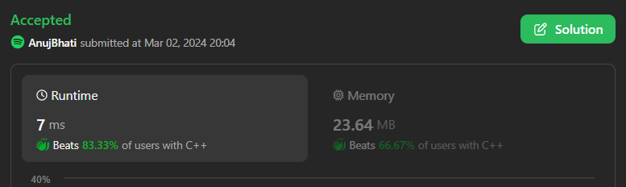

# Easiest 8 Languages Solution done in LeetCode Contest 02-03-2024 with 3 mins of contest

**Author:** Edwards310
**Votes:** 2
**Link:** [https://leetcode.com/problems/minimum-operations-to-exceed-threshold-value-i/solutions/4811897/](https://leetcode.com/problems/minimum-operations-to-exceed-threshold-value-i/solutions/4811897/)

---

# Intuition




```javascript []
/**
 * @param {number[]} nums
 * @param {number} k
 * @return {number}
 */
var minOperations = function (nums, k) {
    var cnt = 0;
    for (var x = 0; x < nums.length; ++x) {
        if (nums[x] < k)
            cnt++;
    }
    return cnt;
};
```
```python3 []
class Solution:
    def minOperations(self, nums: List[int], k: int) -> int:
        cnt = 0
        for x in nums:
            if x < k:
                cnt += 1
        return cnt
```
```C++ []
class Solution {
public:
    int minOperations(vector<int>& nums, int k) {
        int cnt = 0;
        for (auto& x : nums) {
            if (x < k)
                cnt++;
        }
        return cnt;
    }
};
```
```python []
class Solution(object):
    def minOperations(self, nums, k):
        """
        :type nums: List[int]
        :type k: int
        :rtype: int
        """
        count = 0
        for y in nums:
            if y < k:
                count += 1
                
        return count
```
```C# []
public class Solution {
    public int MinOperations(int[] nums, int k) {
        int cnt = 0;
        for(int x = 0; x < nums.Length; ++x){
            if(nums[x] < k)
                cnt += 1;
        }
        return cnt;
    }
}
```
```Java []
class Solution {
    public int minOperations(int[] nums, int k) {
        int cnt = 0;
        for (int x : nums) {
            if (x < k)
                cnt++;
        }
        return cnt;
    }
}
```
```C []
int minOperations(int* nums, int numsSize, int k) {
    int cnt = 0;
    for (int i = 0; i < numsSize; ++i) {
        if (nums[i] < k)
            cnt++;
    }
    return cnt;
}
```

<!-- Describe your first thoughts on how to solve this problem. -->

# Approach
<!-- Describe your approach to solving the problem. -->
 Basic Simply idea is just calculate the number of elements in nus that are smaller than k return their count
# Complexity
- Time complexity:
<!-- Add your time complexity here, e.g. $$O(n)$$ -->
    O(n) --> n = numsSize
- Space complexity:
<!-- Add your space complexity here, e.g. $$O(n)$$ -->
    O(1)
# Code
```
/**
 * @param {number[]} nums
 * @param {number} k
 * @return {number}
 */
var minOperations = function(nums, k) {
    var cnt = 0;
    for(var x = 0; x < nums.length; ++x){
        if(nums[x] < k)
            cnt++;
    }
    return cnt;
};
```

