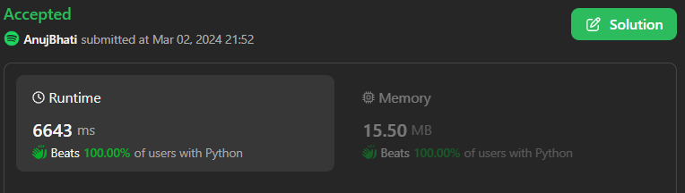

# ☠💀💯 Faster✅💯 Lesser🧠 🎯 C++✅Python3✅Java✅C✅Python✅💥🔥💫Explained☠💥🔥 Beats 💯

**Author:** Edwards310
**Votes:** 2
**Link:** [https://leetcode.com/problems/count-pairs-of-connectable-servers-in-a-weighted-tree-network/solutions/4811749/](https://leetcode.com/problems/count-pairs-of-connectable-servers-in-a-weighted-tree-network/solutions/4811749/)

---

# Intuition


```C++ []
class Solution {
    int dfs(int x, int f, int s, int d, const vector<vector<pair<int, int>>>& con, int& r) {
        int v = 0;
        for (const auto& p : con[x]) {
            if (p.first != f) {
                const int temp = dfs(p.first, x, s, d + p.second, con, r);
                if (f < 0) {
                    r += temp * v;
                }
                v += temp;
            }
        }
        return v + (d % s == 0);
    }

public:
    vector<int> countPairsOfConnectableServers(vector<vector<int>>& edges, int signalSpeed) {
        const int n = edges.size() + 1;
        vector<vector<pair<int, int>>> con(n);
        for (const auto& e : edges) {
            con[e[0]].push_back({e[1], e[2]});
            con[e[1]].push_back({e[0], e[2]});
        }
        vector<int> r(n);
        for (int i = 0; i < n; ++i) {
            dfs(i, -1, signalSpeed, 0, con, r[i]);
        }
        return r;
    }
};
```
```python3 []
class Solution:
    def countPairsOfConnectableServers(self, edges: List[List[int]], signalSpeed: int) -> List[int]:
        g = defaultdict(list)
        n = 0
        for u, v, w in edges:
            n = max(n, v, u)
            g[u].append([v, w])
            g[v].append([u, w])
        res = []

        def dfs(node, w, vis):
            if node in vis:
                return 0
            vis.add(node)
            return sum(dfs(nei, w + ww, vis) for nei, ww in g[node]) + (
                w % signalSpeed == 0
            )

        for i in range(n + 1):
            curr = ans = 0
            temp = []
            for nei, w in g[i]:
                x = dfs(nei, w, {i})
                temp.append(x)
                curr += x
            for x in temp:
                ans += x * (curr - x)
            res.append(ans // 2)
        return res
```
```Java []
class Solution {
    ArrayList<ArrayList<int[]>> graph;
    int mod;

    public int[] countPairsOfConnectableServers(int[][] edges, int signalSpeed) {
        int n = edges.length + 1;
        int res[] = new int[n];
        mod = signalSpeed;

        graph = new ArrayList<ArrayList<int[]>>();

        for (int i = 0; i < n; i++)
            graph.add(new ArrayList<int[]>());

        for (int e[] : edges) {
            graph.get(e[0]).add(new int[] { e[1], e[2] });
            graph.get(e[1]).add(new int[] { e[0], e[2] });
        }

        for (int i = 0; i < n; i++) {
            res[i] = fun(i);
        }

        return res;
    }

    int fun(int i) {
        int res = 0, cur = 0;

        for (int j[] : graph.get(i)) {
            int t = dfs(j[0], i, j[1]);
            res += t * cur;
            cur += t;
        }

        return res;
    }

    int dfs(int node, int par, int wt) {
        int res = wt % mod == 0 ? 1 : 0;

        for (int i[] : graph.get(node)) {
            if (i[0] == par)
                continue;
            res += dfs(i[0], node, wt + i[1]);
        }

        return res;
    }
}
```
```C++[]
class Solution {
public:
    vector<pair<int, int>> v[1005];
#define x first
#define y second
#define mp make_pair
    int dfs(int x, int f, long long sum, int mod) {
        int ans = 0;
        if (sum % mod == 0)
            ans++;
        vector<int> vv;
        for (auto it : v[x]) {
            if (it.x != f) {
                if (f == x)
                    vv.push_back(dfs(it.x, x, sum + it.y, mod));
                else
                    ans += dfs(it.x, x, sum + it.y, mod);
            }
        }
        if (vv.size()) {
            ans = 0;
            int sum = 0;
            for (auto it : vv) {
                ans += sum * it;
                sum += it;
            }
        }
        return ans;
    }
    vector<int> countPairsOfConnectableServers(vector<vector<int>>& edges,
                                               int signalSpeed) {
        for (auto it : edges) {
            v[it[0]].push_back(mp(it[1], it[2]));
            v[it[1]].push_back(mp(it[0], it[2]));
        }
        vector<int> ans;
        for (int i = 0; i < edges.size() + 1; i++) {
            ans.push_back(dfs(i, i, 0, signalSpeed));
        }
        return ans;
    }
};
```
```Python []
class Solution(object):
    def countPairsOfConnectableServers(self, edges, signalSpeed):
        """
        :type edges: List[List[int]]
        :type signalSpeed: int
        :rtype: List[int]
        """
        g = defaultdict(list)
        n = 0
        for u, v, w in edges:
            n = max(n, v, u)
            g[u].append([v, w])
            g[v].append([u, w])
        res = []

        def dfs(node, w, vis):
            if node in vis:
                return 0
            vis.add(node)
            return sum(dfs(nei, w + ww, vis) for nei, ww in g[node]) + (
                w % signalSpeed == 0
            )

        for i in range(n + 1):
            curr = ans = 0
            temp = []
            for nei, w in g[i]:
                x = dfs(nei, w, {i})
                temp.append(x)
                curr += x
            for x in temp:
                ans += x * (curr - x)
            res.append(ans // 2)
        return res
```
<!-- Describe your first thoughts on how to solve this problem. -->

# Approach
<!-- Describe your approach to solving the problem. -->

# Complexity
- Time complexity:
<!-- Add your time complexity here, e.g. $$O(n)$$ -->
    O(n)
- Space complexity:
<!-- Add your space complexity here, e.g. $$O(n)$$ -->
    O(n)
# Code
```
class Solution(object):
    def countPairsOfConnectableServers(self, edges, signalSpeed):
        """
        :type edges: List[List[int]]
        :type signalSpeed: int
        :rtype: List[int]
        """
        g = defaultdict(list)
        n = 0
        for u, v, w in edges:
            n = max(n, v, u)
            g[u].append([v, w])
            g[v].append([u, w])
        res = []

        def dfs(node, w, vis):
            if node in vis:
                return 0
            vis.add(node)
            return sum(dfs(nei, w + ww, vis) for nei, ww in g[node]) + (
                w % signalSpeed == 0
            )

        for i in range(n + 1):
            curr = ans = 0
            temp = []
            for nei, w in g[i]:
                x = dfs(nei, w, {i})
                temp.append(x)
                curr += x
            for x in temp:
                ans += x * (curr - x)
            res.append(ans // 2)
        return res
```

