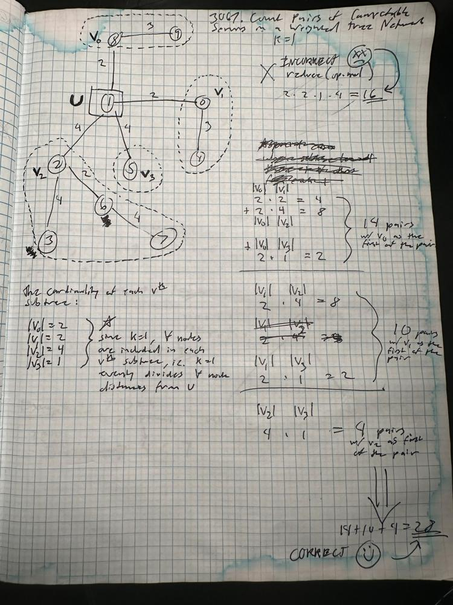

# a few solutions

**Author:** claytonjwong
**Votes:** 0
**Link:** [https://leetcode.com/problems/count-pairs-of-connectable-servers-in-a-weighted-tree-network/solutions/4822939/](https://leetcode.com/problems/count-pairs-of-connectable-servers-in-a-weighted-tree-network/solutions/4822939/)

---

# Game Plan




Since `N = 1000` a brute-force quadratic N<sup>2</sup> solution is AC, ie. for each candidate connector node `u`, let `trees` be all adjacent subtrees rooted at each node `v` adjacent to `u`.  The value of each tree in `trees` is the count of nodes with distance to `u` evenly divisible by target `T`.  Let function `f` return this accumulated count as the recursive stack unwinds (beginning at leaf nodes).

Then formulate the answer `ans` for each candidate connector node `u=0..|E|+1` via all `i`,`j` pairs of `trees` by accumulating their total `t` products `trees[i] * trees[j]`, ie. use the rule-of-product.

Notes:
* we use `|E|+1` inclusive as the upper-bound since there is one more vertex than edge in a tree with `|E|` edges
* we use a map `m` to store the top-most recursive call's `trees`, since these values are used to formlate the answer `ans`
  * these top-most recursive calls are uniquely identified via the sentinel value `last = -123`

# Code

*Kotlin*
```
class Solution {
    fun countPairsOfConnectableServers(E: Array<IntArray>, T: Int): IntArray {
        var adj = mutableMapOf<Int, MutableList<Pair<Int, Int>>>()
        for ((u, v, w) in E) {
            if (!adj.contains(u)) adj[u] = mutableListOf<Pair<Int, Int>>(); adj[u]!!.add(Pair(v, w))
            if (!adj.contains(v)) adj[v] = mutableListOf<Pair<Int, Int>>(); adj[v]!!.add(Pair(u, w))
        }
        var m = mutableMapOf<Int, MutableList<Int>>()
        fun f(u: Int, last: Int = -123, dist: Int = 0): Int {
            var trees = mutableListOf<Int>()
            for ((v, w) in adj[u]!!)
                if (v != last)
                    trees.add((if ((dist + w) % T == 0) 1 else 0) + f(v, u, dist + w))
            if (last == -123)
                m[u] = trees
            return trees.sum()
        }
        var ans = mutableListOf<Int>()
        for (u in 0..E.size) {
            f(u)
            var (t, trees) = Pair(0, m[u]!!)
            for (i in 0 until trees.size)
                for (j in i + 1 until trees.size)
                    t += trees[i] * trees[j]
            ans.add(t)
        }
        return ans.toIntArray()
    }
}
```

*Javasscript*
```
let countPairsOfConnectableServers = (E, T, adj = new Map(_.range(0, E.length + 1).map(u => [u, []])), ans = []) => {
    for (let [u, v, w] of E)
        adj.get(u).push([v, w]),
        adj.get(v).push([u, w]);
    let f = (u, last = -123, dist = 0) => {
        let trees = [];
        for (let [v, w] of adj.get(u))
            if (v != last)
                trees.push(Number((dist + w) % T == 0) + f(v, u, dist + w));
        return last != -123 ? _.sum(trees) : [...trees];
    };
    for (let u = 0; u < E.length + 1; ++u) {
        let [t, trees] = [0, f(u)];
        for (let i = 0; i < trees.length; ++i)
            for (let j = i + 1; j < trees.length; ++j)
                t += trees[i] * trees[j];
        ans.push(t);
    }
    return ans;
};
```

*Python3*
```
class Solution:
    def countPairsOfConnectableServers(self, E: List[List[int]], T: int) -> List[int]:
        adj = defaultdict(list)
        for u, v, w in E:
            adj[u].append((v, w))
            adj[v].append((u, w))
        def f(u, last = -123, dist = 0):
            trees = []
            for v, w in adj[u]:
                if v != last:
                    trees.append(int((dist + w) % T == 0) + f(v, u, dist + w))
            return sum(trees) if last != -123 else trees[:]
        ans = []
        for u in range(len(E)+ 1):
            t, trees = 0, f(u)
            for i in range(len(trees)):
                for j in range(i + 1, len(trees)):
                    t += trees[i] * trees[j]
            ans.append(t)
        return ans
```

*C++*
```
class Solution {
public:
    using VI = vector<int>;
    using VVI = vector<VI>;
    using Pair = pair<int, int>;
    using Pairs = vector<Pair>;
    using Adj = unordered_map<int, Pairs>;
    using Map = unordered_map<int, VI>;
    using fun = function<int(int, int, int)>;
    VI countPairsOfConnectableServers(VVI& E, int T, Adj adj = {}, Map m = {}, VI ans = {}) {
        for (auto& edge: E) {
            auto [u, v, w] = tie(edge[0], edge[1], edge[2]);
            adj[u].push_back({v, w});
            adj[v].push_back({u, w});
        }
        fun f = [&](auto u, auto last, auto dist) {
            VI trees;
            for (auto [v, w]: adj[u])
                if (v != last)
                    trees.push_back(int((dist + w) % T == 0) + f(v, u, dist + w));
            if (last == -123)
                m[u] = trees;
            return accumulate(trees.begin(), trees.end(), 0);
        };
        for (auto u{ 0 }; u < E.size() + 1; ++u) {
            f(u, -123, 0);
            auto [t, trees] = make_pair(0, m[u]);
            for (auto i{ 0 }; i < trees.size(); ++i)
                for (auto j{ i + 1 }; j < trees.size(); ++j)
                    t += trees[i] * trees[j];
            ans.push_back(t);
        }
        return ans;
    }
};
```

# Supplemental: \uD83C\uDF5E "Breadcrumbs" for how we arrived "here" \uD83C\uDFAF

*Python3*
```
# a < b, a != c and b != c.

# ok a b c are separate and distinct subtree roots (each "pointing towards" the leaf nodes for their own separate and distinct subtrees)


# The distance from c to a is divisible by signalSpeed.
# The distance from c to b is divisible by signalSpeed.

# as we DFS outwards from each subtree root, track the distance, so +each node distance as we DFS go

# let's just make a function f which does this then ok?
# tracking last seen, then f will populate a counter for us and we will dfs accumulate the counter bottom-up (leaf nodes backwards as the recursive stack unwinds)


# The path from c to b and the path from c to a do not share any edges.

# a b c are separate and distinct subtree roots

# class Solution:
#     def countPairsOfConnectableServers(self, E: List[List[int]], K: int) -> List[int]:
#         adj = defaultdict(list)
#         for u, v, w in E:
#             adj[u].append((v, w))
#             adj[v].append((u, w))
#         def f(u, seen, dist = 0):
#             cnt = Counter()
#             for v, w in adj[u]:
#                 if v not in seen:
#                     seen.add(v)
#                     next = dist + w
#                     if not (next % K):
#                         cnt[v] += 1
#                     f(v, seen, next)
#             return cnt
#         # cnt = [f(u, set()) for u in range(len(E) + 1)]
#         # print(cnt)
#         seen = set()
#         cnt = f(0, seen = set([0]))
#         print(cnt)
#         return [-1 for _ in range(len(E) + 1)] 
    

# 3:35pm - 3:54pm - ugh...

# class Solution:
#     def countPairsOfConnectableServers(self, E: List[List[int]], K: int) -> List[int]:
#         adj = defaultdict(list)
#         for u, v, w in E:
#             adj[u].append((v, w))
#             adj[v].append((u, w))
#         def go(u, last = -1, dist = 0):
#             if len(adj[u]) == 1:  # leaf node
#                 return 0
#             trees = []
#             for v, w in adj[u]:
#                 if v != last:
#                     tree = go(v, u, dist + w) + (1 if (dist + w) % K == 0 else 0)
#                     trees.append(tree)
#             return 0 if len(trees) == 1 else reduce(operator.mul, trees, 1)
#         return [go(u) for u in range(len(E) + 1)]

# let's do 2-pass solution, then optimize


# first pass is just count
# ok fine, what are we counting?

# from each u, the count of nodes v with distance from u which is evenly divisible by K

# slightly off since the singles aren't accounted for properly

# class Solution:
#     def countPairsOfConnectableServers(self, E: List[List[int]], K: int) -> List[int]:
#         adj = defaultdict(list)
#         for u, v, w in E:
#             adj[u].append((v, w))
#             adj[v].append((u, w))
#         m = defaultdict(list)
#         def go(u, last = -123, dist = 0):
#             # print(f'go(u: {u}, last: {last}, dist: {dist})')
#             trees = []
#             for v, w in adj[u]:
#                 if v != last:
#                     if u == 1 and (dist + w) % K == 0 :
#                         print(f'u..v  {u}..{v}')
#                     t = go(v, u, dist + w) + (1 if (dist + w) % K == 0 else 0)
#                     # print(f'u: {u}  v: {v}   dist + w: {dist + w}  subtree: {t}')
#                     if t:
#                         trees.append(t)
#             # print(f'trees: {trees}')
#             if last == -123:
#                 m[u].extend(trees[:])
#             return sum(trees)
#         ans = []
#         for u in range(len(E) + 1):
#             go(u)
#             # print(m[u])
#             best = 0 if len(m[u]) == 1 else reduce(operator.mul, m[u], 1)
#             single = len([cnt for cnt in m[u] if cnt == 1])
#             total = sum(m[u]) - single
#             print(f'u: {u}  single: {single}  total: {total}')
#             best += total * single
#             ans.append(best)
#         for u in range(len(m)):
#             print(f'm[{u}]: {m[u]}')
#         return ans

# 9:33am - 

# let's just start over and try to keep it super simple

# so we have a graph of weighted edges E = u,v,w  ie. edge u -> v of weight w

# and here's the deal dude, N = 1000, so N^2 is expected to be AC since 1K * 1K = 1M

# the graph is tree, so there's only branches off to leafs from the middle outwards
# ie. no cycles for a DAG

# so for each leg of each connector node, it connects all pairs of subtree nodes

# of upon further observation, I was counting them wrong, ie. using the product "misses"
# the counts for single size subtree length, ie. multiply by 1 is a no-op, when we want it to be counted
# so this is the root cause why the previous solutions were under counting

# Wrong Answer
# 164 / 716 testcases passed
# submitted at Mar 02, 2024 16:26
# Input
# edges =
# [[1,0,2],[2,1,4],[3,2,4],[4,0,3],[5,1,4],[6,2,2],[7,6,4],[8,1,2],[9,8,3]]
# signalSpeed =
# 1

# Use Testcase
# Output
# [8,16,12,0,0,0,8,0,8,0]
# Expected
# [8,28,20,0,0,0,8,0,8,0]

# ok remember to KISS == keep it super simple

# 9:40am -
# for each node as a potential connector,
# track the count of each adjacent node as a subtree with some quantity of nodes with distance evenly divisible by the input target T
# then count the quadratic pairs for each of those subtrees

# 9:42am - implementation begins
# 9:49am - implementation ends and its accepted, yay! LOL I accidenally clicked submit, I meant to click Run

# ok, LOL note to self, when confused, just throw it away, start over again simplify
# or look more closely, right?  19 minutes and 6 seconds into pomodoro #2 for Q3 upsolve ends in AC, yay! \uD83C\uDF89

class Solution:
    def countPairsOfConnectableServers(self, E: List[List[int]], T: int) -> List[int]:
        adj = defaultdict(list)
        for u, v, w in E:
            adj[u].append((v, w))
            adj[v].append((u, w))
        m = defaultdict(list)
        def f(u, last = -123, dist = 0):
            trees = []
            for v, w in adj[u]:
                if v != last:
                    trees.append(int((dist + w) % T == 0) + f(v, u, dist + w))
            if last == -123:
                m[u] = trees[:]
            return sum(trees)
        ans = []
        for u in range(len(E)+ 1):
            f(u)
            t, trees = 0, m[u]
            for i, x in enumerate(trees):
                for j, y in enumerate(trees):
                    if i < j:
                        t += x * y
            ans.append(t)
        return ans
```