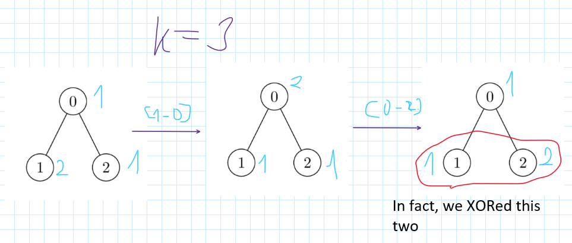

# ✅Detailed Explanation🔥2 Approaches🔥🔥Extremely Simple and effective🔥🔥🔥

**Author:** heir-of-god
**Votes:** 69
**Link:** [https://leetcode.com/problems/find-the-maximum-sum-of-node-values/solutions/5177609/](https://leetcode.com/problems/find-the-maximum-sum-of-node-values/solutions/5177609/)

---

# \uD83C\uDFAFProblem Explanation:
You are given an undirected tree with ```n``` nodes numbered from **0 to n - 1** where each node has some value (see ```nums```) and array ```nodes``` which represents edges beetwen nodes. You can perform XOR operation with number ```k``` any number of times on any two nodes which have edge between them in ```edges```. After perfoming them you want to achieve and return maximum possible sum of the tree.

# \uD83D\uDCE5Input:
- Integer array ```nums``` which represents values for every node.
- Array ```edges``` which contain list with two values - ```node from``` and ```node to``` (In fact, just forget about this parameter, it's just confusing and useless)
- Integer ```k``` - number with which you will perform XOR operation on connected nodes.

# \uD83D\uDCE4Output:
The maximum possible sum of all nodes after perfoming any number of operations.

# \uD83E\uDD14 Intuition
- The main point in this question is specific of XOR operation. **SO first of all, if you don't know what XOR means read this explanation**:
    - *The XOR (exclusive OR) (frequently indicated as "^") operator compares corresponding bits of two operands and returns 1 if the bits are different and 0 if they are the same. For instance, in binary **1010 ^ 1100 = 0110** indicating that the second and third bits differ while the first and fourth bits are the same.*
- Now you know about XOR let's talk a little about its feature. Let's get number from explanation **0110** and then perform on it XOR with **1100**, we will get **0110 ^ 1100 = 1010** -> something familiar, isn't it? If you look closer you can see that this is the first operand from example from the explanation. Do you know what it means? That means that for two number **a** and **b** will be true that ```(a ^ b) ^ b = a```. **This is one of main point for the solutions so I strongly recommend you to reread this if you haven't understanded, consider your own examples or ask questions in comment secion.**
- Another very important point that, considering last point, you can choose not just any conected nodes to perform XOR but any two from the tree because in the tree you always have a path from one node to another (this is why array ```edges``` is useless). Of course I need to explain this. Imagine you have 3 nodes 0, 1, 2 and edges (0, 1) and (0, 2) (the same tree as in the  description section) and look on picture.


- So, we are managed to XOR two nodes which haven't edge beetwen them, in such way I can XOR some node after the second node and so on. Considering that in the tree all nodes have some path between them we can XOR any pair of nodes we want. Now, let's move on to the approaches which based on this observations.


# \uD83E\uDDE0 Approach 1: Recursion with memoization
First of all - don't give up if you don't understand this approach. It's quite hard to come up with or understand so just move on to the next approach if you don't like this.
- We will do something like Fibonacci numbers - we will go from top to the bottom, calculating all possible states of the problem using recursion and memoization
- We want to apply this steps to write code for recursion solution:
    - Initialize memoization array ```temp```
    - We want to choose "root" of our tree so we can be sure that we traverse it all so let's just start with 0. In recursion we want to know on which node we currently are and parity of number of nodes we have XORed all the way to this node.
    - If we've gone through last node and now we are on the non-existing node then we want to return ```-inf``` if number of nodes we XORed is odd (because we can XOR only pair of them) or 0 if it's even (non-existing node mustn't affect the sum).
    - If we already encountered this state then return its maximum result from ```temp```.
    - Call recursion for both occasions - we are XORing this node and we aren't.
    - Find maximum from two values, write it to the memoization array and return it.
- Just return result from our recursion function using node 0 as root and is_even to true (we have XORed 0 nodes which is even)

# \uD83D\uDCD2 Complexity
- \u23F0 Time complexity: O(n), there can be at most 2 * n subproblems (check the size for ```temp``` array)
- \uD83E\uDDFA Space complexity: O(n) we use O(n) for recursion stack and O(2 * n) for memoization so O(3n) in total or just O(n)

# \uD83E\uDDD1\u200D\uD83D\uDCBB Code
``` python []
class Solution:
    def maximumValueSum(self, nums: list[int], k: int, edges: list[list[int]]) -> int:
        n: int = len(nums)
        temp: list[list[int]] = [[-1 for _ in range(2)] for _ in range(n)]  # temp[current_index(node)][is_even]

        def calculate_max(cur_ind, is_even) -> int:  # cur_ind -> cur_index of the tree and is_even represents whether we have already changed (XOR) even or odd number of nodes 
            if cur_ind == n:  # if we go to node which doesn't exist
                return 0 if is_even else -float("inf")
            if temp[cur_ind][is_even] != -1:  # if we've already encountered this state
                return temp[cur_ind][is_even]

            # checking all possible variants (no XOR or XOR)
            no_xor = nums[cur_ind] + calculate_max(cur_ind + 1, is_even)  # we don't change the number of XOR nodes
            with_xor = (nums[cur_ind] ^ k) + calculate_max(cur_ind + 1, not is_even)  # we added 1 XORed node

            mx_possible = max(no_xor, with_xor)
            temp[cur_ind][is_even] = mx_possible
            return mx_possible

        return calculate_max(0, 1)  # is_even == 1 because we have XORed 0 nodes which is even
```
``` C++ []
class Solution {
public:
    long long maximumValueSum(vector<int>& nums, int k, vector<vector<int>>& edges) {
        int n = nums.size();
        vector<vector<long long>> temp(n, vector<long long>(2, -1)); // temp[current_index(node)][is_even]
        
        return calculateMax(nums, n, k, 0, 1, temp);
    }

private:
    // calculate_max -> cur_ind -> cur_index of the tree and is_even represents whether we have already changed (XOR) even or odd number of nodes 
    long long calculateMax(vector<int>& nums, int n, int k, int curInd, int isEven, vector<vector<long long>>& temp) {
        if (curInd == n) {  // if we go to node which doesn't exist
            return isEven == 1 ? 0 : LLONG_MIN;
        }
        if (temp[curInd][isEven] != -1) {  // if we've already encountered this state
            return temp[curInd][isEven];
        }

        // checking all possible variants (no XOR or XOR)
        long long noXor = nums[curInd] + calculateMax(nums, n, k, curInd + 1, isEven, temp);  // we don't change the number of XOR nodes
        long long withXor = (nums[curInd] ^ k) + calculateMax(nums, n, k, curInd + 1, !isEven, temp);  // we added 1 XORed node

        long long mxPossible = max(noXor, withXor);
        temp[curInd][isEven] = mxPossible;
        return mxPossible;
    }
};
```
``` JavaScript []
var maximumValueSum = function(nums, k, edges) {
    const n = nums.length;
    const temp = Array.from({ length: n }, () => [-1, -1]);

    // calculate_max -> cur_ind -> cur_index of the tree and is_even represents whether we have already changed (XOR) even or odd number of nodes 
    function calculateMax(curInd, isEven) {
        if (curInd === n) {  // if we go to node which doesn't exist
            return isEven === 1 ? 0 : -Infinity;
        }
        if (temp[curInd][isEven] !== -1) {  // if we've already encountered this state
            return temp[curInd][isEven];
        }

        // checking all possible variants (no XOR or XOR)
        const noXor = nums[curInd] + calculateMax(curInd + 1, isEven);  // we don't change the number of XOR nodes
        const withXor = (nums[curInd] ^ k) + calculateMax(curInd + 1, 1 - isEven);  // we added 1 XORed node

        const mxPossible = Math.max(noXor, withXor);
        temp[curInd][isEven] = mxPossible;
        return mxPossible;
    }

    return calculateMax(0, 1);  // is_even == 1 because we have XORed 0 nodes which is even
};
```
``` Java []
class Solution {
    public long maximumValueSum(int[] nums, int k, int[][] edges) {
        int n = nums.length;
        long[][] temp = new long[n][2]; // temp[current_index(node)][is_even]
        for (int i = 0; i < n; i++) {
            temp[i][0] = -1;
            temp[i][1] = -1;
        }

        return calculateMax(nums, n, k, 0, 1, temp);  // is_even == 1 because we have XORed 0 nodes which is even
    }

    // calculate_max -> cur_ind -> cur_index of the tree and is_even represents whether we have already changed (XOR) even or odd number of nodes 
    private long calculateMax(int[] nums, int n, int k, int curInd, int isEven, long[][] temp) {
        if (curInd == n) {  // if we go to node which doesn't exist
            return isEven == 1 ? 0 : Long.MIN_VALUE;
        }
        if (temp[curInd][isEven] != -1) {  // if we've already encountered this state
            return temp[curInd][isEven];
        }

        // checking all possible variants (no XOR or XOR)
        long noXor = nums[curInd] + calculateMax(nums, n, k, curInd + 1, isEven, temp);  // we don't change the number of XOR nodes
        long withXor = (nums[curInd] ^ k) + calculateMax(nums, n, k, curInd + 1, 1 - isEven, temp);  // we added 1 XORed node

        long mxPossible = Math.max(noXor, withXor);
        temp[curInd][isEven] = mxPossible;
        return mxPossible;
    }
}
```
``` C []
long long calculateMax(int* nums, int n, int k, int curInd, int isEven, long long** temp) {
    if (curInd == n) {  // if we go to a node that doesn't exist
        return isEven == 1 ? 0 : LLONG_MIN;
    }
    if (temp[curInd][isEven] != -1) {  // if we've already encountered this state
        return temp[curInd][isEven];
    }

    // checking all possible variants (no XOR or XOR)
    long long noXor = nums[curInd] + calculateMax(nums, n, k, curInd + 1, isEven, temp);  // we don't change the number of XOR nodes
    long long withXor = (nums[curInd] ^ k) + calculateMax(nums, n, k, curInd + 1, !isEven, temp);  // we added 1 XORed node

    long long mxPossible = noXor > withXor ? noXor : withXor;
    temp[curInd][isEven] = mxPossible;
    return mxPossible;
}

long long maximumValueSum(int* nums, int numsSize, int k, int** edges, int edgesSize, int* edgesColSize) {
    int n = numsSize;
    long long** temp = (long long**)malloc(n * sizeof(long long*)); // temp[current_index(node)][is_even]
    for (int i = 0; i < n; i++) {
        temp[i] = (long long*)malloc(2 * sizeof(long long));
        temp[i][0] = -1;
        temp[i][1] = -1;
    }

    long long result = calculateMax(nums, n, k, 0, 1, temp);  // is_even == 1 because we have XORed 0 nodes which is even

    for (int i = 0; i < n; i++) {
        free(temp[i]);
    }
    free(temp);

    return result;
}
```


# \uD83E\uDDE0 Approach 2: Calculating deltas and sorting
This approach is quite easier both to write and understand but have worse time complexity.
- For every number we want to XOR it with ```k``` and check how we'll benefit from this, obviously we always want to increase our sum.
- Sort the array ```deltas``` which contain XORed values (as we can XOR any pair of nodes as described above we will first XOR those, which will give us better change in sum)
- Now we want to go through this array by pairs of elements and perform this logic:
    - If sum of this pair is > 0 then our sum will increase after XORing this two elements, we do so and add this sum to res.
    - If sum is < 0 then this pair and all pairs after will decrease our sum so we will just go out of loop 
- Return maximum result we have reached

# \uD83D\uDCD2 Complexity
- \u23F0 Time complexity: O(n logn), we use sorting which is use nlogn time in most languages
- \uD83E\uDDFA Space complexity: O(n) since we creating array ```deltas``` of size n

# \uD83E\uDDD1\u200D\uD83D\uDCBB Code
``` python []
class Solution:
    def maximumValueSum(self, nums: list[int], k: int, edges: list[list[int]]) -> int:
        n: int = len(nums)
        deltas: list[int] = [(nums[i] ^ k) - nums[i] for i in range(n)]  # represents how will change number after XOR
        deltas.sort(reverse=True)
        res: int = sum(nums)

        for start_ind in range(0, n - 1, 2):
            changing_delta: int = deltas[start_ind] + deltas[start_ind + 1]  # showing whether if would be beneficial if we XOR this two nodes 
            if changing_delta > 0:
                res += changing_delta
            else:
                break

        return res
```
``` Java []
class Solution {
    public long maximumValueSum(int[] nums, int k, int[][] edges) {
        int n = nums.length;
        long[] deltas = new long[n]; // represents how will change number after XOR
        for (int i = 0; i < n; i++) {
            deltas[i] = (nums[i] ^ k) - nums[i];
        }
        Arrays.sort(deltas);
        for (int i = 0; i < n / 2; i++) {
            long temp = deltas[i];
            deltas[i] = deltas[n - i - 1];
            deltas[n - i - 1] = temp;
        }

        long res = 0;
        for (int num : nums) {
            res += num;
        }

        for (int startInd = 0; startInd < n - 1; startInd += 2) {
            long changingDelta = deltas[startInd] + deltas[startInd + 1]; // showing whether if would be beneficial if we XOR this two nodes 
            if (changingDelta > 0) {
                res += changingDelta;
            } else {
                break;
            }
        }

        return res;
    }
}
```
``` C++ []
class Solution {
public:
    long long maximumValueSum(vector<int>& nums, int k, vector<vector<int>>& edges) {
        int n = nums.size();
        vector<long long> deltas(n); // represents how will change number after XOR
        for (int i = 0; i < n; i++) {
            deltas[i] = (nums[i] ^ k) - nums[i];
        }
        sort(deltas.rbegin(), deltas.rend());

        long long res = 0;
        for (int num : nums) {
            res += num;
        }

        for (int startInd = 0; startInd < n - 1; startInd += 2) {
            long long changingDelta = deltas[startInd] + deltas[startInd + 1]; // showing whether if would be beneficial if we XOR this two nodes 
            if (changingDelta > 0) {
                res += changingDelta;
            } else {
                break;
            }
        }

        return res;
    }
};
```
``` JavaScript []
var maximumValueSum = function(nums, k, edges) {
    let n = nums.length;
    let deltas = new Array(n).fill(0).map((_, i) => (nums[i] ^ k) - nums[i]); // represents how will change number after XOR
    deltas.sort((a, b) => b - a);

    let res = nums.reduce((acc, num) => acc + num, 0);

    for (let startInd = 0; startInd < n - 1; startInd += 2) {
        let changingDelta = deltas[startInd] + deltas[startInd + 1]; // showing whether if would be beneficial if we XOR this two nodes 
        if (changingDelta > 0) {
            res += changingDelta;
        } else {
            break;
        }
    }

    return res;
};
```
``` C []
// Comparator function for qsort to sort in descending order
int cmpfunc(const void *a, const void *b) {
    return (*(long long *)b - *(long long *)a);
}

long long maximumValueSum(int* nums, int numsSize, int k, int** edges, int edgesSize, int* edgesColSize) {
    int n = numsSize;
    long long* deltas = (long long*)malloc(n * sizeof(long long)); // represents how will change number after XOR

    for (int i = 0; i < n; i++) {
        deltas[i] = (nums[i] ^ k) - nums[i];
    }
    qsort(deltas, n, sizeof(long long), cmpfunc);

    long long res = 0;
    for (int i = 0; i < n; i++) {
        res += nums[i];
    }

    for (int startInd = 0; startInd < n - 1; startInd += 2) {
        long long changingDelta = deltas[startInd] + deltas[startInd + 1]; // showing whether if would be beneficial if we XOR this two nodes 
        if (changingDelta > 0) {
            res += changingDelta;
        } else {
            break;
        }
    }

    free(deltas);
    return res;
}
```

## \uD83D\uDCA1I encourage you to check out [my profile](https://leetcode.com/heir-of-god/) and [Project-S](https://github.com/Heir-of-God/Project-S) project for detailed explanations and code for different problems (not only Leetcode). Happy coding and learning! \uD83D\uDCDA

### Please consider *upvote* because I try really hard not just to put here my code and rewrite testcase to show that it works but explain you WHY it works and HOW. Thank you\u2764\uFE0F

## If you have any doubts or questions feel free to ask them in comments. I will be glad to help you with understanding\u2764\uFE0F\u2764\uFE0F\u2764\uFE0F


