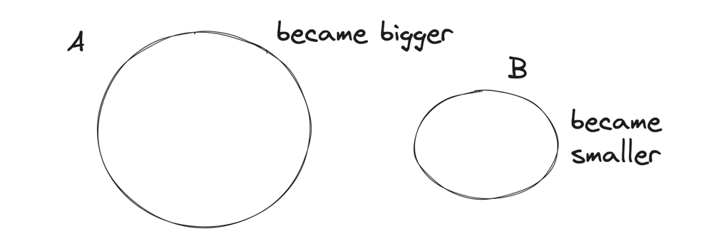
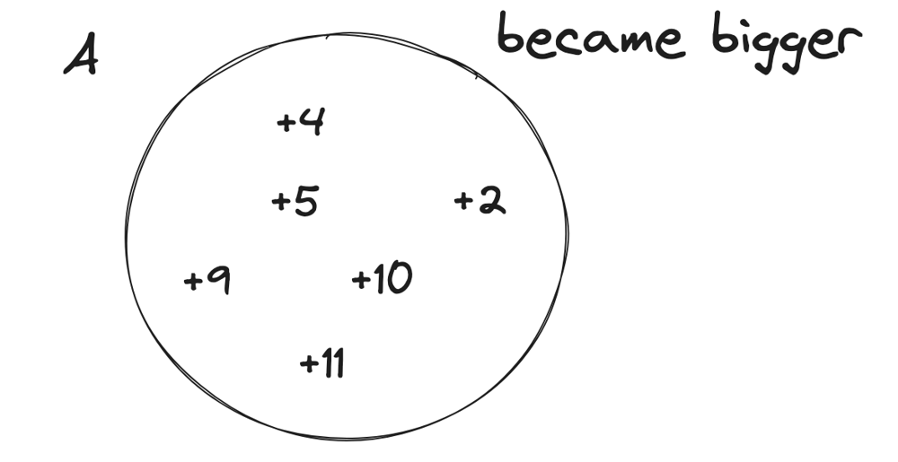
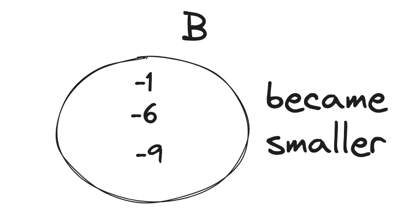
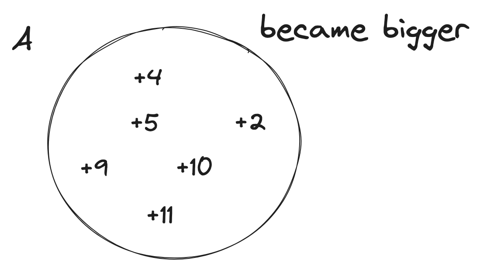
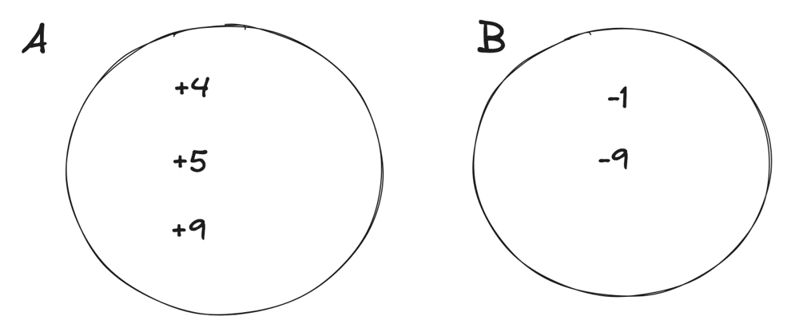
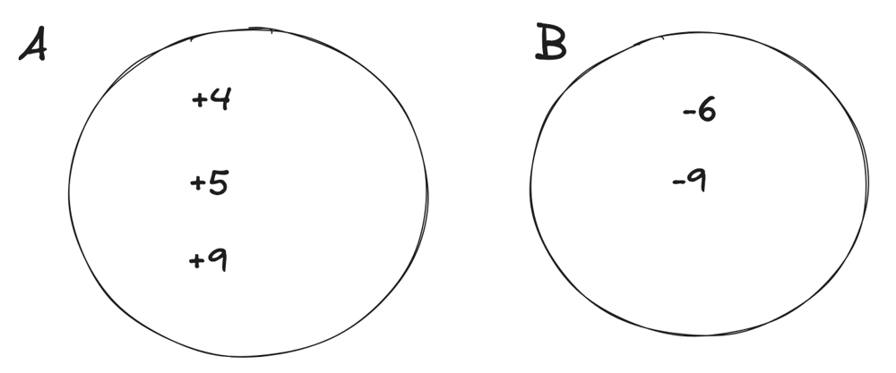

# Extreme detailed Explanation, that could ever exists

**Author:** hi-malik
**Votes:** 165
**Link:** [https://leetcode.com/problems/find-the-maximum-sum-of-node-values/solutions/5176804/](https://leetcode.com/problems/find-the-maximum-sum-of-node-values/solutions/5176804/)

---

So, the first thing you should notice that, this problem doesn't have any big examples. So, whenever you see something like this, you should have your examples, because working on a example, will give you some hints. Because the Questioner doesn't wanted you to get the hint's easily just via there examples!

Let's take our on example. But will take one with letters for now,

Now, the first question you should be asking yourself is,
What will happen if I want to work on path between **a** & **d**
```
->a will become, because first we have choose the edge between a and b

a----b----c----d
a ^ k
```
->b will become, 
```
a------b------c------d
a ^ k  b ^ k
```
-> The next edge we will choose between b and c
```
a------b------c------d
a ^ k  b ^ k
       b ^ k ^ k
```
as `b ^ k ^ k` will become `b`
```
a------b------c------d
a ^ k  b ^ k
       b 
```
```
a------b------c------d
a ^ k  b ^ k  c ^ k
       b 
```
-> The next edge we will choose between c and d
```
a------b------c------d
a ^ k  b ^ k  c ^ k
       b      c ^ k ^ k
```
as `c ^ k ^ k` will become `c`
```
a------b------c------d
a ^ k  b ^ k  c ^ k
       b      c 
```
and finally
```
a------b------c------d
a ^ k  b ^ k  c ^ k  d ^ k
       b      c 
```

Now from this, we can see that. If we choose any two numbers and apply the operarion over them. 

The next question, you should have is! 
> Okay so, I can pick any two numbers, I have for example :
```
a, b, c, d
```
and now you can look at the input as a list, because the tree structure is **irrelevant** and what will happen is that for each number, you should pick that number **at most once**
Because if you pick it twice, it will become
```
a, b, c, d
a^k^k
```
as ~~a^k^k~~ is a, basically it's not going to change.

So, this is the set that the other observation of the property of the **XOR** you should think about this, that I should pick any number **at most once**
> Next you should think, which number should I pick?
Let's say you are picking **a** and **b**
* a will become `a^k`
* b will become `b^k`

But there's some property, that :
* Greater than a `a^k` > `a` or Smaller than a `a^k` < `a`
As, it's either becoming bigger or becoming smaller. Because **k** is not **0**, only **`a ^ 0 = a`** and **k** is greater than **0**

So, now we should think of the input as **two sets**, if we pick them :
* We have a set of **A**, the numbers becoming **bigger**
* And a set of **B**, the numbers becoming **smaller**


Let's now think about this difference,
**`a^k` > `a`**
let's called it 
```
diff = a^k-a
```
So, here's all the diff going to be **+ve** one like:

And in the B, we going to have **-ve** one like:

These numbers may not be correct, but I just wanna make an example, so what happens is that because we have even number of them those that are becoming bigger, we just going to pair them together. As our operation's says we should pick 2 numbers

So, basically our answer would be sum of all of the numbers, because that is going to be the answer, plus these numbers like **`4 2 5 10 9 11`**. 
So it's going to **sum of X, X is input + sum of ai** 
i.e. **`\u2211x + \u2211ai`**
but right now, we don't care about **bi**, but we added the numbers that are becoming a smaller but we just ignored the difference as for the numbers that are becoming bigger, we added them but also added the difference.
> So, this was a one example
> > Let's have another example

In this example, we going to have **set A** and **set B**. In them we going to have :


In **set A** we can pair
```
      A
|-----------|
|  +5  +9   |
|-----------|
```
and add the difference to the answer, also in this case we can pair
```
      A                     B
|-----------|---------|-----------|
|    +4                    -1     |
|-----------|---------|-----------|
```
As **`+4 -1` > `0`**, as it's good to pair these two. This is the one case

**The other case could be**


In **set A** we can pair
```
      A
|-----------|
|  +5  +9   |
|-----------|
```

but we can't pair **`+4` and `-6`**, as it is less than **0** **`+4 -6` < `0`**, this won't be beneficial for us to Peak these two.

---


When the number of positiveCount is odd, we have two choices, either to remove one of the positiveCount occurrence from set of performed XORs or we can include one of the numbers from not performed XORs to be included in the set to make the XOR operation count to even. Basically we need the XOR op count to be even.

Now lets see how we achieve this using absolute diff -
Let XOR of a number n be n'. All the positive (n'-n) diffs are already included in total diff.

How will you remove one of these n's to maximize the sum? Simple - you will not perform xor when the difference is minimal. And subtract that minimum diff.

But, it might be more beneficial to include a negative diff i.e which was not already included - the decision to choose to that extra n which reduces the total sum would be to choose the diff which reduces the sum the least. You can find that by including the least negative diff or by maximizing (n-n').

The implementation does both these things in one shot by using Absolute diff.
**This part explaination by :-** [@kharashubham](https://leetcode.com/u/kharashubham/)

---

Now, you will ask, how do we write the code? The code is super simple, we just add all of the number as I said, **`\u2211xi + \u2211ai`**
Let me try to explain in code!

### Explanation:

1. **Initialization**:
   - Calculate the initial total sum of the `nums` array.
   - Initialize `total_diff` to store the cumulative positive differences.
   - Initialize `positive_count` to count how many positive differences exist.
   - Initialize `min_abs_diff` to store the smallest absolute difference encountered.

2. **Loop through each element in `nums`**:
   - Calculate the difference `diff` when XORing the current element with `k`.
   - If `diff` is positive, add it to `total_diff` and increment `positive_count`.
   - Track the minimum absolute difference encountered using `min_abs_diff`.

3. **Adjust for Odd Positive Count**:
   - If `positive_count` is odd, subtract the smallest absolute difference (`min_abs_diff`) from `total_diff` to maximize the total sum.

4. **Return the Final Sum**:
   - Return the sum of `total` and `total_diff`.

Let's code it UP

**`C++`**
```
class Solution {
public:
    long long maximumValueSum(vector<int>& v, int k, vector<vector<int>>& edges) {
        long long total = accumulate(v.begin(), v.end(), 0ll);
        
        long long total_diff = 0;
        long long diff;
        int positive_count = 0;
        long long min_abs_diff = numeric_limits<int>::max();
        for(auto p : v){
            diff = (p^k) - p;
            
            if(diff > 0){
                total_diff += diff;
                positive_count++;
            }
            min_abs_diff = min(min_abs_diff, abs(diff));
        }
        if(positive_count % 2 == 1){
            total_diff = total_diff - min_abs_diff;
        }
        return total + total_diff;
    }
};
```
**`JAVA`**
```
class Solution {
    public long maximumValueSum(int[] nums, int k, int[][] edges) {
        long total = 0;
        for (int num : nums) {
            total += num;
        }

        long totalDiff = 0;
        long diff;
        int positiveCount = 0;
        long minAbsDiff = Long.MAX_VALUE;
        for (int num : nums) {
            diff = (num ^ k) - num;

            if (diff > 0) {
                totalDiff += diff;
                positiveCount++;
            }
            minAbsDiff = Math.min(minAbsDiff, Math.abs(diff));
        }
        if (positiveCount % 2 == 1) {
            totalDiff -= minAbsDiff;
        }
        return total + totalDiff;
    }
}
```
**`PYTHON`**
```
class Solution:
    def maximumValueSum(self, nums: List[int], k: int, edges: List[List[int]]) -> int:
        total = sum(nums)
        
        total_diff = 0
        positive_count = 0
        min_abs_diff = float('inf')
        
        for num in nums:
            diff = (num ^ k) - num
            
            if diff > 0:
                total_diff += diff
                positive_count += 1
            min_abs_diff = min(min_abs_diff, abs(diff))
        
        if positive_count % 2 == 1:
            total_diff -= min_abs_diff
        
        return total + total_diff
```

---
Complexity Analysis

---

* **Time Complexity :-** BigO(N)


* **Space Complexity :-** BigO(N)


