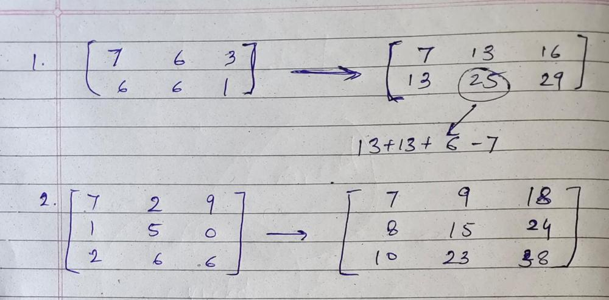

# Prefix sum✅ Easy to understand🔥 C++ || Python || Java

**Author:** Eshaan14_
**Votes:** 40
**Link:** [https://leetcode.com/problems/count-submatrices-with-top-left-element-and-sum-less-than-k/solutions/4814287/](https://leetcode.com/problems/count-submatrices-with-top-left-element-and-sum-less-than-k/solutions/4814287/)

---

# Intuition
We need to calculate the sum of a sub matrix. Therefore, we can use `prefix sum`.

# Approach
We calculate the prefix sum by changing the matrix in-place.

For the 0th row and column, prefix sum can be easily calculated by adding the previous sum to the element.
For the other cells, we can find the prefix sum as:
1. Add the prefix sum of the cell just above and left to it.
2. Subtract the prefix sum of the cell on the top-left diagonal cell. We do this because we have added this prefix sum in each of the top and left cell of the given cell. Therefore, we have to subtract it once.

Once we get the value of the prefix sum, we can simply check if it is lesser than or equal to k, if yes then we increment the result.

If the prefix sum is greater than k then we can break the for loop to save some time since adding any more values will only increase the sum.

This is the how the matrix in both the examples will look like after making the above changes.



# Complexity
- Time complexity:
`O(m*n)`

- Space complexity:
`O(1)`
Since we are changing the matrix in-place to find the prefix sum.

# Code
```C++ []
class Solution {
public:
    int countSubmatrices(vector<vector<int>>& grid, int k) {
        int row = grid.size();
        int col = grid[0].size();
        int res = 0; 

        for(int i=0; i<row; i++){
            for(int j=0; j<col; j++){
                if(i>0) grid[i][j] += grid[i-1][j];
                if(j>0) grid[i][j] += grid[i][j-1];
                if(i>0 && j>0) grid[i][j] -= grid[i-1][j-1];

                if(grid[i][j] <= k) res++;
                else break;
            }
        }

        return res; 
    }
};
```
```Java []
class Solution {
    public int countSubmatrices(int[][] grid, int k) {
        int row = grid.length;
        int col = grid[0].length;
        int res = 0;

        for (int i = 0; i < row; i++) {
            for (int j = 0; j < col; j++) {
                if (i > 0)
                    grid[i][j] += grid[i - 1][j];
                if (j > 0)
                    grid[i][j] += grid[i][j - 1];
                if (i > 0 && j > 0)
                    grid[i][j] -= grid[i - 1][j - 1];

                if (grid[i][j] <= k)
                    res++;
                else
                    break;
            }
        }

        return res;
    }
}

```
```Python []
class Solution:
    def countSubmatrices(self, grid: List[List[int]], k: int) -> int:
        row = len(grid)
        col = len(grid[0])
        res = 0

        for i in range(row):
            for j in range(col):
                if i > 0:
                    grid[i][j] += grid[i - 1][j]
                if j > 0:
                    grid[i][j] += grid[i][j - 1]
                if i > 0 and j > 0:
                    grid[i][j] -= grid[i - 1][j - 1]

                if grid[i][j] <= k:
                    res += 1
                else:
                    break

        return res

```

Please upvote if this solution helped you!\u2764\uFE0F