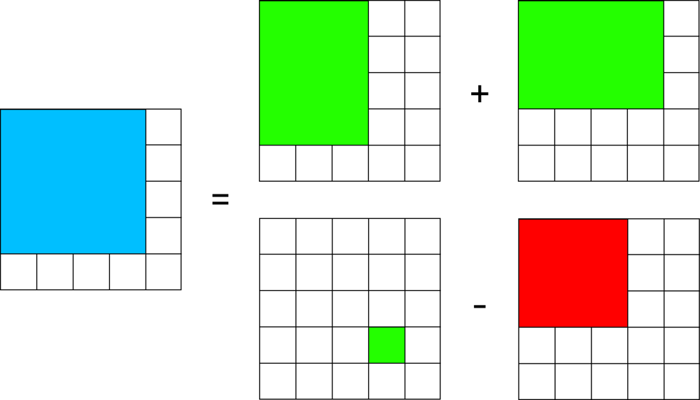

# [C++ / Go] Dynamic Programming - O(n * m) solution

**Author:** mikazuki4712
**Votes:** 1
**Link:** [https://leetcode.com/problems/count-submatrices-with-top-left-element-and-sum-less-than-k/solutions/4819591/](https://leetcode.com/problems/count-submatrices-with-top-left-element-and-sum-less-than-k/solutions/4819591/)

---

# Approach
Just calculate each submatrices using DP.



# Code
```C++ []
class Solution {
public:
    int countSubmatrices(vector<vector<int>>& grid, int k) {
        int n = grid.size();
        int m = grid[0].size();
        
        int res = 0;
        for (int i = 0; i < n; i++)
            for (int j = 0; j < m; j++) {
                if (i > 0) grid[i][j] += grid[i - 1][j];
                if (j > 0) grid[i][j] += grid[i][j - 1];
                if (i > 0 && j > 0) grid[i][j] -= grid[i - 1][j - 1];
                if (grid[i][j] <= k) res++;
            }
        return res;
    }
};
```
```Go []
func countSubmatrices(grid [][]int, k int) int {
    n := len(grid)
	m := len(grid[0])

	res := 0
	for i := 0; i < n; i++ {
		for j := 0; j < m; j++ {
			if i > 0 {
				grid[i][j] += grid[i - 1][j]
			}
			if j > 0 {
				grid[i][j] += grid[i][j - 1]
			}
			if i > 0 && j > 0 {
				grid[i][j] -= grid[i - 1][j - 1]
			}
			if grid[i][j] <= k {
				res++
			}
		}
	}
	return res
}
```

# Complexity
- Time complexity: $$O(n * m)$$
- Space complexity: $$O(1)$$