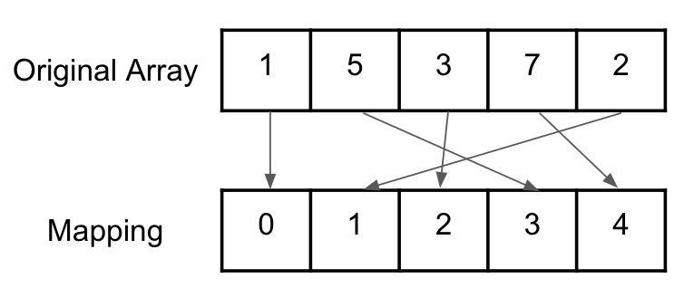

# Editorial covering all approaches.

**Author:** singla__rohan
**Votes:** 11
**Link:** [https://leetcode.com/problems/distribute-elements-into-two-arrays-ii/solutions/4934907/](https://leetcode.com/problems/distribute-elements-into-two-arrays-ii/solutions/4934907/)

---

# Solution
-------
# Overview

Following `1-based` indexing, initially, after inserting ```nums[1]``` to ```arr1``` and ```nums[2]``` to ```arr2```, beginning from index 3, we need to distribute the rest of the elements according to the following conditions for every ```nums[i]```:
* Whichever array has larger number of elements with value greater than ```nums[i]```, append ```nums[i]``` to that array.
* If that number is same for both the arrays, append the element to the one with less total elements.
* If there is still a tie, append ```nums[i]``` to ```arr1```

Finally, we need to return an array obtained from merging `arr1` and `arr2` in this order itself.   
# Intuition
<!-- Describe your first thoughts on how to solve this problem. -->
Following exactly what the problem suggests, while traversing from beginning to end, if at every index `i`, we are able to find out the **number of elements greater than** `nums[i]` in each array, we can follow the given conditions and decide whichever array to put `nums[i]` in. 
So, implementing the ```greaterCount``` function is what we will be majorly following while solving the question itself.

# Algorithm
1. Declare two empty arrays, `arr1` and `arr2`.
2. Push ``nums[1]`` and `nums[2]` to `arr1` and `arr2` respectively.
3. Implement a function `greaterCount` which returns the number of element greater than `nums[i]` in the array `arr`
4. Traverse the array `nums` starting from index `i = 3`.
5. For every element `nums[i]`, find the value of `n1` and `n2`, where
    * `n1 -> greaterCount(arr1, nums[i])`
    * `n2 -> greaterCount(arr2, nums[i])`
6. Now, choose the array to insert `nums[i]` into using following conditions:
    * If `n1 > n2`, insert into `arr1`
    * If `n2 > n1`, insert into `arr2`
    * Else if `n1 == n2`:
        * If `size(arr2) < size(arr1)`, insert into `arr2`
        * else insert into `arr1`
7. Finally, declare an array `ans`.
8. Push all the elements from array `arr1` and then `arr2` into `ans`.
9. Return the array `ans` as the answer.

Now, we will be discussing several ways to implement and optimize the ```greaterCount``` function.
# Approach 1: Brute Force (TLE)
<!-- Describe your approach to solving the problem. -->
This is a fairly straightforward approach where we implement the `greaterCount` function using brute force i.e., we traverse the array while counting the number of elements greater than `nums[i]` and then return the same count.

# Implementation
```CPP []
class Solution {
public:
    int greaterCount(vector<int> &arr, int num){
        int count = 0;
        for(auto &x:arr)
            count += (x > num);
        return count;
    }
    vector<int> resultArray(vector<int>& nums) {
        vector<int> arr1, arr2;
        arr1.push_back(nums[0]);
        arr2.push_back(nums[1]);
        
        for(int i = 2; i < nums.size(); i++){
            int n1 = greaterCount(arr1, nums[i]); 
            int n2 = greaterCount(arr2, nums[i]);

            if(n1 > n2)
                arr1.push_back(nums[i]);

            else if(n1 < n2)
                arr2.push_back(nums[i]);

            else{
                if(arr2.size() < arr1.size())
                    arr2.push_back(nums[i]);
                else 
                    arr1.push_back(nums[i]);
            }
        }

        vector<int> ans;
        for(auto x:arr1) ans.push_back(x);
        for(auto x:arr2) ans.push_back(x);
        
        return ans;
    }
};
```
```Python []
class Solution:
    def greater_count(self, arr, num):
        count = sum(x > num for x in arr)
        return count

    def resultArray(self, nums):
        arr1, arr2 = [nums[0]], [nums[1]]
        
        for i in range(2, len(nums)):
            n1 = self.greater_count(arr1, nums[i])
            n2 = self.greater_count(arr2, nums[i])

            if n1 > n2:
                arr1.append(nums[i])
            elif n1 < n2:
                arr2.append(nums[i])
            else:
                if len(arr2) < len(arr1):
                    arr2.append(nums[i])
                else:
                    arr1.append(nums[i])

        return arr1 + arr2

```
# Complexity
- Time complexity: `O(N^2)`
Iterating the whole `arr1` and `arr2` in each iteration of `nums` array resulting in `TC => N * N`
Of course, this being a highly sub-optimal approach will be giving TLE.
<!-- Add your time complexity here, e.g. $$O(n)$$ -->

- Space complexity: `O(N)`
Used for storing the `arr1`, `arr2` and `ans` arrays.
<!-- Add your space complexity here, e.g. $$O(n)$$ -->

# Approach 2: Ordered Multiset
<!-- Describe your approach to solving the problem. -->
In this approach, we will be using ordered multisets which can basically return, for any given element, the number of elements that are strictly smaller from the whole set.
For the same purpose we can use Data structures like```SortedList``` in Python and ```Ordered Set and GNU C++ PBDS``` in C++. This `Ordered Set` provides two additional features in addition to the already present in the `STL set`:
`order_of_key(k)`: Number of items strictly smaller than k .
`find_by_order(k)`: K-th element in a set (counting from zero).

For reference, you can read more [here](https://gcc.gnu.org/onlinedocs/libstdc++/ext/pb_ds/).

Utilizing the same thing, what we will be doing is, calculating the `greaterCount` function in the following way:
1. First maintain two ordered sets of `arr1` and `arr2` namely, `set1` and `set2`. `Note:` Since, it is possible here to have two same values in the array, we will be using `ordered_multiset` instead, i.e., in C++, while declaring the set we use
`#define ordered_set tree<int, null_type,less_equal<int>, rb_tree_tag,tree_order_statistics_node_update>` -> ordered multiset
instead of
`#define ordered_set tree<int, null_type,less<int>, rb_tree_tag,tree_order_statistics_node_update` -> ordered set
2. Initially insert `nums[1]` to `set1` and `nums[2]` to `set2`.
3. Now in the `greaterCount` function, pass the sets themselves instead of the arrays. 
4. In the function, since we have a ordered set of all the elements present in the array and we know we can find the total number of elements strictly smaller than `num` in the following manner:
    `int elements_strictly_smaller_than_num = set.order_of_key(num);`
And also, number of elements smaller than or equal to `num` would be the same as number of elements strictly smaller than ``(num + 1)``
So, `int elements_smaller_or_equal = set.order_of_key(num + 1);`
5. Finally, the number of elements strictly larger than `num` would be equal to, 
    `int elements_strictly_larger = total - elements_smaller_or_equal;`
Which is our required output of the greaterCount function.
6. After this the question becomes the same as explained in the previous approach with just one minor difference, while pushing the element in any array, we also have to insert it into the respective set.

Now, that we have our optimal `greaterCount` function, we can just following what was discussed earlier for the rest.

# Implementation
```C++ []
#include <ext/pb_ds/assoc_container.hpp> 
#include <ext/pb_ds/tree_policy.hpp> 
using namespace __gnu_pbds;   
#define ordered_multiset tree<int, null_type,less_equal<int>, rb_tree_tag,tree_order_statistics_node_update> 

class Solution {
public:
    int greaterCount(ordered_multiset &st, int num){
        int elements_smaller_or_equal_to_num = st.order_of_key(num + 1);
        int total_elements = st.size();

        return total_elements - elements_smaller_or_equal_to_num;
    }
    vector<int> resultArray(vector<int>& nums) {
        vector<int> arr1, arr2;
        arr1.push_back(nums[0]);
        arr2.push_back(nums[1]);

        ordered_multiset set1, set2;
        set1.insert(nums[0]);
        set2.insert(nums[1]);
        
        for(int i = 2; i < nums.size(); i++){
            int n1 = greaterCount(set1, nums[i]); 
            int n2 = greaterCount(set2, nums[i]);

            if(n1 > n2)
                arr1.push_back(nums[i]), set1.insert(nums[i]);

            else if(n1 < n2)
                arr2.push_back(nums[i]), set2.insert(nums[i]);

            else{
                if(arr2.size() < arr1.size())
                    arr2.push_back(nums[i]), set2.insert(nums[i]);
                else 
                    arr1.push_back(nums[i]), set1.insert(nums[i]);
            }
        }

        vector<int> ans;
        for(auto x:arr1) ans.push_back(x);
        for(auto x:arr2) ans.push_back(x);
        
        return ans;
    }
};
```
```Python []
from sortedcontainers import SortedList

class Solution:
    def greater_count(self, sorted_list, num):
        elements_smaller_or_equal_to_num = sorted_list.bisect_right(num)
        total_elements = len(sorted_list)
        return total_elements - elements_smaller_or_equal_to_num

    def resultArray(self, nums):
        arr1, arr2 = [nums[0]], [nums[1]]
        set1, set2 = SortedList([nums[0]]), SortedList([nums[1]])

        for i in range(2, len(nums)):
            n1 = self.greater_count(set1, nums[i])
            n2 = self.greater_count(set2, nums[i])

            if n1 > n2:
                arr1.append(nums[i])
                set1.add(nums[i])
            elif n1 < n2:
                arr2.append(nums[i])
                set2.add(nums[i])
            else:
                if len(arr2) < len(arr1):
                    arr2.append(nums[i])
                    set2.add(nums[i])
                else:
                    arr1.append(nums[i])
                    set1.add(nums[i])

        return arr1 + arr2
```
# Complexity
- Time complexity: `O(N * log(N))`
For each iteration, O(logN) is used to finding the `key` of every `nums[i]` in both the sets. So, total `TC => N * logN`.
<!-- Add your time complexity here, e.g. $$O(n)$$ -->

- Space complexity: `O(N)`
Used for storing the `set1`, `set2` and `arr1`, `arr2`, `ans` arrays.
<!-- Add your space complexity here, e.g. $$O(n)$$ -->


# Approach 3: Coordinate Compression + Segment Tree
<!-- Describe your approach to solving the problem. -->
One can also think of an approach using Segment Tree in a way that so that each node of the Segment Tree corresponds to a range of values, and the value stored at each node represents the total frequency of values falling within that range in somewhat following manner,
* `Seg.update(nums[i])` -> updates the frequency of nums[i] by 1 in the tree
* `Seg.query(nums[i])` -> returns the total number of elements greater than the element `nums[i]` which is also sum of frequencies of all elements between `nums[i]` and the largest element possible. 

Both these things can easily be achieved using a very basic range sum based Segment Tree except there is an issue with this problem. Even though there are a maximum of `n` distinct values possible but the value range is very large, i.e. the given data is not contiguous but really sparse. So, if we're using the values directly as indices for Segment Tree nodes, while initializing a normal array based Segment Tree, to accomodate values like `1e9`, we would be needing to allocating an array of size as large as `(4 * 1e9)` which is just not feasible and highly ineffecient since there are only ever going to be at max `n <= 1e5` distinct values.

Now, since here, we only need to find numbers relatively larger than any given number at any point and hence only the relative order of the values matters to us rather than the absolute values themselves, we can actually use a technique called coordinate compression to map the to some contiguous values which still maintain the relative original order.
In other words, Compressed coordinates are nothing but a compact representation by assigning contiguous integers to sparse values, preserving information about relative element frequencies and ordering.
Ex: for the array, `nums = [1,5,3,7,2]`, it would be mapped as following



**Compressing Coordinates Function:** 
1. Create a set to store unique elements from the input array nums.
2. Assign compressed coordinates (indexes starting from 0) to each unique element by iterating through the set and storing the element along with its compressed index in an unordered map.
3. Return the unordered map containing the mapping of original elements to their compressed coordinates.

Since there values are contiguous with max map size = `n`, now instead of using the values, we can use their mappings instead and it would be highly efficient and feasible in this case.

**Working of the Segment Tree:**
1. **Initialization:** Upon initializing the Segment Tree, it's constructed to cover the range of compressed coordinates. The tree is implemented using an array where each node corresponds to a particular range of compressed coordinates. Initially, all nodes are initialized with a frequency of 0.
Let's say `sz` is the size of our compressed map.
2. **Updating Frequencies (Seg.update()):** When updating the Segment Tree with a new element from the input array (nums[i]), we traverse the tree to find the node corresponding to the compressed coordinate of that value and increment its frequency by 1 recusively. This operation effectively updates the frequency count of the element within the Segment Tree.
3. **Querying Frequencies (Seg.query()):** To find the, total number of elements greater than a particular element (nums[i]), we perform a query operation on the Segment Tree. This involves traversing the tree and summing up the frequencies of all values greater than nums[i] within the compressed coordinate range `[Compressed[nums[i]] + 1, sz - 1]`. 
The result provides the total count of elements greater than `nums[i]` or rather frequency of elements with compressed indices between in the range `[Compressed[nums[i]] + 1, sz - 1]`.
Read more about Segment Trees [here](https://cp-algorithms.com/data_structures/segment_tree.html#:~:text=A%20Segment%20Tree%20is%20a,sum%20of%20consecutive%20array%20elements).

Finally, Utilizing this Segment Tree now with compressed values, we will calculate the `greaterCount` in the following way:

1. Compress the values of `nums` array in a unordered_map using the Coordinate_Compression function and store it in a unordered_map say `Compressed`.
2. Intiailize two Segment Trees `Seg1` and `Seg2` for `arr1` and `arr2` respectively with size equal to the size of the compressedIndices map.
i.e. `SegmentTree Seg(Compressed.size());`
3. Since, initially we are inserting `nums[1]` to `arr1` and `nums[2]` to `arr2`, perform the following updates on the Segment trees:
`Seg1.update(Compressed[nums[1])`-> increasing its frequency by 1 in Seg1
`Seg2.update(Compressed[nums[2])`-> increasing its frequency by 1 in Seg2
3. Now in the `greaterCount` function, pass the Segment themselves instead of the arrays. 
4. In the function, to find the number of elements greater than the element `num` in the array, we can just use the query function that we implemented eariler in its respective Segment Tree.
`int ans = Seg.query(nums[i]);`
which will be the output of our `greaterCount` function.
6. After this, rest of the question becomes the same as explained in the previous approach with just one minor difference, while insert the element in any array, we also have to increase the frequency of the element's compressed coordinate by 1 in that arrays respective Segment Tree.
i.e., If we insert `nums[i]` into `arr1`, we do the following:
`Seg1.update(Compressed[nums[i]]);`

Now, that we have our optimal `greaterCount` function, we can just following what was discussed earlier for the rest.


# Implementation
```C++ []
class SegmentTree{
    int n;
    vector<int> Seg;
    int query(int i, int sL, int sR, int qL, int qR){
        if(sL > qR || sR < qL) return 0;
        if(sL >= qL && sR <= qR) return Seg[i];

        int left_sum = query(2 * i + 1, sL, (sL + sR) / 2, qL, qR);
        int right_sum = query(2 * i + 2, (sL + sR) / 2 + 1, sR, qL, qR);

        return left_sum + right_sum;
    }
    void update(int i, int sL, int sR, int idx){
        if(sL > idx || sR < idx) return;
        if(sL == sR){
            Seg[i]++;
            return;
        }
        int mid = (sL + sR) / 2;

        if(mid >= idx) update(2 * i + 1, sL, mid, idx);
        else update(2 * i + 2, mid + 1, sR, idx);

        Seg[i] = Seg[2 * i + 1] + Seg[2 * i + 2];
    }
    public:
    SegmentTree(int n){
        this -> n = n;
        Seg.resize(4 * n, 0);
    }
    int query(int val){
        return query(0, 0, n - 1, val + 1, n - 1);
    }
    void update(int idx){
        update(0, 0, n - 1, idx);
    }
};
class Solution {
public:
    unordered_map<int, int> Coordinate_Compression(vector<int> &nums){
        set<int> st;
        for(auto x:nums) st.insert(x); 
        unordered_map<int, int> mp;
        for(auto it:st) mp[it] = mp.size();

        return mp;
    }
    int greaterCount(SegmentTree &Seg, int num, unordered_map<int, int> &mp){
        return Seg.query(mp[num]);
    }
    vector<int> resultArray(vector<int>& nums) {
        unordered_map<int, int> compressedIndices = Coordinate_Compression(nums);

        vector<int> arr1, arr2;
        arr1.push_back(nums[0]);
        arr2.push_back(nums[1]);

        int sz = compressedIndices.size(); //equal to distinct number of elements
        SegmentTree Seg1(sz), Seg2(sz);
        Seg1.update(compressedIndices[nums[0]]);
        Seg2.update(compressedIndices[nums[1]]);
        
        for(int i = 2; i < nums.size(); i++){
            int n1 = greaterCount(Seg1, nums[i], compressedIndices); 
            int n2 = greaterCount(Seg2, nums[i], compressedIndices);

            if(n1 > n2)
                arr1.push_back(nums[i]), Seg1.update(compressedIndices[nums[i]]);

            else if(n1 < n2)
                arr2.push_back(nums[i]), Seg2.update(compressedIndices[nums[i]]);

            else{
                if(arr2.size() < arr1.size())
                    arr2.push_back(nums[i]), Seg2.update(compressedIndices[nums[i]]);
                else 
                    arr1.push_back(nums[i]), Seg1.update(compressedIndices[nums[i]]);;
            }
        }

        vector<int> ans;
        for(auto x:arr1) ans.push_back(x);
        for(auto x:arr2) ans.push_back(x);
        
        return ans;
    }
};
```
```python []
class SegmentTree:
    def __init__(self, n):
        self.n = n
        self.Seg = [0] * (4 * n)

    def query(self, i, sL, sR, qL, qR):
        if sL > qR or sR < qL:
            return 0
        if sL >= qL and sR <= qR:
            return self.Seg[i]

        left_sum = self.query(2 * i + 1, sL, (sL + sR) // 2, qL, qR)
        right_sum = self.query(2 * i + 2, (sL + sR) // 2 + 1, sR, qL, qR)

        return left_sum + right_sum

    def update(self, i, sL, sR, idx):
        if sL > idx or sR < idx:
            return
        if sL == sR:
            self.Seg[i] += 1
            return

        mid = (sL + sR) // 2

        if mid >= idx:
            self.update(2 * i + 1, sL, mid, idx)
        else:
            self.update(2 * i + 2, mid + 1, sR, idx)

        self.Seg[i] = self.Seg[2 * i + 1] + self.Seg[2 * i + 2]


class Solution:
    def coordinate_compression(self, nums):
        st = set(nums)
        mp = {x: i for i, x in enumerate(sorted(st))}
        return mp

    def greater_count(self, Seg, num, mp):
        return Seg.query(0, 0, Seg.n - 1, mp[num] + 1, Seg.n - 1)

    def resultArray(self, nums):
        compressed_indices = self.coordinate_compression(nums)

        arr1, arr2 = [nums[0]], [nums[1]]
        Seg1, Seg2 = SegmentTree(len(compressed_indices)), SegmentTree(len(compressed_indices))
        Seg1.update(0, 0, Seg1.n - 1, compressed_indices[nums[0]])
        Seg2.update(0, 0, Seg2.n - 1, compressed_indices[nums[1]])

        for i in range(2, len(nums)):
            n1 = self.greater_count(Seg1, nums[i], compressed_indices)
            n2 = self.greater_count(Seg2, nums[i], compressed_indices)

            if n1 > n2:
                arr1.append(nums[i])
                Seg1.update(0, 0, Seg1.n - 1, compressed_indices[nums[i]])
            elif n1 < n2:
                arr2.append(nums[i])
                Seg2.update(0, 0, Seg2.n - 1, compressed_indices[nums[i]])
            else:
                if len(arr2) < len(arr1):
                    arr2.append(nums[i])
                    Seg2.update(0, 0, Seg2.n - 1, compressed_indices[nums[i]])
                else:
                    arr1.append(nums[i])
                    Seg1.update(0, 0, Seg1.n - 1, compressed_indices[nums[i]])

        ans = arr1 + arr2
        return ans

```
# Complexity
- Time complexity: `O(N * logN)`
For each iteration, O(logN) is used process the query of both the arrays (i.e. in the `greaterCount` function). So, total `TC => N * logN`.
<!-- Add your time complexity here, e.g. $$O(n)$$ -->

- Space complexity: `O(N)`
Used for storing the `Seg1`, `Seg2` Segment trees and `arr1`, `arr2`, `ans` arrays.

# Approach 4: Coordinate Compression + Fenwick Tree (BIT)
<!-- Describe your approach to solving the problem. -->
This approach is very similar to the one with Segment Tree but rather than using Segment Tree to process our queries for `greaterCount` function, we will be using a binary indexed tree. Binary indexed tree will be used here in the following manner: 
* `bit.update(nums[i])` -> updates the frequency of nums[i] by 1 in the tree
* `bit.query(nums[i])` -> returns the total number of elements greater than the element `nums[i]` which is also sum of frequencies of all elements between `nums[i]` and the largest element possible. 

And from the very basic implementation of BIT, we can clearly achieve the same. 
Of course, similar to Segment Tree approach, Coordinate Compression is necessary here as well since the data is highly sparse, the range is really big for the elements and we only need the information about relative ordering here.

**Working of the BIT:**
It's working is almost exactly the same as that of Segment Tree with just the implementation being a little different. Also, BIT is `1-indexed` here.
1. **Initialization:** On initializing the BIT, the tree is implemented using an array where each node corresponds to a particular range of compressed coordinates. Initially, all nodes are initialized with a frequency of 0.
Let's say `sz` is the size of our compressed map.
2. **Updating Frequencies (bit.update(idx)):** Increases the value at **idx** by 1 **iteratively**.
3. **Querying Frequencies (bit.query()):** Returns the sum of frequencies of elements between `[idx + 1, n - 1]` again **itertively**.
Read more about Binary indexed Trees [here](https://cp-algorithms.com/data_structures/fenwick.html).

Rest of the working remains the same as Segment Tree for BIT as well and having obtained and optimal `greaterCount` function, we can just following what was discussed earlier for the rest.

# Implementation
```C++ []
class BIT {
private:
    vector<int> tree;
    int n;
public:
    BIT(int size){
        tree.resize(size + 1, 0);
        this -> n = size;
    }

    void update(int idx) {
        idx++; // since indices in BIT are 1-based
        while (idx <= n) {
            tree[idx]++;
            idx += idx & -idx;
        }
    }
    
    // Query the sum of values from idx + 1 to n
    int query(int idx) {
        return smallerCountQuery(n - 1) - smallerCountQuery(idx);
    }
    
    //returns the sum of values from 0 to idx
    int smallerCountQuery(int idx){
        idx++; // since indices in BIT are 1-based
        int sum = 0;
        while (idx > 0) {
            sum += tree[idx];
            idx -= idx & -idx;
        }
        return sum;
    }
};

class Solution {
public:
    unordered_map<int, int> Coordinate_Compression(vector<int> &nums){
        set<int> st;
        for(auto x:nums) st.insert(x); 
        unordered_map<int, int> mp;
        for(auto it:st) mp[it] = mp.size();

        return mp;
    }
    int greaterCount(BIT &bit, int num, unordered_map<int, int> &mp){
        return bit.query(mp[num]);
    }
    vector<int> resultArray(vector<int>& nums) {
        unordered_map<int, int> compressedIndices = Coordinate_Compression(nums);

        vector<int> arr1, arr2;
        arr1.push_back(nums[0]);
        arr2.push_back(nums[1]);

        int sz = compressedIndices.size(); //equal to distinct number of elements
        BIT bit1(sz), bit2(sz);
        bit1.update(compressedIndices[nums[0]]);
        bit2.update(compressedIndices[nums[1]]);
        
        for(int i = 2; i < nums.size(); i++){
            int n1 = greaterCount(bit1, nums[i], compressedIndices); 
            int n2 = greaterCount(bit2, nums[i], compressedIndices);

            if(n1 > n2)
                arr1.push_back(nums[i]), bit1.update(compressedIndices[nums[i]]);

            else if(n1 < n2)
                arr2.push_back(nums[i]), bit2.update(compressedIndices[nums[i]]);

            else{
                if(arr2.size() < arr1.size())
                    arr2.push_back(nums[i]), bit2.update(compressedIndices[nums[i]]);
                else 
                    arr1.push_back(nums[i]), bit1.update(compressedIndices[nums[i]]);;
            }
        }

        vector<int> ans;
        for(auto x:arr1) ans.push_back(x);
        for(auto x:arr2) ans.push_back(x);
        
        return ans;
    }
};
```
```python []
class BIT:
    def __init__(self, size):
        self.tree = [0] * (size + 1)
        self.n = size

    def update(self, idx):
        idx += 1  # Since indices in BIT are 1-based
        while idx <= self.n:
            self.tree[idx] += 1
            idx += idx & -idx

    def smallerCountQuery(self, idx):
        # returns sum of frequencies between [0 and idx]
        idx += 1  # Since indices in BIT are 1-based
        sum = 0
        while idx > 0:
            sum += self.tree[idx]
            idx -= idx & -idx
        return sum

    def query(self, idx):
        return self.smallerCountQuery(self.n - 1) - self.smallerCountQuery(idx)

class Solution:
    def coordinateCompression(self, nums):
        st = set(nums)
        mp = {x: i for i, x in enumerate(sorted(st))}
        return mp

    def greaterCount(self, bit, num, mp):
        return bit.query(mp[num])

    def resultArray(self, nums):
        compressedIndices = self.coordinateCompression(nums)

        arr1 = [nums[0]]
        arr2 = [nums[1]]
        
        sz = len(compressedIndices)
        
        bit1 = BIT(sz)
        bit2 = BIT(sz)

        bit1.update(compressedIndices[nums[0]])
        bit2.update(compressedIndices[nums[1]])

        for i in range(2, len(nums)):
            n1 = self.greaterCount(bit1, nums[i], compressedIndices)
            n2 = self.greaterCount(bit2, nums[i], compressedIndices)

            if n1 > n2:
                arr1.append(nums[i])
                bit1.update(compressedIndices[nums[i]])
            elif n1 < n2:
                arr2.append(nums[i])
                bit2.update(compressedIndices[nums[i]])
            else:
                if len(arr2) < len(arr1):
                    arr2.append(nums[i])
                    bit2.update(compressedIndices[nums[i]])
                else:
                    arr1.append(nums[i])
                    bit1.update(compressedIndices[nums[i]])

        ans = arr1 + arr2
        return ans
```
# Complexity
- Time complexity: `O(N * logN)`
For each iteration, O(logN) is used process the query of both the arrays (i.e. in the `greaterCount` function). So, total `TC => N * logN`.
<!-- Add your time complexity here, e.g. $$O(n)$$ -->

- Space complexity: `O(N)`
Used for storing the `bit1`, `bit2` Binary Indexed trees and `arr1`, `arr2`, `ans` arrays.


