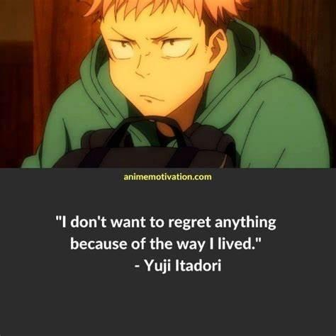

# Fastest (100%) || Short & Concise || Easiest to Understand

**Author:** gameboey
**Votes:** 101
**Link:** [https://leetcode.com/problems/maximize-happiness-of-selected-children/solutions/5132388/](https://leetcode.com/problems/maximize-happiness-of-selected-children/solutions/5132388/)

---

# Intuition
It's like picking the tastiest ramen bowls from a buffet, starting with the yummiest, within a limit, ensuring each bowl adds to your overall satisfaction!

# Approach

So, the problem aims to maximize the total happiness gained by selecting the happiest bowls of ramen within the given budget (`k`). It's all about enjoying the most happiness while savoring some tasty ramen! Let's break down the approach used in the code with Yuji Itadori's style:

1. **Sorting the Happiness Bowls**: Just like picking the most delicious ramen bowls, we sort the bowls of happiness in descending order. This way, we can start with the happiest ones first!

2. **Eating the Yummiest Bowls**: With a limited number of bowls we can eat (`k`), we start devouring the yummiest ones! Each time we eat a bowl, we check if it makes us even happier. If it does, we enjoy it; otherwise, we skip it.

3. **Adjusting Happiness Levels**: As we eat the bowls, we also adjust the happiness levels of the remaining bowls. We subtract 1 from their happiness, but only if they were initially positive.

4. **Summing Up the Joy**: After finishing our ramen feast, we sum up all the happiness from the bowls we've eaten. That's our total joy!

So, it's all about picking the most happiness-packed bowls within our limit and making sure each bowl we eat adds to our overall joy. Just like enjoying a hearty ramen meal!


**Dry - Run :**
Let's go through the dry run for the given example:

```
Input: happiness = [1, 2, 3], k = 2
```

**Step 1:** Sort the `happiness` array in descending order.

```
happiness = [3, 2, 1]
```

**Step 2:** Initialize variables.

```cpp
i = 0
res = 0
```

**Step 3:** Enter the loop toselect `k` children.

```cpp
while(k--) {
    // k = 2
    happiness[i] = max(happiness[i] - i, 0);
    // happiness[0] = max(3 - 0, 0) = 3

    res += happiness[i++];
    // res = 0 + 3 = 3
    // i = 1

    // k = 1
    happiness[i] = max(happiness[i] - i, 0);
    // happiness[1] = max(2 - 1, 0) = 1

    res += happiness[i++];
    // res = 3 + 1 = 4
    // i = 2
}
```

Since `k` is now 0, the loop terminates.

**Step 4:** Return the result.

```cpp
return res; // Returns 4
```

So, the maximum sum of happiness values by selecting 2 children is 4, which is achieved by:

1. Selecting the child with the maximum happiness value of 3. The remaining happiness values become `[0, 1]`.
2. Selecting the child with the happiness value of 1. The remaining happiness value becomes `[0]`.

The sum of the happiness values of the selected children is 3 + 1 = 4, as mentioned in the explanation.

# Complexity
- Time complexity: O(nlogn + min(k, n))

- Space complexity: O(1)

# Code
```C++ []
class Solution {
public:
    long long maximumHappinessSum(vector<int>& happiness, int k) {
        ios_base::sync_with_stdio(0), cin.tie(0), cout.tie(0);
        sort(begin(happiness), end(happiness), greater<int>());
        int i = 0;
        long long res = 0;

        while(k--) {
            happiness[i] = max(happiness[i] - i, 0);
            res += happiness[i++];
        }

        return res;
    }
};
```
```java []
public class Solution {
    public long maximumHappinessSum(int[] happiness, int k) {
        Arrays.sort(happiness);
        long res = 0;
        int n = happiness.length, j = 0;

        for (int i = n - 1; i >= n - k; --i) {
            happiness[i] = Math.max(happiness[i] - j++, 0);
            res += happiness[i];
        }

        return res;
    }
}
```
```python []
class Solution:
    def maximumHappinessSum(self, happiness: List[int], k: int) -> int:
        happiness.sort(reverse=True)
        i = 0
        res = 0

        while k > 0:
            happiness[i] = max(happiness[i] - i, 0)
            res += happiness[i]
            i += 1
            k -= 1

        return res
```
```javascript []
/**
 * @param {number[]} happiness
 * @param {number} k
 * @return {number}
 */
var maximumHappinessSum = function(happiness, k) {
    happiness.sort((a, b) => b - a);
    let i = 0;
    let res = 0;

    while (k > 0 && i < happiness.length) {
        happiness[i] = Math.max(happiness[i] - i, 0);
        res += happiness[i];
        i++;
        k--;
    }

    return res;
};
```

