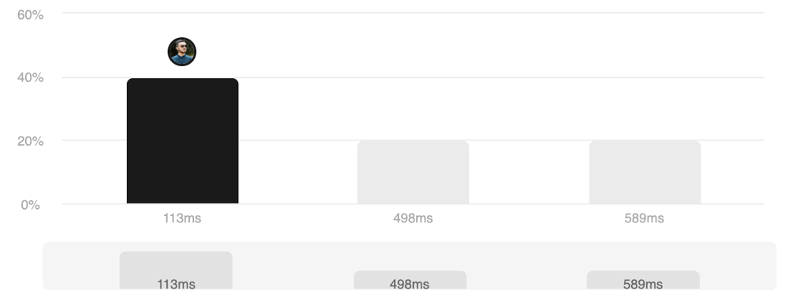

# Beats Everyone 💯 || Clean Code ✅ || DP solution 🔥 || Very Easy to understand for beginners

**Author:** soukarja
**Votes:** 4
**Link:** [https://leetcode.com/problems/shortest-uncommon-substring-in-an-array/solutions/4851413/](https://leetcode.com/problems/shortest-uncommon-substring-in-an-array/solutions/4851413/)

---

# Accepted Status



# Code
```
class Solution {
public:
    vector<string> shortestSubstrings(vector<string>& arr) {
        map<string, int> sub;
        unordered_map<string, vector<string>> dp;
        vector<string> res(arr.size());
        for (int i=0; i<arr.size(); ++i) subString(arr[i], sub, i);
        for (auto &x: sub){
            if (x.second != -1) dp[arr[x.second]].push_back(x.first);
        }
        for (int i=0; i<arr.size(); ++i){
            string m = "";
            for (string &y: dp[arr[i]]) {
                if (m == "") m = y;
                else if (y.size()<m.size()) m=y;
                else if (y.size() == m.size()){
                    if (y < m) m = y;
                }
            }
            res[i] = m;
        }
        return res;
    }
    
    void subString(string s, map<string, int> &sub, int strpos) 
    {
        int n = s.size();
        
        for (int i = 0; i < n; i++) 
            for (int len = 1; len <= n - i; len++)
            {
                string s1 = s.substr(i, len);
                if (sub.count(s1)>0 && sub[s1]!=strpos) sub[s1] = -1; 
                else sub[s1] = strpos;
            }
        
    }
};
```


