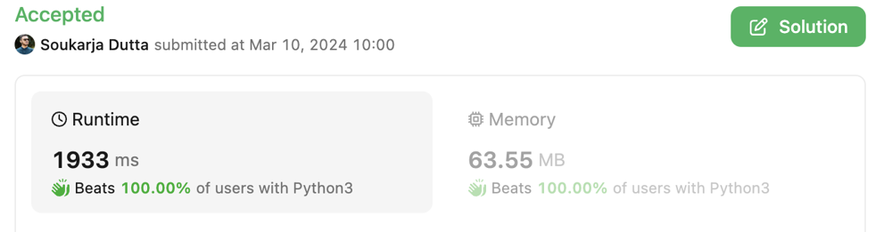

# Beats 100% ✅ || Using DP 🔥 || Shortest and Very Easy to understand for beginners 💯

**Author:** soukarja
**Votes:** 21
**Link:** [https://leetcode.com/problems/maximum-strength-of-k-disjoint-subarrays/solutions/4851566/](https://leetcode.com/problems/maximum-strength-of-k-disjoint-subarrays/solutions/4851566/)

---


# Approach
<!-- Describe your approach to solving the problem. -->
We will be implementing a dynamic programming approach to find the **maximum strength** based on the given list of integers (nums) and an integer parameter (k) that indicates we need to choose **k disjoint subarrays**. 

We will then iterate through the elements of `nums` and calculates the `maximum strength` at each step, storing intermediate results in the `dp` array. The final result is obtained from the last cell of the dp array.



# Code
```python []
class Solution:
    def maximumStrength(self, nums: List[int], k: int) -> int:
        dp = [[0] * (len(nums) + 1) for _ in range(k + 1)]
        for i in range(1, k + 1):
            maxsum = -float('inf')
            curr = -float('inf')
            multiplier = k + 1 - i if i % 2 == 1 else i - 1 - k
            for j in range(i - 1, len(nums)):
                curr = max(curr + nums[j] * multiplier, dp[i - 1][j] + nums[j] * multiplier)
                maxsum = max(maxsum, curr)
                dp[i][j + 1] = maxsum
        return dp[-1][-1] 
```

```java []
class Solution {
    public long maximumStrength(int[] nums, int k) {
        long[][] dp = new long[k + 1][nums.length + 1];
        for (int i = 1; i <= k; i++) {
            long maxSum = Long.MIN_VALUE /2;
            long curr = Long.MIN_VALUE/2;
            long multiplier = (i % 2 == 1) ? (k + 1 - i) : (i - 1 - k);
            for (int j = i - 1; j < nums.length; j++) {
                curr = Math.max(curr + nums[j] * multiplier, dp[i - 1][j] + nums[j] * multiplier);
                maxSum = Math.max(maxSum, curr);
                dp[i][j + 1] = maxSum;
            }
        }
        return dp[k][nums.length];
    }
}
```
```cpp []
class Solution {
public:
    long long maximumStrength(vector<int>& nums, int k) {
        vector<vector<long long>> dp(k + 1, vector<long long>(nums.size() + 1, 0));

        for (int i = 1; i <= k; i++) {
            long long maxSum = LLONG_MIN/2;
            long long curr = LLONG_MIN/2;
            long long multiplier = (i % 2 == 1) ? (k + 1 - i) : (i - 1 - k);

            for (int j = i - 1; j < nums.size(); j++) {
                curr = max(curr + nums[j] * multiplier, dp[i - 1][j] + nums[j] * multiplier);
                maxSum = max(maxSum, curr);
                dp[i][j + 1] = maxSum;
            }
        }

        return dp[k][nums.size()];
    }
};
```

# Explaination
##### Here's a step-by-step explanation of the code:

- Initialize a 2D list dp with dimensions (`k + 1`) x (`len(nums) + 1`) and fill it with zeros. This list will be used for dynamic programming to store intermediate results.
- Use nested loops to iterate over the possible values of `i` and `j`. `i` ranges from `1 to k` (inclusive), and `j` ranges from `i - 1` to the length of `nums - 1`.
- Inside the loops, calculate the **maximum strength** using the following logic:

    - Initialize `maxsum` to negative infinity and curr to negative infinity, *so that we can calculate the max value later without adding extra edge cases*.
    - Calculate the `multiplier` based on the parity of i. If i is odd, set multiplier to `k + 1 - i`; otherwise, set it to `i - 1 - k`. (For some who were asking: `i - 1 - k` is just `-1 * (k + 1 - i)`).
    - Iterate over the elements in `nums` starting from `index i - 1`.
    - Update `curr` by taking the maximum of two values: the sum of the current element multiplied by multiplier and the corresponding value from the previous row in the dp array added to the current element multiplied by multiplier.
    - Update `maxsum` to be the maximum of its current value and `curr`.
    - Update the dp array at position `[i][j + 1]` with the calculated `maxsum`.

- After completing the loops, return the value stored in `dp[-1][-1]`, which represents the **maximum strength**.


