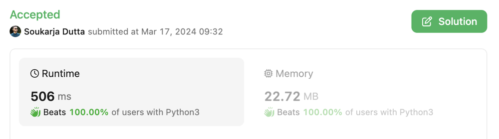

# Beats 100% ✅ || Sliding Window 🔥 || Very Easy to understand for beginners 💯

**Author:** soukarja
**Votes:** 8
**Link:** [https://leetcode.com/problems/minimum-moves-to-pick-k-ones/solutions/4886280/](https://leetcode.com/problems/minimum-moves-to-pick-k-ones/solutions/4886280/)

---

## Intuition
To summarize the question, we need to find the minimum number of moves for Dylan to pick exactly k ones from a binary array nums, with certain constraints on allowed moves. Dylan can either convert zeros to ones or swap adjacent ones and zeros, subject to a maximum number of allowed changes.

---

## Approach
1. First, determine the maximum number of consecutive ones in the array `(max_cons)`. This is crucial as it helps in optimizing Dylan's selection of ones.

2. Check if Dylan can achieve the target number of ones (k) with the maximum allowed changes `(max_changes)`. If yes, return the minimum number of moves accordingly.

3. If Dylan needs more ones than allowed by `max_changes`, implement a dynamic programming approach.

4. Iterate through the indices of ones to find the optimal solution.

5. Calculate the **cumulative difference between indices** to assess potential moves.

6. Update the **minimum difference** based on the current configuration.
Finally, return the **total minimum moves** required.

---

## Detailed Explanation
- The function `minimumMoves` takes `three` arguments: 
    - `nums` (a list of binary numbers)
    - `k` (the target number of ones Dylan needs to pick)
    - `max_changes` (the maximum number of allowed changes)

- We then convert the binary array `nums` is into a string `s` for easier manipulation.

- Then we check if there are any **consecutive sequences** of ones in the array `nums` and identify  the maximum consecutive ones `(max_cons)` by checking if `"111"`, `"11"`, or `"1"` exists in the string representation. This is done to optimize the selection of ones by Dylan.

- It's ensured that `max_cons` is not greater than `k`. **This is because Dylan can't pick more ones than there are in the array.**

- If `max_changes` is enough to make up for the **difference between `k` and `max_cons`,** Dylan can achieve the target with the fewest moves. In this case, the function returns `(k - max_cons) * 2 + max(0, max_cons - 1)`. 
    - `(k - max_cons) * 2` represents the moves needed to convert zeros to ones
    - `max(0, max_cons - 1)` represents the moves needed to swap ones and zeros within max_cons consecutive ones.

- If `max_changes` is not enough, we calculate the minimum number of moves required.

- Initialize `res` to `max_changes * 2`, representing the moves needed to convert zeros to ones.

- Subtract `max_changes` from `k` to determine how many additional ones Dylan needs to pick `(k -= max_changes)`.

- Creates a list of indices `idxes` where ones are present.

- Calculate the middle point `(pmid)` considering the remaining required ones (k) and divide it by 2.

- Iterate through the indices to find the optimal solution.

    - Calculate the **cumulative difference** `(cdiff)` by summing the absolute differences between the indices of the ones.

    - Update the **minimum difference** `(mdiff)` by comparing it with the cumulative difference.

- Finally, add `mdiff` to `res` and returns the result.


---



---

### Time Complexity: `O(N)`
### Space Complexity: `O(N)`

---


##### If you want the code in other languages, let me know in the comments below.
###### I will update the post within one hour! Thanks :)

---

# Code
``` python []
class Solution:
    def minimumMoves(self, nums: List[int], k: int, max_changes: int) -> int:
        s = "".join(map(str, nums))
        if "111" in s:
            max_cons = 3
        elif "11" in s:
            max_cons = 2
        elif "1" in s:
            max_cons = 1
        else:
            max_cons = 0

        if max_cons > k:
            max_cons = k
        if max_changes >= k - max_cons:
            return (k - max_cons) * 2 + max(0, max_cons - 1)
        
        res = max_changes * 2
        k -= max_changes
        idxes = [i for i in range(len(nums)) if nums[i]]
        pmid = k // 2
        left = 0
        cdiff = mdiff = sum(abs(i - idxes[pmid]) for i in idxes[:k])
        for right in range(k, len(idxes)):
            cdiff -= idxes[pmid] - idxes[left]
            left += 1
            cdiff += idxes[right] - idxes[pmid + 1]
            move_d = idxes[pmid + 1] - idxes[pmid]
            cdiff += ((pmid + 1 - left) - (right - 1 - pmid)) * move_d
            mdiff = min(mdiff, cdiff)
            pmid += 1
        res += mdiff
        return res
```


### Also please  $${\\color{purple}upvote}$$, that motivates me! 


