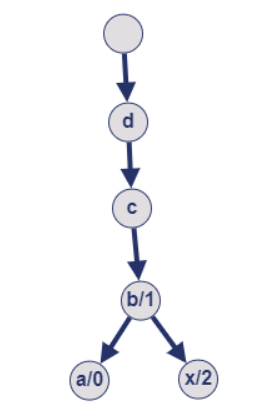

# [C++, Java, Python] 2 Approaches | Trie | DFS | Precomputation

**Author:** shivamaggarwal513
**Votes:** 18
**Link:** [https://leetcode.com/problems/longest-common-suffix-queries/solutions/4917364/](https://leetcode.com/problems/longest-common-suffix-queries/solutions/4917364/)

---

# Intuition

I will share my thought process for this. I could not solve it during contest just because I used dynamic array instead of static.

Longest common suffix is same as longest common prefix if we reverse every string in both `wordsContainer` and `wordsQuery`. Either you can reverse all of them first then find longest common prefix or you can just traverse each string right to left. It does not matter, both will be correct.

Now, as soon as I see Longest Common Prefix/Suffix, my first thought is can we use Trie here? Let's make a trie for Example 1:

```
wordsContainer = ["abcd","bcd","xbcd"]
wordsQuery = ["cd","bcd","xyz"]
```

A generic node in trie contains the following information:

```
int/bool -> is there a word which ends on this node
pointers -> to the next characters, if available
```

Remember, we make trie for strings in reverse order:



Node denotes `(character/index of word)`. Node does not actually contains current character, it's just for visualization.

So, this is a generic trie, nothing fancy. How can we use this for our problem? Can we build something up with it?

Let's say for a given string (query), we start traversing trie from root and from last character of query (because suffix), then at some point of time, we will either reach a leaf node or we will traverse complete query string or we will traverse the suffix as much as we can.

Let's say that this node is some `node`. At this point, we will know that any string which is below this `node`, or in other words, any string which belongs to the sub-trie rooted at `node` CAN BE an answer for longest common suffix for our current query. They all share the same suffix (and it is the longest possible). Our only concern is how to find the smallest length word and earliest index word from those candidates?

One thing I thought here is we can do a traversal (DFS/BFS) in the sub-trie rooted at `node` but this will result in TLE.

Main thing to note here once we have inserted all the strings from container into our trie, answer will not change for any `node`. Any `node` will need information from it's children to give answer for itself. The `node` will take information of children's answers and will return the minimum length and earliest one from them. This information can be stored right inside the trie node (or you can make a `hashmap{key=node_pointer, value=answer}`).

This is like precomputing the best indices for each trie node so that we can directly return them for our queries.

Now, slightly modifying the defintion of trie node:

```
int -> best index for the sub-trie rooted at node (this is changed)
pointers -> to the next characters, if available (this is same)
```

After inserting all the words from container, we will fill these values of `best index` by doing a DFS on trie. For a node, we will get best indices from it's children and will select the best index for current node, and will return the same to parent.

## DFS Example


> Made with Microsoft PowerPoint. Right now it is in GIF form so you can't control its playback. I don't know how to embed a video here. I want something similar to [<ins>**this slideshow**</ins>](https://leetcode.com/problems/find-all-people-with-secret/editorial/#:~:text=Here%20is%20the%20animation%20explaining%20the%20approach%20for%20the%20following%20input.). I have my slides, but I'm not good in HTML, can anyone help me?

# Code

```C++ []
class TrieNode {
public:
    int index;
    array<TrieNode*, 26> children;
    
    TrieNode(int index = INT_MAX) : index(index), children({nullptr}) {}
};

class Trie {
private:
    TrieNode* root;
    vector<string> words;
    
    bool change(int i, int j) { // change i to j ?
        int n = words.size();
        return (0 <= j && j < n) && // j should be valid
            (!(0 <= i && i < n) || // change if i is not valid
             words[j].size() < words[i].size() || // or if less size
             (words[j].size() == words[i].size() && j < i)); // or if less index
    }
    
    int fillIndices(TrieNode* curr) {
        for (auto& child: curr->children) {
            int r = child ? fillIndices(child) : INT_MAX;
            if (change(curr->index, r)) {
                curr->index = r;
            }
        }
        return curr->index;
    }
    
public:
    Trie(vector<string>& words) : root(new TrieNode), words(words) {
        int n = words.size();
        for (int i = 0; i < n; i++) {
            insertSuffix(words[i], i);
        }
        fillIndices(root);
    }
    
    void insertSuffix(string& s, int index) {
        TrieNode* curr = root;
        for (int i = s.size() - 1; i >= 0; i--) {
            if (!curr->children[s[i] - 'a']) {
                curr->children[s[i] - 'a'] = new TrieNode;
            }
            curr = curr->children[s[i] - 'a'];
        }
        curr->index = min(curr->index, index);
    }
    
    int longestCommonSuffix(string& s) {
        TrieNode* curr = root;
        for (int i = s.size() - 1; i >= 0 && curr->children[s[i] - 'a']; i--) {
            curr = curr->children[s[i] - 'a'];
        }
        return curr->index;
    }
};

class Solution {
public:
    vector<int> stringIndices(vector<string>& wordsContainer, vector<string>& wordsQuery) {
        Trie trie(wordsContainer);
        vector<int> result;
        for (string& s: wordsQuery) {
            result.push_back(trie.longestCommonSuffix(s));
        }
        return result;
    }
};
```
```Java []
class TrieNode {
    public int index;
    public TrieNode[] children;

    public TrieNode() {
        index = Integer.MAX_VALUE;
        children = new TrieNode[26];
    }
}

class Trie {
    private TrieNode root;
    private String[] words;

    private boolean change(int i, int j) { // change i to j ?
        int n = words.length;
        return (0 <= j && j < n) && // j should be valid
            (!(0 <= i && i < n) || // change if i is not valid
             words[j].length() < words[i].length() || // or if less size
             (words[j].length() == words[i].length() && j < i)); // or if less index
    }
    
    private int fillIndices(TrieNode curr) {
        for (TrieNode child: curr.children) {
            int r = child != null ? fillIndices(child) : Integer.MAX_VALUE;
            if (change(curr.index, r)) {
                curr.index = r;
            }
        }
        return curr.index;
    }

    public Trie(String[] words) {
        int n = words.length;
        root = new TrieNode();
        this.words = words;
        for (int i = 0; i < n; i++) {
            insertSuffix(words[i], i);
        }
        fillIndices(root);
    }
    
    public void insertSuffix(String s, int index) {
        TrieNode curr = root;
        char[] str = s.toCharArray();
        for (int i = str.length - 1; i >= 0; i--) {
            if (curr.children[str[i] - 'a'] == null) {
                curr.children[str[i] - 'a'] = new TrieNode();
            }
            curr = curr.children[str[i] - 'a'];
        }
        curr.index = Math.min(curr.index, index);
    }
    
    public int longestCommonSuffix(String s) {
        TrieNode curr = root;
        char[] str = s.toCharArray();
        for (int i = str.length - 1; i >= 0 && curr.children[str[i] - 'a'] != null; i--) {
            curr = curr.children[str[i] - 'a'];
        }
        return curr.index;
    }
}

class Solution {
    public int[] stringIndices(String[] wordsContainer, String[] wordsQuery) {
        int m = wordsQuery.length;
        Trie trie = new Trie(wordsContainer);
        int[] result = new int[m];
        for (int i = 0; i < m; i++) {
            result[i] = trie.longestCommonSuffix(wordsQuery[i]);
        }
        return result;
    }
}
```
```Python []
class TrieNode:
    def __init__(self):
        self.index = inf
        self.children = [None] * 26

class Trie:
    def __init__(self, words: List[str]):
        self.root = TrieNode()
        self.words = words
        for i, word in enumerate(words):
            self.insertSuffix(word, i)
        self.fillIndices(self.root)
    
    def change(self, i: int, j: int) -> bool: # change i to j ?
        # j should be valid
        # change if i is not valid, or if less size, or if less index
        n = len(self.words)
        return (0 <= j < n) and \\
            (not (0 <= i < n) or \\
             len(self.words[j]) < len(self.words[i]) or \\
             (len(self.words[j]) == len(self.words[i]) and j < i))
    
    def fillIndices(self, curr: TrieNode) -> int:
        for child in curr.children:
            r = self.fillIndices(child) if child else inf
            if self.change(curr.index, r):
                curr.index = r
        return curr.index
    
    def insertSuffix(self, s: str, index: int):
        curr = self.root
        for ch in s[::-1]:
            i = ord(ch) - ord('a')
            if not curr.children[i]:
                curr.children[i] = TrieNode()
            curr = curr.children[i]
        curr.index = min(curr.index, index)
    
    def longestCommonSuffix(self, s: str) -> int:
        curr = self.root
        for ch in s[::-1]:
            i = ord(ch) - ord('a')
            if not curr.children[i]:
                break
            curr = curr.children[i]
        return curr.index

class Solution:
    def stringIndices(self, wordsContainer: List[str], wordsQuery: List[str]) -> List[int]:
        trie = Trie(wordsContainer)
        return [trie.longestCommonSuffix(word) for word in wordsQuery]
```

One optimization can be done for DFS part. We can update the value of `best index` right when we are inserting the words in trie.

```C++ []
class TrieNode {
public:
    int index;
    array<TrieNode*, 26> children;
    
    TrieNode(int index = INT_MAX) : index(index), children({nullptr}) {}
};

class Trie {
private:
    TrieNode* root;
    vector<string> words;
    
    bool change(int i, int j) { // change i to j ?
        int n = words.size();
        return (0 <= j && j < n) && // j should be valid
            (!(0 <= i && i < n) || // change if i is not valid
             words[j].size() < words[i].size()); // or if less size
             // or if less index: REMOVED as we are inserting words from container with increasing index
    }
    
public:
    Trie(vector<string>& words) : root(new TrieNode), words(words) {
        int n = words.size();
        for (int i = 0; i < n; i++) {
            insertSuffix(words[i], i);
        }
    }
    
    void insertSuffix(string& s, int index) {
        TrieNode* curr = root;
        for (int i = s.size() - 1; i >= 0; i--) {
            if (!curr->children[s[i] - 'a']) {
                curr->children[s[i] - 'a'] = new TrieNode;
            }
            if (change(curr->index, index)) {
                curr->index = index;
            }
            curr = curr->children[s[i] - 'a'];
        }
        if (change(curr->index, index)) {
            curr->index = index;
        }
    }
    
    int longestCommonSuffix(string& s) {
        TrieNode* curr = root;
        for (int i = s.size() - 1; i >= 0 && curr->children[s[i] - 'a']; i--) {
            curr = curr->children[s[i] - 'a'];
        }
        return curr->index;
    }
};

class Solution {
public:
    vector<int> stringIndices(vector<string>& wordsContainer, vector<string>& wordsQuery) {
        Trie trie(wordsContainer);
        vector<int> result;
        for (string& s: wordsQuery) {
            result.push_back(trie.longestCommonSuffix(s));
        }
        return result;
    }
};
```
```Java []
class TrieNode {
    public int index;
    public TrieNode[] children;

    public TrieNode() {
        index = Integer.MAX_VALUE;
        children = new TrieNode[26];
    }
}

class Trie {
    private TrieNode root;
    private String[] words;

    private boolean change(int i, int j) { // change i to j ?
        int n = words.length;
        return (0 <= j && j < n) && // j should be valid
            (!(0 <= i && i < n) || // change if i is not valid
             words[j].length() < words[i].length()); // or if less size
             // or if less index: REMOVED as we are inserting words from container with increasing index
    }

    public Trie(String[] words) {
        int n = words.length;
        root = new TrieNode();
        this.words = words;
        for (int i = 0; i < n; i++) {
            insertSuffix(words[i], i);
        }
    }
    
    public void insertSuffix(String s, int index) {
        TrieNode curr = root;
        char[] str = s.toCharArray();
        for (int i = str.length - 1; i >= 0; i--) {
            if (curr.children[str[i] - 'a'] == null) {
                curr.children[str[i] - 'a'] = new TrieNode();
            }
            if (change(curr.index, index)) {
                curr.index = index;
            }
            curr = curr.children[str[i] - 'a'];
        }
        if (change(curr.index, index)) {
            curr.index = index;
        }
    }
    
    public int longestCommonSuffix(String s) {
        TrieNode curr = root;
        char[] str = s.toCharArray();
        for (int i = str.length - 1; i >= 0 && curr.children[str[i] - 'a'] != null; i--) {
            curr = curr.children[str[i] - 'a'];
        }
        return curr.index;
    }
}

class Solution {
    public int[] stringIndices(String[] wordsContainer, String[] wordsQuery) {
        int m = wordsQuery.length;
        Trie trie = new Trie(wordsContainer);
        int[] result = new int[m];
        for (int i = 0; i < m; i++) {
            result[i] = trie.longestCommonSuffix(wordsQuery[i]);
        }
        return result;
    }
}
```
```Python []
class TrieNode:
    def __init__(self):
        self.index = inf
        self.children = [None] * 26

class Trie:
    def __init__(self, words: List[str]):
        self.root = TrieNode()
        self.words = words
        for i, word in enumerate(words):
            self.insertSuffix(word, i)
    
    def change(self, i: int, j: int) -> bool: # change i to j ?
        # j should be valid
        # change if i is not valid, or if less size,
        # or if less index: REMOVED as we are inserting words from container with increasing index
        n = len(self.words)
        return (0 <= j < n) and (not (0 <= i < n) or len(self.words[j]) < len(self.words[i]))
    
    def insertSuffix(self, s: str, index: int):
        curr = self.root

        for ch in s[::-1]:
            i = ord(ch) - ord('a')
            if not curr.children[i]:
                curr.children[i] = TrieNode()
            if self.change(curr.index, index):
                curr.index = index
            curr = curr.children[i]
        
        if self.change(curr.index, index):
            curr.index = index
    
    def longestCommonSuffix(self, s: str) -> int:
        curr = self.root
        for ch in s[::-1]:
            i = ord(ch) - ord('a')
            if not curr.children[i]:
                break
            curr = curr.children[i]
        return curr.index

class Solution:
    def stringIndices(self, wordsContainer: List[str], wordsQuery: List[str]) -> List[int]:
        trie = Trie(wordsContainer)
        return [trie.longestCommonSuffix(word) for word in wordsQuery]
```

# Complexity

For $\\sum_i \	ext{wordsContainer[i].length} = n_c$ and $\\sum_i \	ext{wordsQuery[i].length} = n_q$, where according to constraints given $n_c \\le 5 . 10^5$ and $n_q \\le 5 . 10^5$,
- Time complexity: $O(n_c + n_q) \\approx 10^6$
- Space complexity: $O(n_c) \\approx 10^5$