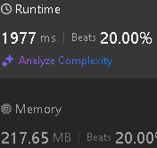

# Rabin-Karp + HashMap<Pair<Int, Int>,Pair<Int, Int>>

**Author:** sav20011962
**Votes:** 0
**Link:** [https://leetcode.com/problems/longest-common-suffix-queries/solutions/5827247/](https://leetcode.com/problems/longest-common-suffix-queries/solutions/5827247/)

---

# Approach
First I form all suffixes from all dictionary strings as a Rabin-Karp transformation, then I go through the queries and look for the maximum match.
# Complexity

# Code
```\u041Aotlin []
class Solution {
    fun stringIndices(wordsContainer: Array<String>, wordsQuery: Array<String>): IntArray {
        val map = HashMap<Pair<Int, Int>,Pair<Int, Int>>()
        // \u041A\u043B\u044E\u0447 (hash,\u0434\u043B\u0438\u043D\u0430 \u0441\u0443\u0444\u0444\u0438\u043A\u0441\u0430)
        // \u0417\u0430\u0447\u0435\u043D\u0438\u0435 - (\u0434\u043B\u0438\u043D\u0430 \u0441\u0442\u0440\u043E\u043A\u0438,\u0438\u043D\u0434\u0435\u043A\u0441 \u0441\u0442\u0440\u043E\u043A\u0438)
        // val mult = IntArray(5_000)
        val prime = 29
        val len_C = wordsContainer.size
        val len_Q = wordsQuery.size
        val rez = IntArray(len_Q)
        // mult[0] = 1
        // for (i in 1 until 5_000) {
        //     mult[i] = mult[i-1] * prime
        // }
        for (i in 0 until len_C) {
            val str = wordsContainer[i]
            var hash = 0
            val len = str.length
            val pair = Pair(hash,0)
            if (!map.containsKey(pair)) {
                map[pair] = Pair(len,i)
            }
            else {
                var (len_m,ind) = map.getValue(pair)
                if (len<len_m) {
                    map[pair] = Pair(len,i)
                }
                else if (len==len_m) {
                    map[pair] = Pair(len,minOf(i,ind))
                }
            }
            for (j in len-1 downTo 0) {
                hash = hash * prime + (str[j]-'a'+1) // * mult[len-j-1]
                val pair = Pair(hash,len-j)
                if (!map.containsKey(pair)) {
                    map[pair] = Pair(len,i)
                }
                else {
                    var (len_m,ind) = map.getValue(pair)
                    if (len<len_m) {
                        map[pair] = Pair(len,i)
                    }
                    else if (len==len_m) {
                        map[pair] = Pair(len,minOf(i,ind))
                    }
                }
            }
        }
        // println("map=$map")
        for (i in 0 until len_Q) {
            var max = 0
            val str = wordsQuery[i]
            var hash = 0
            val len = str.length
            val pair = Pair(hash,0)
            var ind = map.getValue(pair).second
            for (j in len-1 downTo 0) {
                hash = hash * prime + (str[j]-'a'+1) // * mult[len-j-1]
                val pair = Pair(hash,len-j)
                if (map.containsKey(pair)) {
                    if (max<len-j) {
                        max=len-j
                        ind = map.getValue(pair).second
                    }
                }
                else break
            }
            rez[i] = ind
        }
        return rez
    }
}
```