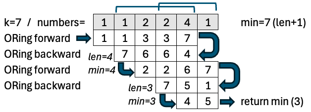

# C# - Fast - 1ms - O(n)/O(1) - Forwards and backwards - no heap objects created

**Author:** hafthor
**Votes:** 4
**Link:** [https://leetcode.com/problems/shortest-subarray-with-or-at-least-k-ii/solutions/6028401/](https://leetcode.com/problems/shortest-subarray-with-or-at-least-k-ii/solutions/6028401/)

---

| \u2764\uFE0F **Upvote or Comment Please** \uD83D\uDE4F |  |
| :--: | :--: |

# Intuition
We look forward, ORing as we go until we reach k, then we start ORing from that location but moving backwards to see how short we can make it. We then continue from that point and repeat.



# Approach
* Loop
  * OR forward until we reach k or end
  * Return shortest length (or -1) encountered if we reach end
  * {:style='display:inline'} OR backwards from that location until we reach k to see how short we can make it
  * {:style='display:inline'}Continue loop starting just after where we stopped above

# Complexity
- Time complexity: $$O(n)$$
- Space complexity: $$O(1)$$

# Code
```csharp []
public class Solution {
    public int MinimumSubarrayLength(int[] nums, int k) {
        for(int i=0, min=nums.Length+1;;i++) {
            // look forward until we reach k
            for(int o=0; i<nums.Length; i++) {
                o|=nums[i];
                if(o>=k) break;
            }
            if(i>=nums.Length) return min>nums.Length ? -1 : min;
            // look backward to see how short we can make it, but
            // only up to len=min since we want something shorter
            for(int len=0, o=0; ++len<min;i--) {
                o|=nums[i];
                if(o>=k) {min=len; break;}
            }
            if(min==1) return 1; // we're not going to do better than 1!
        }
    }
}
```

# Bonus: Code Golf
```csharp []
public class Solution {
    public int MinimumSubarrayLength(int[] a, int k) { // 126 characters
        int o=0,n=a.Length,m=n+1,i=0,l;for(;i<n;)if((o|=a[i++])>=k){for(o=0,l=1;(o|=a[--i])<k;l++);o=0;i++;m=l<m?l:m;}return m>n?-1:m;
    }
}
```