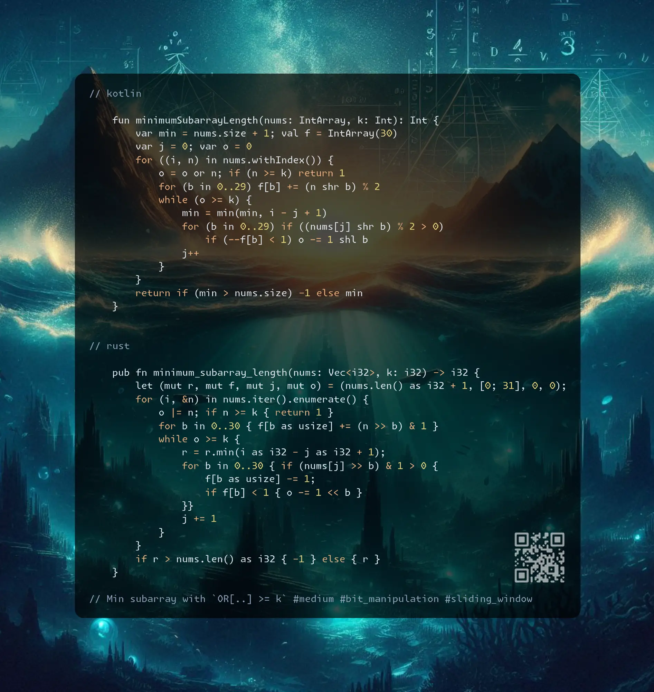

# Kotlin | Rust

**Author:** SamoylenkoDmitry
**Votes:** 2
**Link:** [https://leetcode.com/problems/shortest-subarray-with-or-at-least-k-ii/solutions/6029875/](https://leetcode.com/problems/shortest-subarray-with-or-at-least-k-ii/solutions/6029875/)

---



https://youtu.be/8B3Zmw0GOrA

#### Join me on Telegram

https://t.me/leetcode_daily_unstoppable/796

#### Problem TLDR

Min subarray with `OR[..] >= k` #medium #bit_manipulation #sliding_window

#### Intuition

First, don't solve the wrong problem, `OR[..]` must be `at least k`, not the `exact k`.

Now, the simple idea is to use the `Sliding Window` techique: expand it with each number, calculating the `OR`. However, the shrinking is not trivial, as the `OR` operation is not reversable. So we should track how each number bits are add in the final `OR` result to be able to remove them. To do this, count each bit frequency.

Another way to look at this problem is no maintain the most recent index of each bit:

```j

    //                             not exact, but 'at least k'!
    // k=101
    //  1000 <-- good, bigger than b101, any number with higher bit => 1
    //   110 <-- good, bigger than b101, any number with same prefix => 1
    //   010 <---------------------------. 
    //   001 -> search for second bit    |
    //  *011 -> update pos for first bit | this OR will give 110 > 101, good
    //   000                             |
    //  *100 <-- second bit--------------J

```

This solution is more complex, as we should analyze every bit for possible corner cases. 

#### Approach

* one optimization is if the number is bigger than `k` we can return 1
* pointers approach is a single-pass but is slower than frequencies approach for the test dataset (30ms vs 5ms)

#### Complexity

- Time complexity:
$$O(n)$$

- Space complexity:
$$O(n)$$

#### Code

```kotlin []

    fun minimumSubarrayLength(nums: IntArray, k: Int): Int {
        var min = nums.size + 1
        val pos = IntArray(32) { -1 }
        for ((i, n) in nums.withIndex()) {
            if (n >= k) return 1
            var max = -1; var all = true
            for (b in 31 downTo 0) {
                if ((n shr b) % 2 > 0) pos[b] = i
                val kBit = (k shr b) % 2 > 0
                if (kBit && pos[b] < 0) all = false
                if (all && !kBit && pos[b] >= 0) min = min(min, max(max, i - pos[b] + 1))
                if (all && kBit) max = max(max, i - pos[b] + 1)
            }
            if (all) min = min(min, max)
        }
        return if (min > nums.size) -1 else min
    }

```
```kotlin []

    fun minimumSubarrayLength(nums: IntArray, k: Int): Int {
        var min = nums.size + 1; val f = IntArray(30)
        var j = 0; var o = 0
        for ((i, n) in nums.withIndex()) {
            o = o or n; if (n >= k) return 1
            for (b in 0..29) f[b] += (n shr b) % 2
            while (o >= k) {
                min = min(min, i - j + 1)
                for (b in 0..29) if ((nums[j] shr b) % 2 > 0)
                    if (--f[b] < 1) o -= 1 shl b
                j++
            }
        }
        return if (min > nums.size) -1 else min
    }  

```
```rust []

    pub fn minimum_subarray_length(nums: Vec<i32>, k: i32) -> i32 {
        let (mut r, mut f, mut j, mut o) = (nums.len() as i32 + 1, [0; 31], 0, 0);
        for (i, &n) in nums.iter().enumerate() {
            o |= n; if n >= k { return 1 }
            for b in 0..30 { f[b as usize] += (n >> b) & 1 }
            while o >= k {
                r = r.min(i as i32 - j as i32 + 1);
                for b in 0..30 { if (nums[j] >> b) & 1 > 0 {
                    f[b as usize] -= 1;
                    if f[b] < 1 { o -= 1 << b }
                }}
                j += 1
            }
        }
        if r > nums.len() as i32 { -1 } else { r }
    }

```
```c++ []

    int minimumSubarrayLength(vector<int>& a, int k) {
        int r = a.size() + 1, j = 0, o = 0, b = 0;
        int f[31] = {};
        for (int i = 0; i < a.size(); ++i) {
            if (a[i] >= k) return 1;
            for (b = 0; b < 30; b++) f[b] += a[i] >> b & 1;
            for (o |= a[i]; o >= k; j++)
                for (r = min(r, i - j + 1), b = 0; b < 30; b++)
                    if ((a[j] >> b & 1) && !--f[b]) o -= 1 << b;
        }
        return r > a.size() ? -1 : r;
    }

```

Bonus solution without bits array (algo author https://leetcode.com/problems/shortest-subarray-with-or-at-least-k-ii/solutions/6029167/kotlin-o-n-sliding-window-without-bit-count-array-o-1-memory/):
```kotlin
    fun minimumSubarrayLength(nums: IntArray, k: Int): Int {
        var ans = nums.size + 1
        var o = 0
        for ((i, n) in nums.withIndex()) {
            if (n >= k) return 1
            o = o or n
            if (o < k) continue
            o = 0
            var j = i
            while (o or nums[j] < k) o = o or nums[j--]
            ans = minOf(ans, i - j + 1)
        }
        return if (ans > nums.size) -1 else ans
    }
```

Can we form a sequence consisting of ~n sliding windows or-equal k? 

Proof that it is O(n):

The interesting periodic sequence is powers of two filled with zeros: `10...020...040...0...80...`:
```j
    // k=11111111  255
    //   00000001  1
    //   00000010  2
    //   00000100  4
    //   00001000  8
    //   00010000  16
    //   00100000  32
    //   01000000  64
    //   10000000  128
    //   00000001  1
    //   00000010  2
    //   00000100  4
    //   00001000  8
    //   00010000  16
    //   00100000  32
    //   01000000  64
    //   10000000  128
```
Each new number will backtrack to a length of the period. So, how many periods we can totally have?
Let's write a generator:
```kotlin
    fun g(): Pair<Int, List<Int>> {
        val zerosFill = 13
        val b = 29
        val nMax = 200_000
        val k = (1 shl b) - 1
        val twos = (0..<b).flatMap { listOf(1 shl it) + (1..zerosFill).map { 0 } }
        val nums = (1..nMax/twos.size).flatMap { twos }
        println("window length = ${twos.size}")
        println("windows count = ${nMax/twos.size}")
        println("k=$k")
        println(nums.size)
        if (nums.size > nMax) throw Error(""+nums.size)
        return k to nums
    }
```
As we can see, the number of periods `np` and the period length `pl` must not exceed the total value of `n = 2*10^5`. So, `np * pl <= n`, or our `backtrack count * backtrack length <= n`. That gives us `backtrack^2 <= n`. If we do a quadratic backtrack count, we are not exceeding the `n`.