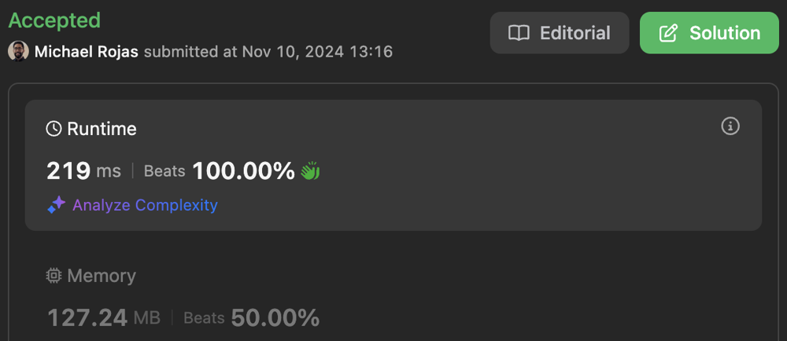
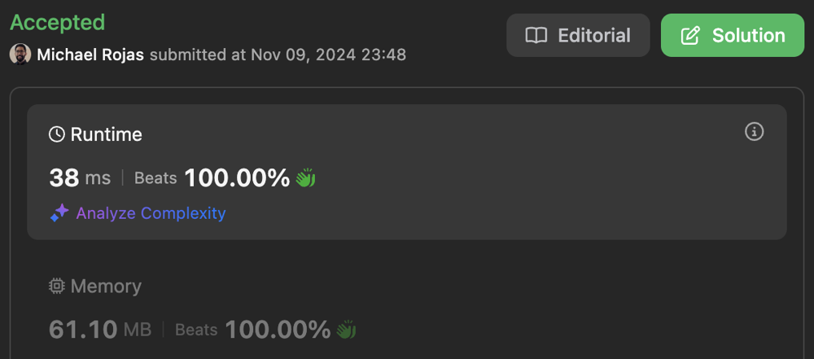

# 100% | 4 Solutions | Time: O(N) | Space: O(1)

**Author:** rojas
**Votes:** 3
**Link:** [https://leetcode.com/problems/shortest-subarray-with-or-at-least-k-ii/solutions/6028843/](https://leetcode.com/problems/shortest-subarray-with-or-at-least-k-ii/solutions/6028843/)

---

# Table of Contents

From slowest to fastest:

[toc]

# Sparse Table

- Time complexity: $$O(log(N!))$$

- Space complexity: $$O(log(N!))$$

    $$log(N!)$$ approaches $$N\\log{N}$$ from below as$N$ grows towards infinity. 

[JavaScript](https://leetcode.com/problems/shortest-subarray-with-or-at-least-k-ii/submissions/1448908272/)



```typescript []
function minimumSubarrayLength(nums: number[], k: number): number {
    const table = new SparseTable(nums);

    let left = 0;
    let minLen = nums.length + 1;
    for (let right = 1; right <= nums.length; ++right) {
        while (left < right && table.query(left, right) >= k) {
            minLen = Math.min(minLen, right - left);
            ++left;
        }
    }

    return minLen <= nums.length ? minLen : -1;
}

class SparseTable {
    private table: number[][];

    constructor(nums: number[]) {
        const N = nums.length;
        const table: number[][] = new Array(N);

        let log2 = 0;
        for (let i = 0; i < N; ++i) {
            log2 += (i + 1) >> log2;
            table[i] = new Array(log2);
            table[i][0] = nums[N - i - 1];
            for (let j = 1, pow = 1; j < log2; ++j) {
                table[i][j] = table[i][j-1] | table[i - pow][j-1];
                pow <<= 1;
            }
        }
        
        this.table = table.reverse();
    }

    query(left: number, right: number): number {
        const j = 0 | Math.log2(right - left);
        return this.table[left][j] | this.table[right - (1 << j)][j];
    }
}
```

```javascript []
/**
 * @param {number[]} nums
 * @param {number} k
 * @return {number}
 */
function minimumSubarrayLength(nums, k) {
    const table = new SparseTable(nums);

    let left = 0;
    let minLen = nums.length + 1;
    for (let right = 1; right <= nums.length; ++right) {
        while (left < right && table.query(left, right) >= k) {
            minLen = Math.min(minLen, right - left++);
        }
    }

    return minLen <= nums.length ? minLen : -1;
}

class SparseTable {

    constructor(nums) {
        const N = nums.length;
        const table = new Array(N);

        let log2 = 0;
        for (let i = 0; i < N; ++i) {
            log2 += (i + 1) >> log2;
            table[i] = new Array(log2);
            table[i][0] = nums[N - i - 1];
            for (let j = 1, pow = 1; j < log2; ++j) {
                table[i][j] = table[i][j-1] | table[i - pow][j-1];
                pow <<= 1;
            }
        }
        
        this.table = table.reverse();
    }

    query(left, right) {
        const j = 0 | Math.log2(right - left);
        return this.table[left][j] | this.table[right - (1 << j)][j];
    }
}
```

# Segment Tree

- Time complexity: $$O(N\\log{N})$$

- Space complexity: $$O(N)$$

[JavaScript](https://leetcode.com/problems/shortest-subarray-with-or-at-least-k-ii/submissions/1449019428/)


```typescript []
function minimumSubarrayLength(nums: number[], k: number): number {
    const tree = new OrTree(nums);

    let left = 0;
    let minLen = nums.length + 1;
    for (let right = 1; right <= nums.length; ++right) {
        while (left < right && tree.query(left, right) >= k) {
            minLen = Math.min(minLen, right - left);
            ++left;
        }
    }

    return minLen <= nums.length ? minLen : -1;
}


class OrTree {
    private _min: number;
    private _vals: number[];

    constructor(nums: number[]) {
        const N = nums.length;
        const MIN = 1 << Math.ceil(Math.log2(N));
        const vals = new Array(MIN + N).fill(0);

        for (let i = 0; i < N; ++i) {
            vals[i + MIN] = nums[i];
        }
        for (let i = vals.length - 1; i > 1; --i) {
            vals[i >> 1] |= vals[i];
        }

        this._min = MIN;
        this._vals = vals;
    }

    query(left: number, right: number): number {
        left += this._min;
        right += this._min;

        let val = 0;
        while (left < right) {
            val |= -(left & 1) & this._vals[left++];
            val |= -(right & 1) & this._vals[right - 1];
            left >>= 1;
            right >>= 1;
        }

        return val;
    }
}
```

```javascript []
/**
 * @param {number[]} nums
 * @param {number} k
 * @return {number}
 */
function minimumSubarrayLength(nums, k) {
    const tree = new OrTree(nums);

    let left = 0;
    let minLen = nums.length + 1;
    for (let right = 1; right <= nums.length; ++right) {
        while (left < right && tree.query(left, right) >= k) {
            minLen = Math.min(minLen, right - left);
            ++left;
        }
    }

    return minLen <= nums.length ? minLen : -1;
}


class OrTree {

    constructor(nums) {
        const N = nums.length;
        const MIN = 1 << Math.ceil(Math.log2(N));
        const vals = new Array(MIN + N).fill(0);

        for (let i = 0; i < N; ++i) {
            vals[i + MIN] = nums[i];
        }
        for (let i = vals.length - 1; i > 1; --i) {
            vals[i >> 1] |= vals[i];
        }

        this._min = MIN;
        this._vals = vals;
    }

    query(left, right) {
        left += this._min;
        right += this._min;

        let val = 0;
        while (left < right) {
            val |= -(left & 1) & this._vals[left++];
            val |= -(right & 1) & this._vals[right - 1];
            left >>= 1;
            right >>= 1;
        }

        return val;
    }
}
```

# Sliding Window I

- Time complexity: $$O(N)$$

- Space complexity: $$O(1)$$

[JavaScript](https://leetcode.com/problems/shortest-subarray-with-or-at-least-k-ii/submissions/1448343920/)



```typescript []
const MAX_BITS = 30; // 1 + Math.floor(log2(1e9));

function minimumSubarrayLength(nums: number[], k: number): number {
    const freqs = new Array(MAX_BITS).fill(0);

    let left = -1;
    let minLen = nums.length + 1;
    for (let right = 0; right < nums.length; ++right) {
        updateFreqs(freqs, nums[right], 1);
        while (left < right && freqsToNum(freqs) >= k) {
            minLen = Math.min(minLen, right - left);
            updateFreqs(freqs, nums[++left], -1);
        }
    }

    return minLen <= nums.length ? minLen : -1;
}

function freqsToNum(freqs: number[]): number {
    let num = 0;
    for (let bit = 0; bit < MAX_BITS; ++bit) {
        num |= +(freqs[bit] > 0) << bit;
    }
    return num;
}

function updateFreqs(freqs: number[], num: number, value: number): void {
    for (let bit = 0; num > 0; ++bit) {
        freqs[bit] += -(num & 1) & value;
        num >>= 1;
    }
}
```

```javascript []
const MAX_BITS = 30; // 1 + Math.floor(log2(1e9));

/**
 * @param {number[]} nums
 * @param {number} k
 * @return {number}
 */
function minimumSubarrayLength(nums, k) {
    const freqs = new Array(MAX_BITS).fill(0);

    let left = -1;
    let minLen = nums.length + 1;
    for (let right = 0; right < nums.length; ++right) {
        updateFreqs(freqs, nums[right], 1);
        while (left < right && freqsToNum(freqs) >= k) {
            minLen = Math.min(minLen, right - left);
            updateFreqs(freqs, nums[++left], -1);
        }
    }

    return minLen <= nums.length ? minLen : -1;
}

/**
 * @param {number[]} freqs
 * @return {number}
 */
function freqsToNum(freqs) {
    let num = 0;
    for (let bit = 0; bit < MAX_BITS; ++bit) {
        num |= +(freqs[bit] > 0) << bit;
    }
    return num;
}

/**
 * @param {number[]} freqs
 * @param {number} num
 * @param {number} value
 */
function updateFreqs(freqs, num, value) {
    for (let bit = 0; num > 0; ++bit) {
        freqs[bit] += -(num & 1) & value;
        num >>= 1;
    }
}
```

# Sliding Window II

- Time complexity: $$O(N)$$

- Space complexity: $$O(1)$$

[JavaScript](https://leetcode.com/problems/shortest-subarray-with-or-at-least-k-ii/submissions/1468745642/)


```typescript []
function minimumSubarrayLength(nums: number[], k: number): number {
    let size = nums.length + 1;
    let min = 0;
    let sum = 0;

    for (let max = 0; max < nums.length; ++max) {
        sum |= nums[max];
        min = (sum == nums[max]) ? max : min;
        if (sum >= k) {
            size = Math.min(size, max - min + 1);
            max = min;
            sum = 0;
            
        }
    }

    return (size <= nums.length) ? size : -1;
}
```

```javascript []
/**
 * @param {number[]} nums
 * @param {number} k
 * @return {number}
 */
function minimumSubarrayLength(nums, k) {
    let size = nums.length + 1;
    let min = 0;
    let sum = 0;

    for (let max = 0; max < nums.length; ++max) {
        sum |= nums[max];
        min = (sum == nums[max]) ? max : min;
        if (sum >= k) {
            size = Math.min(size, max - min + 1);
            max = min;
            sum = 0;
            
        }
    }

    return (size <= nums.length) ? size : -1;
};
```