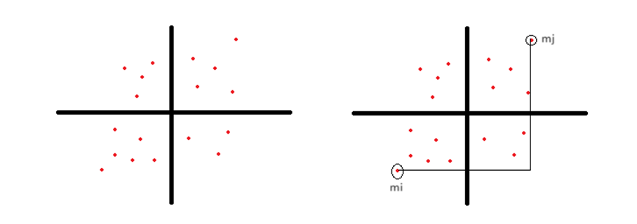

# [C++, Java, Python] Sums and Differences | Time: O(n) | Space: O(1)

**Author:** shivamaggarwal513
**Votes:** 145
**Link:** [https://leetcode.com/problems/minimize-manhattan-distances/solutions/4949614/](https://leetcode.com/problems/minimize-manhattan-distances/solutions/4949614/)

---

# Intuition

First solve a smaller problem. Given an array of points, how can we find the maximum Manhattan distance between any pair of points, and their indices? Keep in mind that checking all possible pairs in $O(n^2)$ time is not feasible.

Let's write the formula for Manhattan distance:

$$
\	ext{Manhattan}(P_i, P_j) = \\vert x_i-x_j \\vert + \\vert y_i-y_j \\vert$$

$$=
\\begin{cases}
x_i-x_j + y_i-y_j & \	ext{if } x_i \\ge x_j \	ext{ and } y_i \\ge y_j \\\\
x_i-x_j - y_i+y_j & \	ext{if } x_i \\ge x_j \	ext{ and } y_i < y_j \\\\
-x_i+x_j + y_i-y_j & \	ext{if } x_i < x_j \	ext{ and } y_i \\ge y_j \\\\
-x_i+x_j - y_i+y_j & \	ext{if } x_i < x_j \	ext{ and } y_i < y_j
\\end{cases}
$$

Rearranging the terms such that $i$s are together and $j$s are together:

$$
=
\\begin{cases}
(x_i + y_i) - (x_j + y_j) & \	ext{if } x_i \\ge x_j \	ext{ and } y_i \\ge y_j \\\\
(x_i - y_i) - (x_j - y_j) & \	ext{if } x_i \\ge x_j \	ext{ and } y_i < y_j \\\\
-(x_i - y_i) + (x_j - y_j) & \	ext{if } x_i < x_j \	ext{ and } y_i \\ge y_j \\\\
-(x_i + y_i) + (x_j + y_j) & \	ext{if } x_i < x_j \	ext{ and } y_i < y_j
\\end{cases}
$$

Looking at the formula above, let's define two variables:

$$
\	ext{sum}_i = s_i = x_i + y_i \\\\
\	ext{diff}_i = d_i = x_i - y_i
$$

Rewriting the formula:

$$
=
\\begin{cases}
s_i - s_j & \	ext{if } x_i \\ge x_j \	ext{ and } y_i \\ge y_j \\\\
d_i - d_j & \	ext{if } x_i \\ge x_j \	ext{ and } y_i < y_j \\\\
-d_i + d_j & \	ext{if } x_i < x_j \	ext{ and } y_i \\ge y_j \\\\
-s_i + s_j & \	ext{if } x_i < x_j \	ext{ and } y_i < y_j
\\end{cases}
$$

Hence, maximum Manhattan distance can be found if we try to maximize the following formula:

$$
\\displaystyle\\max_{i,j} \	ext{Manhattan}(P_i, P_j) = \\displaystyle\\max_{i, j} \\left(\\max(\\vert s_i-s_j\\vert, \\vert d_i-d_j\\vert)\\right)
$$

So, if we make separate arrays of `sums` and `differences`, then maximum Manhattan distance will be the larger of the
1. Difference between maximum of `sums` and minimum of `sums`, and
2. Difference between maximum of `differences` and minimum of `differences`.

$$
\\displaystyle\\max_{i,j} \	ext{Manhattan}(P_i, P_j) = \\max(s_{imax} - s_{imin}, d_{imax} - d_{imin})
$$

Now, coming back to the original problem, suppose we have found maximum Manhattan distance without removing anything and the maximum is for indices $mi$ and $mj$.

**This maximum Manhattan distance will not change if we are removing anything other than $mi$ and $mj$.** So, you already have the answer for maximum Manhattan distance for $n-2$ possible removals.

For the remaining 2 cases, we can first remove $mi$ and calculate maximum Manhttan distance again. Then we can insert back $mi$ and remove $mj$ and calculate maximum Manhattan distance again.

Final answer will be the minimum of these 3 possibilities.

As pointed by [@intelliCode](/intelliCode), we can remove first case where we didn't removed $mi$ and $mj$ (answer of $n-2$ possible removals).



From the image, we can see that if we removed any of $mi$ or $mj$, then maximum Manhattan distance will only decrease as farthest points will be closer. And we are interested in finding the minimum, so we can safely ignore the first case.

# Code

```C++ []
class Solution {
private:
    int manhattan(vector<vector<int>>& points, int i, int j) {
        return abs(points[i][0] - points[j][0]) + abs(points[i][1] - points[j][1]);
    }
    
    pair<int, int> maxManhattanDistance(vector<vector<int>>& points, int remove = -1) {
        int n = points.size();
        int maxSum = INT_MIN, minSum = INT_MAX, maxDiff = INT_MIN, minDiff = INT_MAX;
        int maxSumIndex, minSumIndex, maxDiffIndex, minDiffIndex;
        for (int i = 0; i < n; i++) {
            if (i != remove) {
                int sum = points[i][0] + points[i][1],
                    diff = points[i][0] - points[i][1];
                if (sum > maxSum) {
                    maxSumIndex = i;
                    maxSum = sum;
                }
                if (sum < minSum) {
                    minSumIndex = i;
                    minSum = sum;
                }
                if (diff > maxDiff) {
                    maxDiffIndex = i;
                    maxDiff = diff;
                }
                if (diff < minDiff) {
                    minDiffIndex = i;
                    minDiff = diff;
                }
            }
        }
        return max(maxSum - minSum, maxDiff - minDiff) == maxSum - minSum
            ? make_pair(maxSumIndex, minSumIndex)
            : make_pair(maxDiffIndex, minDiffIndex);
    }
    
public:
    int minimumDistance(vector<vector<int>>& points) {
        auto [mi, mj] = maxManhattanDistance(points);
        auto [mi1, mj1] = maxManhattanDistance(points, mi); // remove mi
        auto [mi2, mj2] = maxManhattanDistance(points, mj); // remove mj
        return min(
            manhattan(points, mi1, mj1),
            manhattan(points, mi2, mj2)
        );
    }
};
```
```Java []
class Solution {
    private int manhattan(int[][] points, int i, int j) {
        return Math.abs(points[i][0] - points[j][0]) + Math.abs(points[i][1] - points[j][1]);
    }

    private int[] maxManhattanDistance(int[][] points, int remove) {
        int n = points.length;
        int maxSum = Integer.MIN_VALUE, minSum = Integer.MAX_VALUE, maxDiff = Integer.MIN_VALUE, minDiff = Integer.MAX_VALUE;
        int maxSumIndex = -1, minSumIndex = -1, maxDiffIndex = -1, minDiffIndex = -1;
        for (int i = 0; i < n; i++) {
            if (i != remove) {
                int sum = points[i][0] + points[i][1],
                    diff = points[i][0] - points[i][1];
                if (sum > maxSum) {
                    maxSumIndex = i;
                    maxSum = sum;
                }
                if (sum < minSum) {
                    minSumIndex = i;
                    minSum = sum;
                }
                if (diff > maxDiff) {
                    maxDiffIndex = i;
                    maxDiff = diff;
                }
                if (diff < minDiff) {
                    minDiffIndex = i;
                    minDiff = diff;
                }
            }
        }
        int[] result = new int[2];
        return Math.max(maxSum - minSum, maxDiff - minDiff) == maxSum - minSum
            ? new int[]{maxSumIndex, minSumIndex}
            : new int[]{maxDiffIndex, minDiffIndex};
    }

    public int minimumDistance(int[][] points) {
        int[] m = maxManhattanDistance(points, -1);
        int[] m1 = maxManhattanDistance(points, m[0]); // remove mi
        int[] m2 = maxManhattanDistance(points, m[1]); // remove mj
        return Math.min(
            manhattan(points, m1[0], m1[1]),
            manhattan(points, m2[0], m2[1])
        );
    }
}
```
```Python []
class Solution:
    def manhattan(self, points: List[List[int]], i: int, j: int) -> int:
        return abs(points[i][0] - points[j][0]) + abs(points[i][1] - points[j][1])
    
    def maxManhattanDistance(self, points: List[List[int]], remove: int = -1) -> Tuple[int]:
        n = len(points)
        maxSum, minSum, maxDiff, minDiff = -inf, inf, -inf, inf
        for i in range(n):
            if i != remove:
                s = points[i][0] + points[i][1]
                d = points[i][0] - points[i][1]
                if s > maxSum:
                    maxSumIndex = i
                    maxSum = s
                if s < minSum:
                    minSumIndex = i
                    minSum = s
                if d > maxDiff:
                    maxDiffIndex = i
                    maxDiff = d
                if d < minDiff:
                    minDiffIndex = i
                    minDiff = d
        return (maxSumIndex, minSumIndex) \\
            if max(maxSum - minSum, maxDiff - minDiff) == maxSum - minSum \\
            else (maxDiffIndex, minDiffIndex)
    
    def minimumDistance(self, points: List[List[int]]) -> int:
        mi, mj = self.maxManhattanDistance(points)
        return min(
            self.manhattan(points, *self.maxManhattanDistance(points, mi)), # remove mi
            self.manhattan(points, *self.maxManhattanDistance(points, mj)) # remove mj
        )
```

# Complexity

- Time complexity: $O(n)$
- Space complexity: $O(1)$