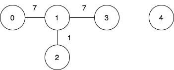
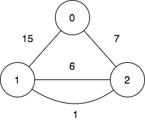

# [3108. Minimum Cost Walk in Weighted Graph](https://leetcode.com/problems/minimum-cost-walk-in-weighted-graph/)

| Category | Difficulty | Likes | Dislikes |
| :------: | :--------: | :---: | :------: |
| Algorithms | Hard | 774 | 43 |

**Tags:** [`array`](https://leetcode.com/tag/array), [`bit-manipulation`](https://leetcode.com/tag/bit-manipulation), [`union-find`](https://leetcode.com/tag/union-find), [`graph`](https://leetcode.com/tag/graph)

**Companies:** `google`, `microsoft`, `de-shaw`

## Description

There is an undirected weighted graph with `n` vertices labeled from `0` to `n - 1`.

You are given the integer `n` and an array `edges`, where `edges[i] = [u_i, v_i, w_i]` indicates that there is an edge between vertices `u_i` and `v_i` with a weight of `w_i`.

A walk on a graph is a sequence of vertices and edges. The walk starts and ends with a vertex, and each edge connects the vertex that comes before it and the vertex that comes after it. It's important to note that a walk may visit the same edge or vertex more than once.

The **cost** of a walk starting at node `u` and ending at node `v` is defined as the bitwise `AND` of the weights of the edges traversed during the walk. In other words, if the sequence of edge weights encountered during the walk is `w_0, w_1, w_2, ..., w_k`, then the cost is calculated as `w_0 & w_1 & w_2 & ... & w_k`, where `&` denotes the bitwise `AND` operator.

You are also given a 2D array `query`, where `query[i] = [s_i, t_i]`. For each query, you need to find the minimum cost of the walk starting at vertex `s_i` and ending at vertex `t_i`. If there exists no such walk, the answer is `-1`.

Return *the array *`answer`*, where *`answer[i]`* denotes the **minimum** cost of a walk for query *`i`.

 

**Example 1:**

**Input:** n = 5, edges = [[0,1,7],[1,3,7],[1,2,1]], query = [[0,3],[3,4]]

**Output:** [1,-1]

**Explanation:**

To achieve the cost of 1 in the first query, we need to move on the following edges: `0->1` (weight 7), `1->2` (weight 1), `2->1` (weight 1), `1->3` (weight 7).

In the second query, there is no walk between nodes 3 and 4, so the answer is -1.

**Example 2:**

**Input:** n = 3, edges = [[0,2,7],[0,1,15],[1,2,6],[1,2,1]], query = [[1,2]]

**Output:** [0]

**Explanation:**

To achieve the cost of 0 in the first query, we need to move on the following edges: `1->2` (weight 1), `2->1` (weight 6), `1->2` (weight 1).

 

**Constraints:**

	- `2 <= n <= 10^5`

	- `0 <= edges.length <= 10^5`

	- `edges[i].length == 3`

	- `0 <= u_i, v_i <= n - 1`

	- `u_i != v_i`

	- `0 <= w_i <= 10^5`

	- `1 <= query.length <= 10^5`

	- `query[i].length == 2`

	- `0 <= s_i, t_i <= n - 1`

	- `s_i != t_i`

---

**Links:** [Submissions](https://leetcode.com/problems/minimum-cost-walk-in-weighted-graph/) | [Solutions](https://leetcode.com/problems/minimum-cost-walk-in-weighted-graph/)
