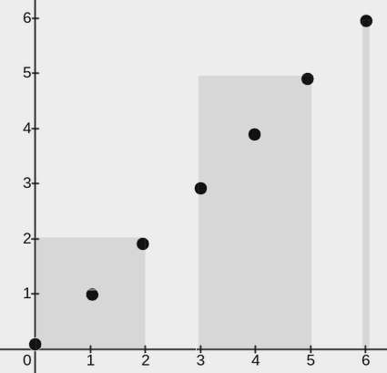

# [3111. Minimum Rectangles to Cover Points](https://leetcode.com/problems/minimum-rectangles-to-cover-points/)

| Category | Difficulty | Likes | Dislikes |
| :------: | :--------: | :---: | :------: |
| Algorithms | Medium | 107 | 8 |

**Tags:** [`array`](https://leetcode.com/tag/array), [`greedy`](https://leetcode.com/tag/greedy), [`sorting`](https://leetcode.com/tag/sorting)

**Companies:** `microsoft`

## Description

You are given a 2D integer array `points`, where `points[i] = [x_i, y_i]`. You are also given an integer `w`. Your task is to **cover** **all** the given points with rectangles.

Each rectangle has its lower end at some point `(x_1, 0)` and its upper end at some point `(x_2, y_2)`, where `x_1 = 0`, and the condition `x_2 - x_1 <= w` **must** be satisfied for each rectangle.

A point is considered covered by a rectangle if it lies within or on the boundary of the rectangle.

Return an integer denoting the **minimum** number of rectangles needed so that each point is covered by **at least one** rectangle*.*

**Note:** A point may be covered by more than one rectangle.

 

**Example 1:**

**Input:** points = [[2,1],[1,0],[1,4],[1,8],[3,5],[4,6]], w = 1

**Output:** 2

**Explanation: **

The image above shows one possible placement of rectangles to cover the points:

	- A rectangle with a lower end at `(1, 0)` and its upper end at `(2, 8)`

	- A rectangle with a lower end at `(3, 0)` and its upper end at `(4, 8)`

**Example 2:**

**Input:** points = [[0,0],[1,1],[2,2],[3,3],[4,4],[5,5],[6,6]], w = 2

**Output:** 3

**Explanation: **

The image above shows one possible placement of rectangles to cover the points:

	- A rectangle with a lower end at `(0, 0)` and its upper end at `(2, 2)`

	- A rectangle with a lower end at `(3, 0)` and its upper end at `(5, 5)`

	- A rectangle with a lower end at `(6, 0)` and its upper end at `(6, 6)`

**Example 3:**

**Input:** points = [[2,3],[1,2]], w = 0

**Output:** 2

**Explanation: **

The image above shows one possible placement of rectangles to cover the points:

	- A rectangle with a lower end at `(1, 0)` and its upper end at `(1, 2)`

	- A rectangle with a lower end at `(2, 0)` and its upper end at `(2, 3)`

 

**Constraints:**

	- `1 <= points.length <= 10^5`

	- `points[i].length == 2`

	- `0 <= x_i == points[i][0] <= 10^9`

	- `0 <= y_i == points[i][1] <= 10^9`

	- `0 <= w <= 10^9`

	- All pairs `(x_i, y_i)` are distinct.

---

**Links:** [Submissions](https://leetcode.com/problems/minimum-rectangles-to-cover-points/) | [Solutions](https://leetcode.com/problems/minimum-rectangles-to-cover-points/)
