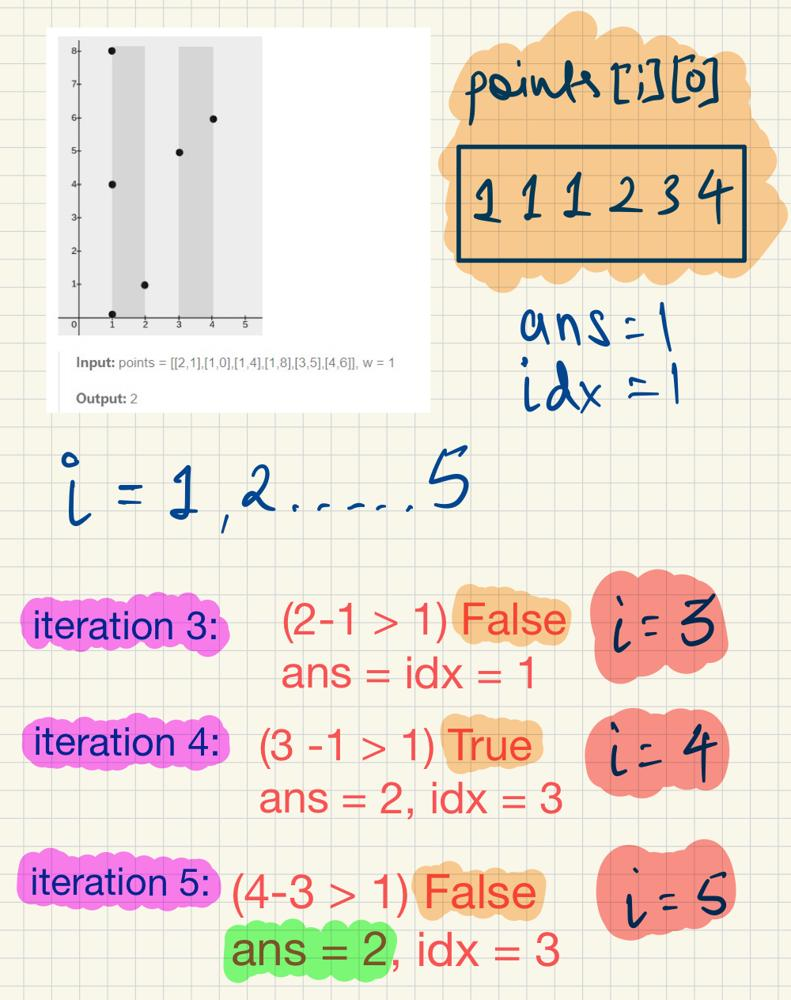

# Simplified Solution For Beginners || Intuitive Approach

**Author:** fahad_Mubeen
**Votes:** 12
**Link:** [https://leetcode.com/problems/minimum-rectangles-to-cover-points/solutions/5017375/](https://leetcode.com/problems/minimum-rectangles-to-cover-points/solutions/5017375/)

---

# Intuition
Sort the points based on their x-coordinate, iterate through them, and count the number of segments of width greater than w, increment the count of rectangles accordingly.
Finally, return the total count of rectangles needed to cover all the points.

# Approach
1. Sort the the given vector in increasing order.
2. Set intial width as one and do not increment the answer unless the points[i][0] do not fit in the rectangle (i.e., the rectangle exceeds the width) upon which we would need another rectangle, repeat the process for all points[i][j].



# Complexity
- Time complexity: O(nlogn)

- Space complexity:O(1)

# Code
```
class Solution {
public:
    int minRectanglesToCoverPoints(vector<vector<int>>& points, int w) {
        int ans = 1;
        sort(points.begin(), points.end());
        int idx = points[0][0]; // starting point of rectangle
        for(int i = 1; i < points.size(); i++){
            if(points[i][0] - idx > w){
                ans++; // increment the recangle needed by one
                idx = points[i][0]; // update the starting point
            }
        }
        return ans;
    }
};
```