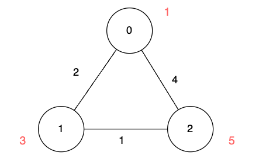

# [3112. Minimum Time to Visit Disappearing Nodes](https://leetcode.com/problems/minimum-time-to-visit-disappearing-nodes/)

| Category | Difficulty | Likes | Dislikes |
| :------: | :--------: | :---: | :------: |
| Algorithms | Medium | 213 | 23 |

**Tags:** [`array`](https://leetcode.com/tag/array), [`graph`](https://leetcode.com/tag/graph), [`heap-priority-queue`](https://leetcode.com/tag/heap-priority-queue), [`shortest-path`](https://leetcode.com/tag/shortest-path)

## Description

There is an undirected graph of `n` nodes. You are given a 2D array `edges`, where `edges[i] = [u_i, v_i, length_i]` describes an edge between node `u_i` and node `v_i` with a traversal time of `length_i` units.

Additionally, you are given an array `disappear`, where `disappear[i]` denotes the time when the node `i` disappears from the graph and you won't be able to visit it.

**Note** that the graph might be *disconnected* and might contain *multiple edges*.

Return the array `answer`, with `answer[i]` denoting the **minimum** units of time required to reach node `i` from node 0. If node `i` is **unreachable** from node 0 then `answer[i]` is `-1`.

 

**Example 1:**

**Input:** n = 3, edges = [[0,1,2],[1,2,1],[0,2,4]], disappear = [1,1,5]

**Output:** [0,-1,4]

**Explanation:**

We are starting our journey from node 0, and our goal is to find the minimum time required to reach each node before it disappears.

	- For node 0, we don't need any time as it is our starting point.

	- For node 1, we need at least 2 units of time to traverse `edges[0]`. Unfortunately, it disappears at that moment, so we won't be able to visit it.

	- For node 2, we need at least 4 units of time to traverse `edges[2]`.

**Example 2:**

**Input:** n = 3, edges = [[0,1,2],[1,2,1],[0,2,4]], disappear = [1,3,5]

**Output:** [0,2,3]

**Explanation:**

We are starting our journey from node 0, and our goal is to find the minimum time required to reach each node before it disappears.

	- For node 0, we don't need any time as it is the starting point.

	- For node 1, we need at least 2 units of time to traverse `edges[0]`.

	- For node 2, we need at least 3 units of time to traverse `edges[0]` and `edges[1]`.

**Example 3:**

**Input:** n = 2, edges = [[0,1,1]], disappear = [1,1]

**Output:** [0,-1]

**Explanation:**

Exactly when we reach node 1, it disappears.

 

**Constraints:**

	- `1 <= n <= 5 * 10^4`

	- `0 <= edges.length <= 10^5`

	- `edges[i] == [u_i, v_i, length_i]`

	- `0 <= u_i, v_i <= n - 1`

	- `1 <= length_i <= 10^5`

	- `disappear.length == n`

	- `1 <= disappear[i] <= 10^5`

---

**Links:** [Submissions](https://leetcode.com/problems/minimum-time-to-visit-disappearing-nodes/) | [Solutions](https://leetcode.com/problems/minimum-time-to-visit-disappearing-nodes/)
