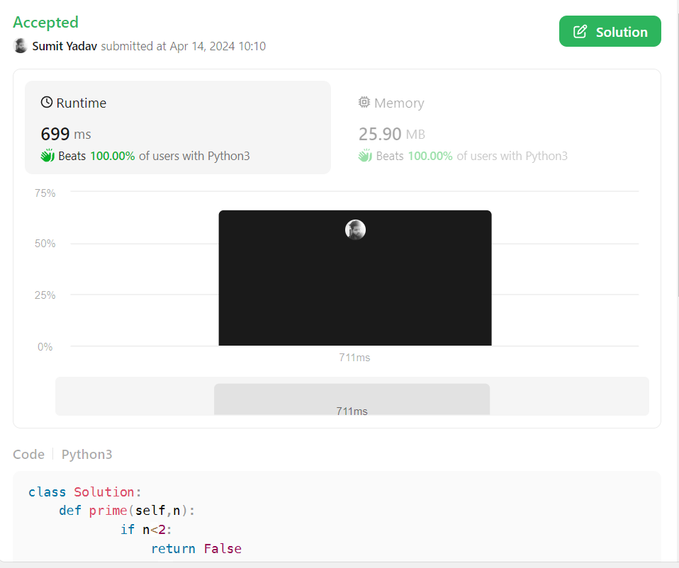

# ✅☑️ Beats 100% || Very Easy Solution || Beginner Friendly

**Author:** sumit4199
**Votes:** 3
**Link:** [https://leetcode.com/problems/maximum-prime-difference/solutions/5020056/](https://leetcode.com/problems/maximum-prime-difference/solutions/5020056/)

---

image.png

# Intuition
Prime Function -> To check element is prime or not

**maximumPrimeDifference Function:**

It calculates the maximum difference between the indices of prime numbers in the given array.
It initializes an empty vector arr to store the indices of prime numbers.
It iterates through each element of the input array.
For each element, it checks if it's prime using the isPrime function.
If the element is prime, its index is added to the arr vector.
Finally, it calculates the maximum difference between the first and last elements of arr.
It returns this difference as the maximum gap between prime numbers in the array.

# Complexity
- Time complexity: O(n * sqrt(num))
<!-- Add your time complexity here, e.g. $$O(n)$$ -->

- Space complexity: O(n)
<!-- Add your space complexity here, e.g. $$O(n)$$ -->

# PYTHON 3
```
class Solution:
    def prime(self,n):
            if n<2:
                return False
            if n == 2:
                return True
            for i in range(2,int(n**0.5)+1):
                if n % i == 0:
                    return False
            return True

    def maximumPrimeDifference(self, nums: List[int]) -> int:
        arr = []
        for i in range(len(nums)):
            if self.prime(nums[i]):
                arr.append(i)
        return arr[-1] - arr[0]
```

# JAVA 
```
import java.util.ArrayList;
import java.util.List;

class Solution {
    boolean isPrime(int n) {
        if (n < 2) {
            return false;
        }
        if (n == 2) {
            return true;
        }
        for (int i = 2; i <= Math.sqrt(n); i++) {
            if (n % i == 0) {
                return false;
            }
        }
        return true;
    }
    
    int maximumPrimeDifference(int[] nums) {
        List<Integer> arr = new ArrayList<>();
        for (int i = 0; i < nums.length; i++) {
            if (isPrime(nums[i])) {
                arr.add(i);
            }
        }
        return arr.get(arr.size() - 1) - arr.get(0);
    }
}
```

# CPP
```
class Solution {
public:
    bool isPrime(int n) {
        if (n < 2) {
            return false;
        }
        if (n == 2) {
            return true;
        }
        for (int i = 2; i <= sqrt(n); i++) {
            if (n % i == 0) {
                return false;
            }
        }
        return true;
    }
    
    int maximumPrimeDifference(vector<int>& nums) {
        vector<int> arr;
        for (int i = 0; i < nums.size(); i++) {
            if (isPrime(nums[i])) {
                arr.push_back(i);
            }
        }
        return arr[arr.size() - 1] - arr[0];
    }
};
```