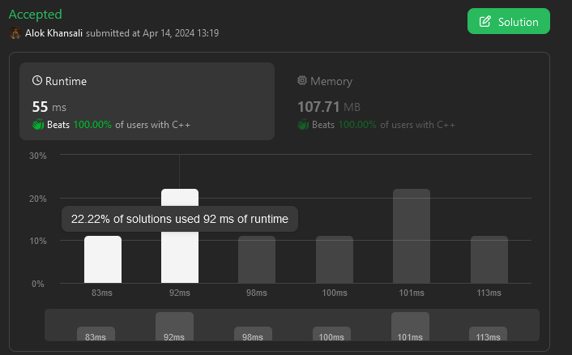

# ✅✅Fastest 💯💯|| Easiest Explanation || 100% best in space🔥🔥

**Author:** TheCodeAlpha
**Votes:** 9
**Link:** [https://leetcode.com/problems/maximum-prime-difference/solutions/5021071/](https://leetcode.com/problems/maximum-prime-difference/solutions/5021071/)

---

# Intuition
<!-- Describe your first thoughts on how to solve this problem. -->
#### Iss function maximumPrimeDifference ka maqsad` hai diye gaye array nums mein pehle aur akhri prime numbers ke beech ke sabse zyada farq ko dhundna. 

#### Toh iske liye best ye rahega ki starting se ek prime dhundlo and store krlo vo index, `start`, aur iske baad last se dhundlo ek prime and uski index bhi store karlo `end` mai

#### Bas iske baad apka iss question ko solve krne ka maqsad poora hojayega `end` - `start`, return karke

# Algorithm
<!-- Describe your approach to solving the problem. -->
#### 1) isPrime Function: 
- Yeh function super hero ki tarah hai, jo prime numbers ko dhundta hai! 
- Is function mein check hota hai ki, kya ek number prime hai ya nahi. Agar number 2 se chhota hai, toh hum seedha declare karte hain ki yeh non-prime hai. 
- Fir, yeh shuruaat karta hai ek bahadur safar, numbers ki duniya mein, 2 se lekar n ke square root tak. 
- Agar koi number n ko puri tarah se divide kar leta hai bina kisi remainder ke, toh usko prime nahi maana jaata hai, aur false declare ho jaata hai. 
- Lekin, agar aisa koi shatir divisor nahi milta, toh `n` ko prime ghoshit kiya jaata hai, aur true ka faisla suna diya jaata hai.

#### 2) maximumPrimeDifference Function:
- Yeh function ek bahut hi shandaar function hai! Isne bulaye hai do bahadur yoddha, `start` aur `end`, array ki duniya mein safar karne ko. 
- Yeh dono shuruaat se aakhri tak, dhundte hain pehla prime number, vishwaas ke saath isPrime function ke sahare.
- Par rukna mat, yeh safar yahi khatam nahi hota! Sar uncha karke, yeh dono array ke opposite end ki taraf chalte hain, dhoondne ke liye vahi akhri prime number.
- Ant mein, ye yoddha wapas aate hain, lekar apni yatra ka maal - pehla aur aakhri prime numbers ke indices.
- Aur bas inhi dono indices ke farak ko hum return karkar iss question ki kahani ko purn viram de dete hain

### Asha hai apko iss kahani ke madhyam se, iss sawal ko samajne mai thodi asani hui hogi, yadi koi bhi doubt reh gya hai toh niche diye huye example ko dekhein

Suppose the given array is: nums = {4, 6, 8, 10, 12, 14, 15, 17}.

### Initialization:
    start = 0 and end = 7.
    We start iterating from the beginning and end of the array to
    find the first prime numbers from both sides.
### Finding the First Prime from the Start:
    We start from index 0 and check each number until we find a prime.
    In this example, nums[7] = 17 is a prime number, so start is updated to 7.
### Finding the First Prime from the End:
    We start from index 7 and move towards the 
    start of the array until we find a prime.
    In this example, nums[7] = 17 is also a prime number, 
    so end remains at 7.
### Calculating the Difference:
    The difference between the indices of the first and last prime
    numbers found is calculated as end - start = 7 - 7 = 0.

#### So, in this example, the maximum prime difference in the given array {4, 6, 8, 10, 12, 14, 15, 17} is 0.

____

# Complexity
- Time complexity: $$O(N * \u221AN)$$ ~ $$O(N)$$, 
- Since isPrime takes $$\u221AN$$, and N is in range[0,100]
- $$\u221AN$$ will be in range [0,10], and this is constant time
<!-- Add your time complexity here, e.g. $$O(n)$$ -->

- Space complexity: $$O(1)$$
<!-- Add your space complexity here, e.g. $$O(n)$$ -->



# Code
```cpp []
class Solution
{
public:
    // Function to check if a number is prime
    bool isPrime(int n)
    {
        if (n < 2)
            return false; // Numbers less than 2 are not prime
        for (int i = 2; i * i <= n; i++)
        {
            if (n % i == 0)
                return false; // If n is divisible by any number between 2 and sqrt(n), it's not prime
        }
        return true; // If no divisors found, n is prime
    }
    int maximumPrimeDifference(vector<int> &nums)
    {
        int start = 0, end = nums.size() - 1; // Start and end pointers for the array
        // Find the first prime number from the start
        for (; start < end; start++)
        {
            if (isPrime(nums[start]))
                break;
        }
        // Find the first prime number from the end
        for (; end >= start; end--)
        {
            if (isPrime(nums[end]))
                break;
        }
        // Return the difference between the indices of the first and last prime numbers found
        return (end - start);
    }
};
```
```java []
class Solution {
    // Function to check if a number is prime
    boolean isPrime(int n) {
        if (n < 2)
            return false; // Numbers less than 2 are not prime
        for (int i = 2; i * i <= n; i++) {
            if (n % i == 0)
                return false; // If n is divisible by any number between 2 and sqrt(n), it's not prime
        }
        return true; // If no divisors found, n is prime
    }

    public int maximumPrimeDifference(int[] nums) {
        int start = 0, end = nums.length - 1; // Start and end pointers for the array
        // Find the first prime number from the start
        while (start < end) {
            if (isPrime(nums[start]))
                break;
            start++;
        }
        // Find the first prime number from the end
        while (end >= start) {
            if (isPrime(nums[end]))
                break;
            end--;
        }
        // Return the difference between the indices of the first and last prime numbers found
        return (end - start);
    }
}
```
```python []
class Solution:
    # Function to check if a number is prime
    def isPrime(self, n: int) -> bool:
        if n < 2:
            return False  # Numbers less than 2 are not prime
        for i in range(2, int(n ** 0.5) + 1):
            if n % i == 0:
                return False  # If n is divisible by any number between 2 and sqrt(n), it's not prime
        return True  # If no divisors found, n is prime

    def maximumPrimeDifference(self, nums: List[int]) -> int:
        start, end = 0, len(nums) - 1  # Start and end pointers for the array
        # Find the first prime number from the start
        while start < end:
            if self.isPrime(nums[start]):
                break
            start += 1
        # Find the first prime number from the end
        while end >= start:
            if self.isPrime(nums[end]):
                break
            end -= 1
        # Return the difference between the indices of the first and last prime numbers found
        return (end - start)
```

____

### DO Upvote, if this helped :)

