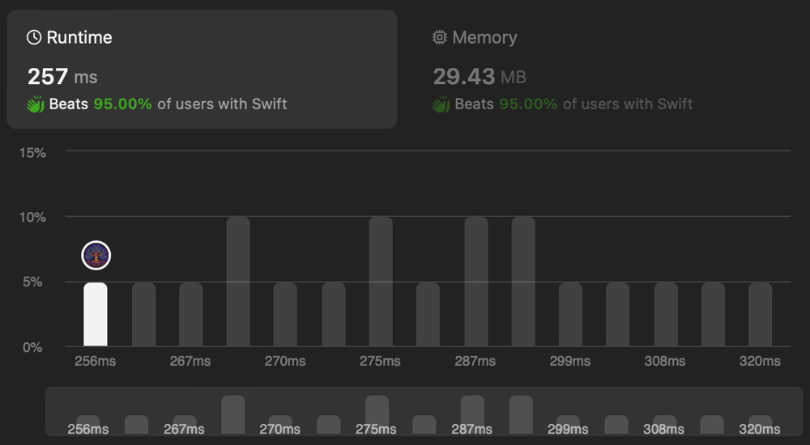

# ✅ Two Pointers | Efficient Solution

**Author:** eleev
**Votes:** 1
**Link:** [https://leetcode.com/problems/maximum-prime-difference/solutions/5032539/](https://leetcode.com/problems/maximum-prime-difference/solutions/5032539/)

---



# Solution
```swift
struct Solution {
    @_optimize(speed)
    func maximumPrimeDifference(_ nums: [Int]) -> Int {
        var (left, right) = (0, nums.count - 1)
        
        while left < right {
            switch (nums[left].isPrime, nums[right].isPrime) {
                case (true, true):
                    return right - left
                case (true, false):
                    right -= 1
                case (false, true):
                    left += 1
                default:
                    left += 1
                    right -= 1
            }
        }
        return 0
    }
}

private extension Int {
    var isPrime: Bool {
        guard self >= 2       else { return false }
        guard self != 2       else { return true  }
        guard self & 0b1 != 0 else { return false }
        return !(2..<self).lazy
                .filter { $0 == 2 || $0 % 2 != 0 }
                .prefix(while: { $0 * $0 <= self })
                .contains { self % $0 == 0 }
    }
}
```