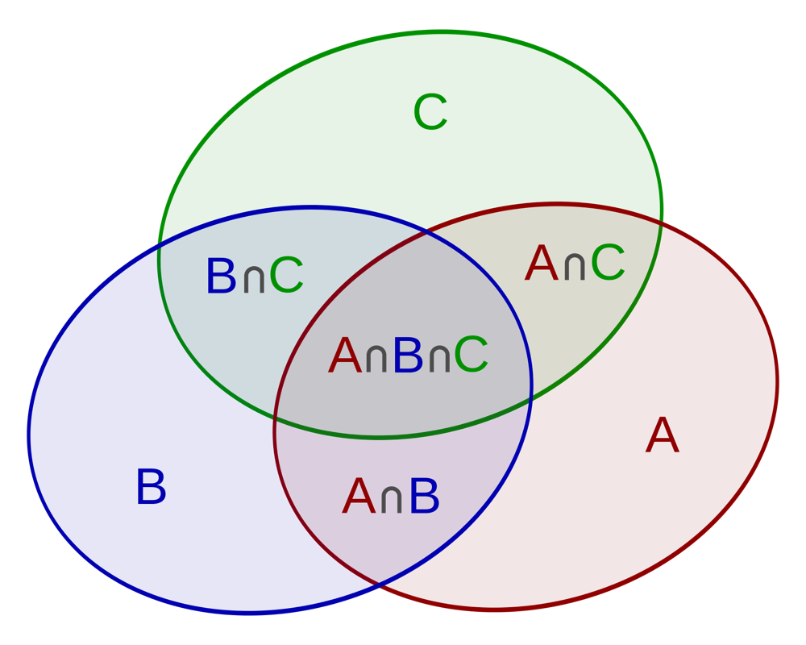
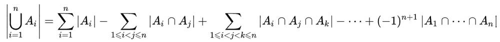

# [Python3] Math | Inclusion-Exclusion Principle | Binary Search

**Author:** xil899
**Votes:** 76
**Link:** [https://leetcode.com/problems/kth-smallest-amount-with-single-denomination-combination/solutions/5019504/](https://leetcode.com/problems/kth-smallest-amount-with-single-denomination-combination/solutions/5019504/)

---

# Intuition
Since $$k$$ can be as large as $$2 \	imes 10^9$$, the requested algorithm has to give a time complexity better than $$O(k)$$. One natural solution is to use binary search on the answer space.
<!-- Describe your first thoughts on how to solve this problem. -->

# Approach
To use binary search on the answer space, the key step is to come with up a proper helper function. In this question, we need to implement a helper function that can **count the number of valid denominations that are less or equal to `target`**. However, since different coins can produce overlapping denominations when they are multiples of their lcm (least common multiple), we need to avoid counting such duplicates.

For example, if `coins = [3, 6, 9]` in Example 1, we need to avoid counting 6 twice (since both 3 and 6 can produce a denomination of 6). You may think about the famous Venn diagram and recall the formula for $$n = 2$$: $$|A \\cup B| = |A| + |B| - |A \\cap B|$$.



Now we are on the right track, great! However, since the length of `coins` can be more than two, what is tricky here is that we need to apply the general **Inclusion-Exclusion Principle** by properly accounting for 3, 4, ..., $n$-way intersections. To do this, we need to loop through the **power-set** of `coins`, and calculate the **LCM** of each subset of `coins`, and then apply the Inclusion-Exclusion Principle:



Finally, we use binary search to decide **the smallest denomination `target` such that its count is greater or equal to `k`**, which gives the final answer. 

<!-- Describe your approach to solving the problem. -->

# Complexity
- Time complexity: $$O(2^n)\	imes \\log(k)$$, where `n = len(coins)`
<!-- Add your time complexity here, e.g. $$O(n)$$ -->

- Space complexity: $$O(2^n)$$
<!-- Add your space complexity here, e.g. $$O(n)$$ -->

Please upvote if you find this solution helpful. Figure credit: Wikipedia.

# Code
```
class Solution:
    def findKthSmallest(self, coins: List[int], k: int) -> int:
        n = len(coins)
        dic = defaultdict(list)
        for i in range(1, n + 1):
            for comb in itertools.combinations(coins, i):
                dic[len(comb)].append(math.lcm(*comb))
        
        def count(dic, target):
            ans = 0
            for i in range(1, n + 1):
                for lcm in dic[i]:
                    ans += target // lcm * pow(-1, i + 1)
            return ans
        
        start, end = min(coins), min(coins) * k
        while start + 1 < end:
            mid = (start + end) // 2
            if count(dic, mid) >= k:
                end = mid
            else:
                start = mid
        if count(dic, start) >= k:
            return start
        else:
            return end
```