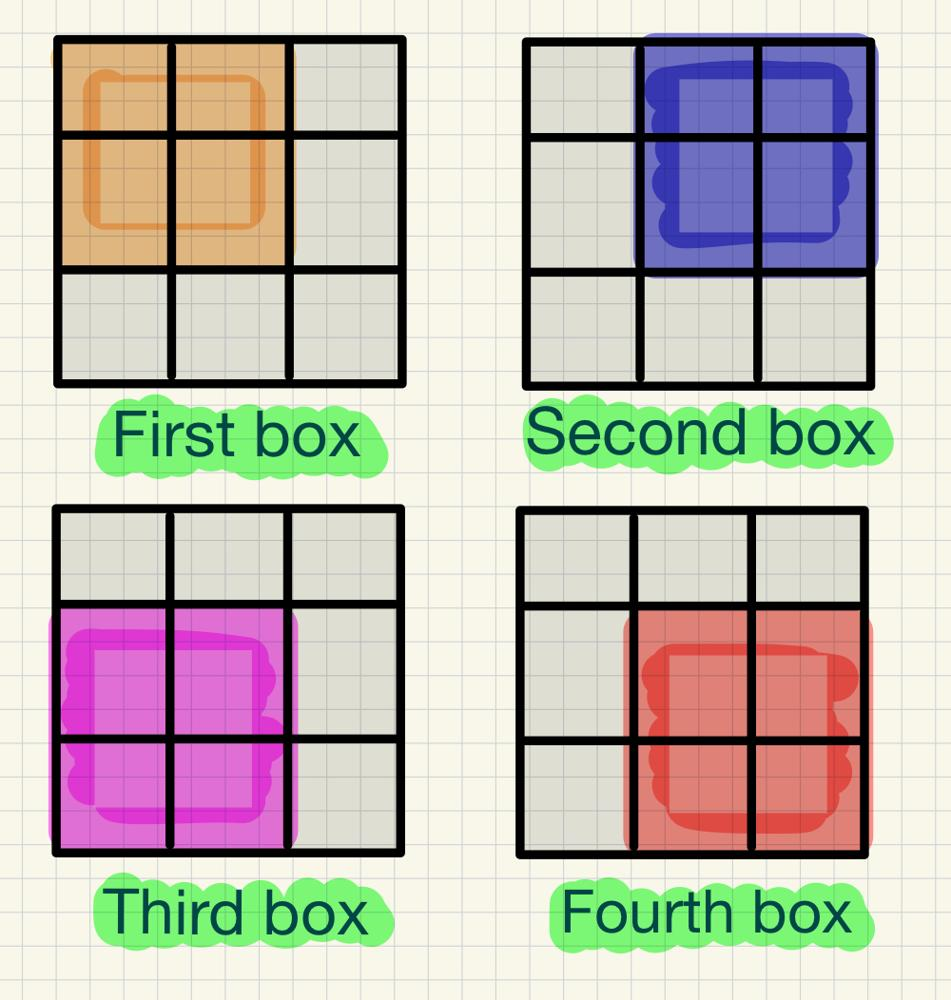

# Visualized || Brute Force + General Solution || C++

**Author:** fahad_Mubeen
**Votes:** 18
**Link:** [https://leetcode.com/problems/make-a-square-with-the-same-color/solutions/5080150/](https://leetcode.com/problems/make-a-square-with-the-same-color/solutions/5080150/)

---

## 1. Brute Force:
# Intuition 
- Only four **2x2 Squares** are possible, check for all of them.
# Approach 
1. The problem requires determining if it's possible to create a 2x2 square of the same color by changing at most one cell in the given 3x3 grid. 
2. Thus we examines each potential 2x2 square configuration around the central cell (grid[1][1]) in the 3x3 grid, incrementing counts for 'W' and 'B' cells. 
3. After counting the 'W' and 'B' cells in each potential square, verify if either 'W' or 'B' count exceeds 2. If either count exceeds 2 in any of the squares, it's possible to create a 2x2 square of the same color. In such case we return True.
4. If no such square is found we return false.
<!-- Describe your first thoughts on how to solve this problem. -->

# Visual Representation 



# Complexity
- Time complexity: O(1)

- Space complexity: O(1)
<!-- Add your space complexity here, e.g. $$O(n)$$ -->

# Code
```
class Solution {
public:
    bool canMakeSquare(vector<vector<char>>& grid) {
        char ch = grid[1][1];
        int W = 0, B = 0;
        ch == 'W' ? W++ : B++;
        // first box
        (grid[0][0] == 'W' ? W++ : B++);
        (grid[0][1] == 'W' ? W++ : B++);
        (grid[1][0] == 'W' ? W++ : B++);
        if(W > 2 || B > 2) return 1;
        W = 0, B = 0; ch == 'W' ? W++ : B++;

        // second box
        (grid[0][1] == 'W' ? W++ : B++);
        (grid[0][2] == 'W' ? W++ : B++);
        (grid[1][2] == 'W' ? W++ : B++);
        if(W > 2 || B > 2) return 1;
        W = 0, B = 0; ch == 'W' ? W++ : B++;

        // third box
        (grid[1][0] == 'W' ? W++ : B++);
        (grid[2][0] == 'W' ? W++ : B++);
        (grid[2][1] == 'W' ? W++ : B++);
        if(W > 2 || B > 2) return 1;
        W = 0, B = 0; ch == 'W' ? W++ : B++;

        // fourth box
        (grid[1][2] == 'W' ? W++ : B++);
        (grid[2][1] == 'W' ? W++ : B++);
        (grid[2][2] == 'W' ? W++ : B++);
        if(W > 2 || B > 2)return 1;
        
        return 0;
    }
};
```
## 2. General Solution
If the input matrix is 4x4 or larger, implementing brute force becomes tedious and often impractical. For larger matrices, a general solution applicable to all sizes becomes necessary. I have provided the code for the same below.
# Complexity 
1. Time Complexity: O(*(size of matrix* - *size of square)*) almost **O(n)** for *square of size 2 and matrix of size n.*
2. Space Complexity: O(1);

```
class Solution {
public:
    bool isPossible(vector<vector<char>>& grid, int i, int j){
        int W = 0, B = 0;
        for(int x = i; x < i + 2; x++){
            for(int y = j; y < j + 2; y++){
                if(grid[x][y] == 'W') W++;
                else B++;
            }
        }
        if(W > 2 || B > 2) return 1;
        return 0;
    }
    bool canMakeSquare(vector<vector<char>>& grid){
        int n = grid.size();
        for(int i = 0; i <= n - 2; i++){ // n- 2 since square size is 2
            for(int j = 0; j <= n - 2; j++){
                if(isPossible(grid, i, j)) return 1;
            }
        }
        return 0;
    }
};
```