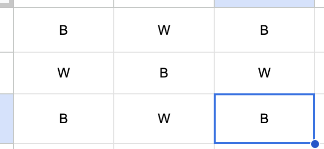
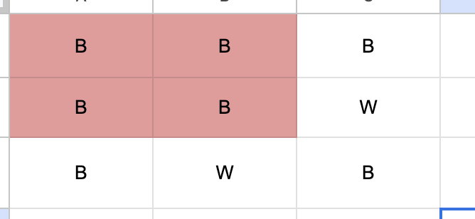
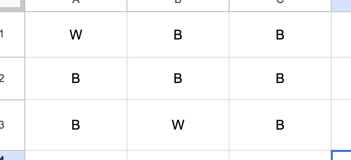

# Detailed explanation w/ Images - Easy Approach

**Author:** muhammadfarhankt
**Votes:** 0
**Link:** [https://leetcode.com/problems/make-a-square-with-the-same-color/solutions/5087229/](https://leetcode.com/problems/make-a-square-with-the-same-color/solutions/5087229/)

---

# Intuition
- To solve this problem, we need to iterate over each possible 2x2 square within the 3x3 grid and check whether the number of black cells ('B') or white cells ('W') in each square is at least 3. If such a square is found, we return true, indicating that it's possible to create a 2x2 square of the same color by changing at most one cell. Otherwise, we return false.
image.png

### Sample 1: Square Not Possible



### Sample 2: Square Already Exists



### Sample 3: Square Possible with One Change



# Approach
1. Iterate through potential squares: 
    - Use nested loops to iterate through each row (i) and column (j) combination within the grid, considering these as the top-left corner of a potential square.
2. Count cell colors:
    - Get the color at the top-left corner (grid[i][j]).
    - Initialize two counters, blackCount and whiteCount, to 0.
    - Use another nested loop to iterate through the remaining cells in the 2x2 square:
        - If the current cell's color matches the top-left corner, increment blackCount.
         - Otherwise, increment whiteCount.
3. Check for possibility of square:
    - After counting, analyze the blackCount and whiteCount:
        - If either count is 2, it means the square already has the same color (no change needed).
        - If either count is 4, it means all four cells have the same color (no change possible).
        - If exactly one count is 3 (and the other is 1), it means the square has a dominant color with one cell of a different color. This allows us to change the single cell to form a same-colored square.
    - If any of the above conditions (2, 3, or 4) are met, it means we can create a same-colored square. Return True in this case.
4. No square found:
    - If none of the squares formed from any top-left corner meet the conditions, it means no 2x2 square with the same color exists (or can be formed with one change). After iterating through all combinations, return False.

# Complexity
- Time complexity: O(n^2). We iterate through each element in the 3x3 grid once to check its potential as the top-left corner of a square. The nested loops for counting colors within the square contribute another factor of n. Overall, the time complexity is dominated by the nested loops, resulting in O(n^2).
- Space complexity: O(1) We only use a constant amount of additional space for variables to store counts.

### Don't forget to upvote

# Code
```javascript []
var canMakeSquare = function(grid) {
    for (let i = 0; i < 2; i++) {
        let black = 0, white = 0;
        for (let j = 0; j < 2; j++) {
            if (grid[i][j] === 'W') white++;
            else black++;
            if (grid[i + 1][j] === 'W') white++;
            else black++;
        }
        if (black >= 3 || white >= 3) return true;
        black = 0; white = 0;
        for (let j = 1; j < 3; j++) {
            if (grid[i][j] === 'W') white++;
            else black++;
            if (grid[i + 1][j] === 'W') white++;
            else black++;
        }
        if (black >= 3 || white >= 3) return true;
    }
    return false;
};
```
```python []
class Solution:
    def canMakeSquare(self, grid: List[List[str]]) -> bool:
        for i in range(2):
            black, white = 0, 0
            for j in range(2):
                if grid[i][j] == 'W':
                    white += 1
                else:
                    black += 1
                if grid[i + 1][j] == 'W':
                    white += 1
                else:
                    black += 1
            if black >= 3 or white >= 3:
                return True
            black, white = 0, 0
            for j in range(1, 3):
                if grid[i][j] == 'W':
                    white += 1
                else:
                    black += 1
                if grid[i + 1][j] == 'W':
                    white += 1
                else:
                    black += 1
            if black >= 3 or white >= 3:
                return True
        return False
```
```Dart []
class Solution {
  bool canMakeSquare(List<List<String>> grid) {
    for (int i = 0; i < 2; i++) {
      int black = 0, white = 0;
      for (int j = 0; j < 2; j++) {
        if (grid[i][j] == 'W')
          white++;
        else
          black++;
        if (grid[i + 1][j] == 'W')
          white++;
        else
          black++;
      }
      if (black >= 3 || white >= 3) return true;
      black = 0;
      white = 0;
      for (int j = 1; j < 3; j++) {
        if (grid[i][j] == 'W')
          white++;
        else
          black++;
        if (grid[i + 1][j] == 'W')
          white++;
        else
          black++;
      }
      if (black >= 3 || white >= 3) return true;
    }
    return false;
  }
}
```
```Java []
class Solution {
    public boolean canMakeSquare(char[][] grid) {
        for (int i = 0; i < 2; i++) {
            int black = 0, white = 0;
            for (int j = 0; j < 2; j++) {
                if (grid[i][j] == 'W') white++;
                else black++;
                if (grid[i + 1][j] == 'W') white++;
                else black++;
            }
            if (black >= 3 || white >= 3) return true;
            black = 0;
            white = 0;
            for (int j = 1; j < 3; j++) {
                if (grid[i][j] == 'W') white++;
                else black++;
                if (grid[i + 1][j] == 'W') white++;
                else black++;
            }
            if (black >= 3 || white >= 3) return true;
        }
        return false;
    }
}
```
```Golang []
func canMakeSquare(grid [][]byte) bool {
    for i := 0; i < 2; i++ {
        black, white := 0, 0
        for j := 0; j < 2; j++ {
            if grid[i][j] == 'W' {
                white++
            } else {
                black++
            }
            if grid[i+1][j] == 'W' {
                white++
            } else {
                black++
            }
        }
        if black >= 3 || white >= 3 {
            return true
        }
        black, white = 0, 0
        for j := 1; j < 3; j++ {
            if grid[i][j] == 'W' {
                white++
            } else {
                black++
            }
            if grid[i+1][j] == 'W' {
                white++
            } else {
                black++
            }
        }
        if black >= 3 || white >= 3 {
            return true
        }
    }
    return false
}
```
```c []
bool canMakeSquare(char** grid, int gridSize, int* gridColSize) {
    for (int i = 0; i < 2; i++) {
        int black = 0, white = 0;
        for (int j = 0; j < 2; j++) {
            if (grid[i][j] == 'W') white++;
            else black++;
            if (grid[i + 1][j] == 'W') white++;
            else black++;
        }
        if (black >= 3 || white >= 3) return true;
        black = 0;
        white = 0;
        for (int j = 1; j < 3; j++) {
            if (grid[i][j] == 'W') white++;
            else black++;
            if (grid[i + 1][j] == 'W') white++;
            else black++;
        }
        if (black >= 3 || white >= 3) return true;
    }
    return false;
}
```
```C++ []
class Solution {
public:
    bool canMakeSquare(vector<vector<char>>& grid) {
        for (int i = 0; i < 2; i++) {
            int black = 0, white = 0;
            for (int j = 0; j < 2; j++) {
                if (grid[i][j] == 'W') white++;
                else black++;
                if (grid[i + 1][j] == 'W') white++;
                else black++;
            }
            if (black >= 3 || white >= 3) return true;
            black = 0;
            white = 0;
            for (int j = 1; j < 3; j++) {
                if (grid[i][j] == 'W') white++;
                else black++;
                if (grid[i + 1][j] == 'W') white++;
                else black++;
            }
            if (black >= 3 || white >= 3) return true;
        }
        return false;
    }
};
```