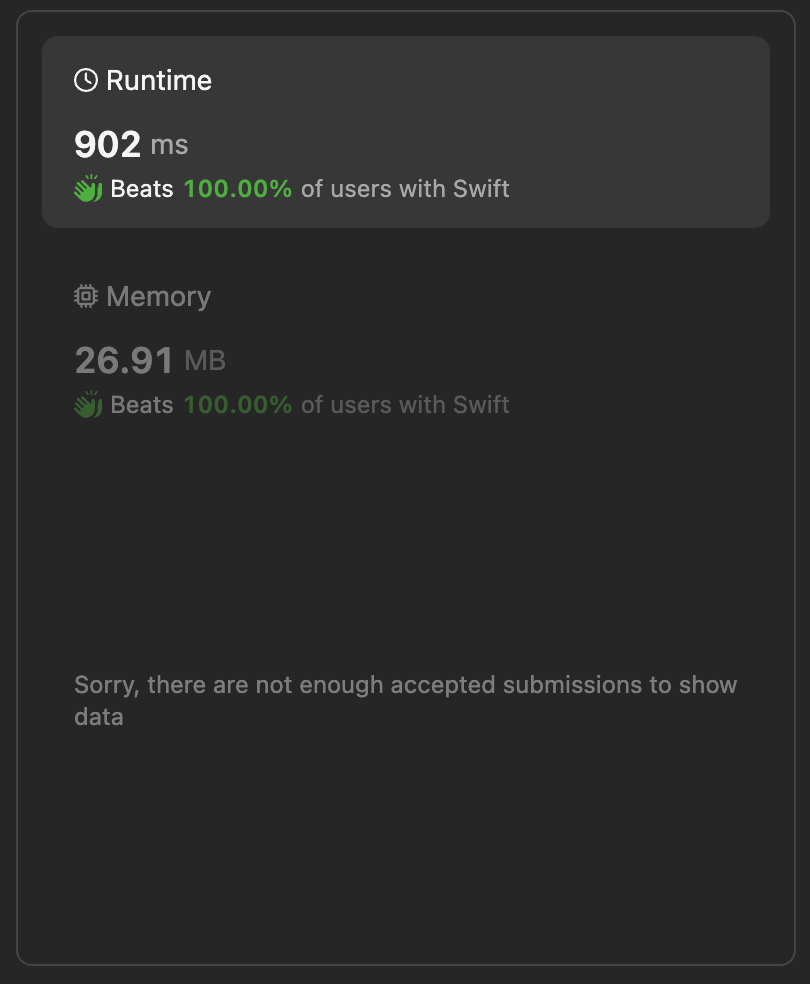

# Right Triangles  🚦 Best performing and detailed Swift implementation

**Author:** lebon
**Votes:** 0
**Link:** [https://leetcode.com/problems/right-triangles/solutions/5081343/](https://leetcode.com/problems/right-triangles/solutions/5081343/)

---

# Intuition
The problem involves counting the number of right triangles formed by the value `1` in a 2D grid. A right triangle is formed when three `1` values are aligned in such a way that they can potentially form a right triangle. The task is to efficiently count such combinations.

# Approach
1. **Row and Column Counts**: First, iterate through the grid to count the number of `1`s in each row (`rowCounts`) and each column (`colCounts`).
2. **Count Triangles**: Then, iterate through the grid again. For each cell containing `1`, calculate how many potential right triangles can be formed using the `1`s in the same row and column. This calculation is based on the formula `(rowCounts[r] - 1) * (colCounts[c] - 1)`. This formula represents how many ways we can choose two other `1`s from the same row and column to form a right triangle with the current `1`.
3. **Accumulate Count**: Accumulate the count of right triangles as you traverse the grid.

# Complexity
- **Time Complexity**: The time complexity is $$(O(m * n))$$, where $$(m)$$ is the number of rows and $$(n)$$ is the number of columns in the grid. This is because we make two passes through the grid to compute row and column counts and then to count the triangles.
- **Space Complexity**: The space complexity is $$(O(m + n))$$ for storing the `rowCounts` and `colCounts` arrays, where $$(m)$$ is the number of rows and $$(n)$$ is the number of columns in the grid. Additionally, we use constant extra space for other variables.



# Code
```
class Solution {
    func numberOfRightTriangles(_ grid: [[Int]]) -> Int {
let rows = grid.count
        let cols = grid[0].count
        var rowCounts = [Int](repeating: 0, count: rows)
        var colCounts = [Int](repeating: 0, count: cols)
        
        // Calculate row and column counts
        for r in 0..<rows {
            for c in 0..<cols {
                if grid[r][c] == 1 {
                    rowCounts[r] += 1
                    colCounts[c] += 1
                }
            }
        }
        
        var triangles = 0
        
        // Calculate the number of right triangles
        for r in 0..<rows {
            for c in 0..<cols {
                if grid[r][c] == 1 {
                    triangles += (rowCounts[r] - 1) * (colCounts[c] - 1)
                }
            }
        }
        
        return triangles
    }
}
```