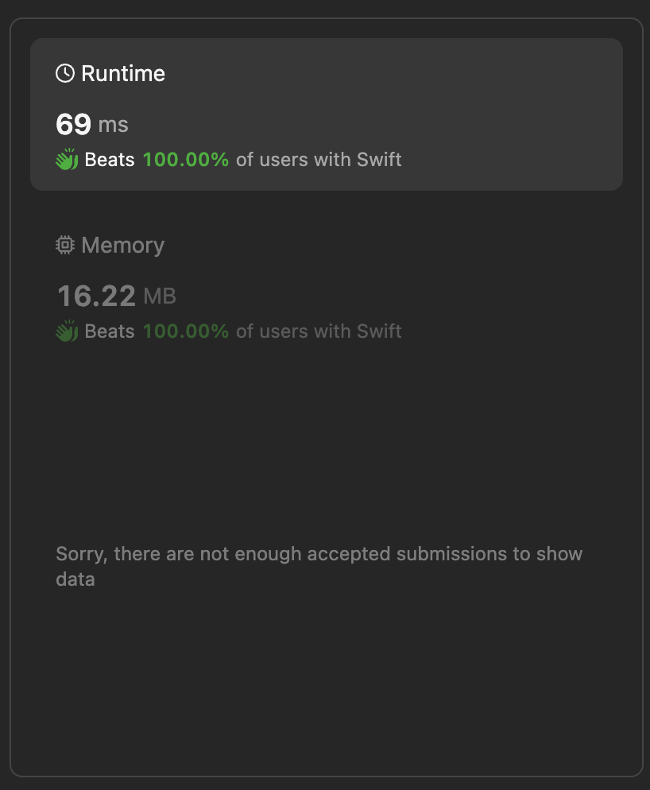

# Optimal Approach in Swift 🚦 Find Products of elements of Big Array

**Author:** lebon
**Votes:** 0
**Link:** [https://leetcode.com/problems/find-products-of-elements-of-big-array/solutions/5172487/](https://leetcode.com/problems/find-products-of-elements-of-big-array/solutions/5172487/)

---


## Intuition
The problem involves calculating the product of numbers within a given range where the numbers are represented by their binary powers of 2. Each power of 2 follows a specific pattern. To solve the problem efficiently, we can utilize these patterns to determine the counts of each power of 2 in the given range and then calculate the resulting product modulo a given value.

## Approach
1. **Process Each Query:**
   - For each query, get the start (`s`) and end (`t`) indices and the modulo value (`mod`).
   - Adjust the end index by adding 1 because the range is inclusive.

2. **Binary Search for Upper Bound:**
   - Use binary search to find the highest number `n1` where the sum of the count of powers of 2 in integers from 0 to `n1-1` is less than or equal to `s`.
   - Repeat the process for `t` to find `n2`.

3. **Get Counts of Powers of 2:**
   - Calculate the counts of each power of 2 for numbers up to `n1` and `n2`.
   - Adjust these counts to match exactly `s` and `t` by incrementing the counts until they sum up to the desired target.

4. **Compute Range Counts:**
   - Subtract the counts obtained for `s` from the counts obtained for `t` to get the counts for the range `[s, t)`.

5. **Calculate Product:**
   - Use these counts to calculate the product of powers of 2 modulo `mod`.
   - For each power of 2, compute its contribution and handle the rollovers to the next higher power.

6. **Final Adjustment for Highest Power:**
   - For the highest power of 2, continue reducing the count by doubling the base and updating the product.

## Complexity
- **Time complexity:** 
  - Binary search in the given range [1, 100000000000000] will take $$O(\\log(\	ext{MAX}))$$ iterations.
  - Calculating the sum of frequencies for each power of 2 will take $$O(\\log(\	ext{MAX}))$$ time.
  - Adjusting the counts and calculating the product will take $$O(\\log(\	ext{MAX})$$ time.
  - For $$Q$$ queries, the total time complexity is $$O(Q \\cdot \\log^2(\	ext{MAX}))$$.

- **Space complexity:**
  - The space used for storing counts of powers of 2 is $$O(\\log(\	ext{MAX}))$$.
  - The space complexity is $$O(\\log(\	ext{MAX}))$$.




```swift []
class Solution {
    // Function to find products of elements for each query
    func findProductsOfElements(_ queries: [[Int]]) -> [Int] {
        var response = [Int](repeating: 0, count: queries.count)
        
        // Process each query individually
        for (i, query) in queries.enumerated() {
            let s = Int64(query[0]) // Start index
            let t = Int64(query[1]) + 1 // End index
            let mod = Int64(query[2]) // Modulo value
            response[i] = solve(s, t, mod) // Solve for the current query
        }
        
        return response
    }
    
    // Function to solve a single query
    private func solve(_ s: Int64, _ t: Int64, _ mod: Int64) -> Int {
        // Get the highest number x such that the sum of count of 
        // powers of 2 in integers in the range [0, x-1] is <= s
        let n1: Int64 = s > 0 ? getNextHigher(1, 100000_00000_00000, s) : 0
        var c1: [Int64] = s > 0 ? getLowerCounts(n1) : Array(repeating: 0, count: 51)
        adjust(&c1, n1, s) // Adjust counts for s
        
        // Get the highest number x such that the sum of count of 
        // powers of 2 in integers in the range [0, x-1] is <= t
        let n2: Int64 = getNextHigher(1, 100000_00000_00000, t)
        var c2: [Int64] = getLowerCounts(n2)
        adjust(&c2, n2, t) // Adjust counts for t
        
        // Calculate counts of each power of 2 in the desired range [s, t)
        for i in 0..<50 {
            c2[i] -= c1[i]
        }
        
        // Calculate powers of 2 modulo mod
        var pow = [Int64](repeating: 1, count: 50)
        for i in 1..<50 {
            pow[i] = (pow[i - 1] << 1) % mod
        }
        
        // Calculate the product of powers of 2
        var product: Int64 = 1
        var next: Int64 = 2
        c2[50] = 0
        
        // Iterate through each power of 2
        for i in 1..<50 {
            // Calculate remainder and division
            let remainder = Int((c2[i] * Int64(i)) % (Int64(i) + 1))
            let division = (c2[i] * Int64(i)) / (Int64(i) + 1)
            // Update product
            product = (product * pow[remainder]) % mod
            
            // Roll over the division to the next higher power of 2
            c2[i + 1] += division
            next <<= 1
        }
        
        // Calculate product for the highest power of 2
        var base = next % mod
        while c2[50] > 0 {
            if c2[50] % 2 == 1 {
                product = (product * base) % mod
            }
            base = (base * base) % mod
            c2[50] >>= 1
        }
        
        return Int(product % mod)
    }
    
    // Function to adjust counts
    private func adjust(_ counts: inout [Int64], _ x: Int64, _ target: Int64) {
        var index = 0
        var x = x
        // Increment counts until it matches target
        while counts[50] != target {
            if x == 0 {
                print("Error")
                break
            }
            if x % 2 != 0 {
                counts[index] += 1
                counts[50] += 1
            }
            x >>= 1
            index += 1
        }
    }
    
    // Function to get the next higher number for which the sum of count of 
    // powers of 2 is <= target
    private func getNextHigher(_ from: Int64, _ to: Int64, _ target: Int64) -> Int64 {
        if from == to {
            return from
        }
        let mid = from + (to + 1 - from) / 2
        let counts = getLowerCounts(mid)
        if counts[50] > target {
            return getNextHigher(from, mid - 1, target)
        } else {
            return getNextHigher(mid, to, target)
        }
    }
    
    // Function to get counts of each power of 2 less than x
    private func getLowerCounts(_ x: Int64) -> [Int64] {
        var counts = [Int64](repeating: 0, count: 51)
        var total: Int64 = 0
        var i = 0
        var next: Int64 = 1
        // Calculate counts for each power of 2
        while next < x {
            counts[i] = (x / (2 * next)) * next + max((x % (2 * next)) - next, 0)
            total += counts[i]
            i += 1
            next <<= 1
        }
        // Store total count at the end of the array
        counts[50] = total
        return counts
    }
}
```