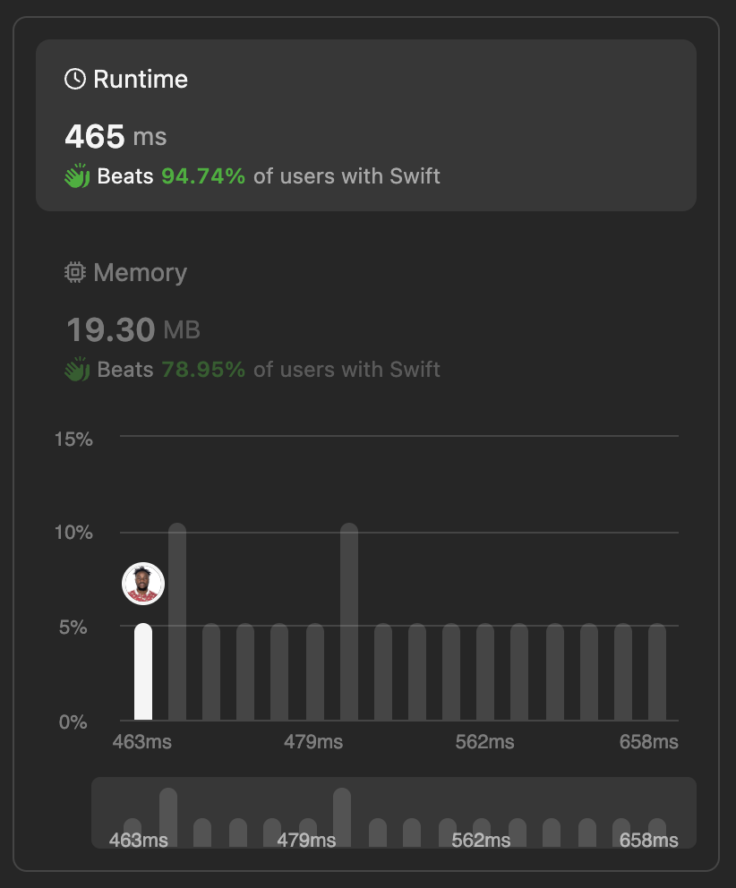

# Taking Maximum Energy 🚦 Optimal Implementation using Swift

**Author:** lebon
**Votes:** 1
**Link:** [https://leetcode.com/problems/taking-maximum-energy-from-the-mystic-dungeon/solutions/5159147/](https://leetcode.com/problems/taking-maximum-energy-from-the-mystic-dungeon/solutions/5159147/)

---


## Intuition
The function `maximumEnergy` aims to find the maximum energy obtainable starting from any index in the `energy` array, where you can jump at most `k` steps forward to accumulate energy. The goal is to determine the maximum value of `dp[i]` for all valid indices `i` in the array.

## Approach
1. **Initialization**:
   - Initialize `n` to store the length of the `energy` array.
   - Create an array `dp` of size `n` initialized with zeros to store the maximum energy obtainable starting from each index.

2. **Traversal from Right to Left**:
   - Traverse the `energy` array from the last element to the first element using a decrementing loop (`stride(from: n - 1, through: 0, by: -1)`).

3. **Calculate `dp[i]`**:
   - For each index `i` in the loop:
     - Calculate `dp[i]` as `energy[i] + (i + k < n ? dp[i + k] : 0)`.
       - `energy[i]` represents the energy value at the current index.
       - `(i + k < n ? dp[i + k] : 0)` represents the maximum energy obtainable starting from the index `i + k`, if it is within the array bounds. If `i + k` exceeds the array bounds, use `0` (no additional energy).

4. **Update `res`**:
   - Update `res` to store the maximum energy found during the traversal using `res = max(res, dp[i])`.

5. **Return Result**:
   - Finally, return `res`, which holds the maximum energy obtainable starting from any index in the `energy` array.

## Complexity
- **Time Complexity**: $$O(n)$$ - The algorithm traverses the `energy` array once from right to left.
- **Space Complexity**: $$O(n)$$ - We use an additional array `dp` of size $$n$$ to store the computed maximum energies. The space complexity is linear with respect to the input size $$n$$.




# Code
```swift []
class Solution {
    func maximumEnergy(_ energy: [Int], _ k: Int) -> Int {
        let n = energy.count
        var dp = [Int](repeating: 0, count: n)
        
        var res = Int.min // Initialize the result with negative infinity
        
        // Traverse the energy array from right to left
        for i in stride(from: n - 1, through: 0, by: -1) {
            // Calculate the current dp value for index i
            // dp[i] represents the maximum energy obtainable starting from index i
            dp[i] = energy[i] + (i + k < n ? dp[i + k] : 0)
            
            // Update the result with the maximum energy found
            res = max(res, dp[i])
        }
        
        return res
    }
}

```

This approach efficiently computes the maximum obtainable energy using **dynamic programming**, leveraging the `dp` array to store and update the maximum energies from right to left. The resulting `res` value contains the maximum energy value obtainable from any index in the `energy` array considering the jump distance `k`.