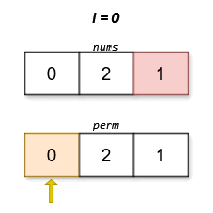

# [3149. Find the Minimum Cost Array Permutation](https://leetcode.com/problems/find-the-minimum-cost-array-permutation/)

| Category | Difficulty | Likes | Dislikes |
| :------: | :--------: | :---: | :------: |
| Algorithms | Hard | 144 | 7 |

**Tags:** [`array`](https://leetcode.com/tag/array), [`dynamic-programming`](https://leetcode.com/tag/dynamic-programming), [`bit-manipulation`](https://leetcode.com/tag/bit-manipulation), [`bitmask`](https://leetcode.com/tag/bitmask)

**Companies:** `google`

## Description

You are given an array `nums` which is a permutation of `[0, 1, 2, ..., n - 1]`. The **score** of any permutation of `[0, 1, 2, ..., n - 1]` named `perm` is defined as:

`score(perm) = |perm[0] - nums[perm[1]]| + |perm[1] - nums[perm[2]]| + ... + |perm[n - 1] - nums[perm[0]]|`

Return the permutation `perm` which has the **minimum** possible score. If *multiple* permutations exist with this score, return the one that is lexicographically smallest among them.

 

**Example 1:**

**Input:** nums = [1,0,2]

**Output:** [0,1,2]

**Explanation:**

****

The lexicographically smallest permutation with minimum cost is `[0,1,2]`. The cost of this permutation is `|0 - 0| + |1 - 2| + |2 - 1| = 2`.

**Example 2:**

**Input:** nums = [0,2,1]

**Output:** [0,2,1]

**Explanation:**

****

The lexicographically smallest permutation with minimum cost is `[0,2,1]`. The cost of this permutation is `|0 - 1| + |2 - 2| + |1 - 0| = 2`.

 

**Constraints:**

	- `2 <= n == nums.length <= 14`

	- `nums` is a permutation of `[0, 1, 2, ..., n - 1]`.

---

**Links:** [Submissions](https://leetcode.com/problems/find-the-minimum-cost-array-permutation/) | [Solutions](https://leetcode.com/problems/find-the-minimum-cost-array-permutation/)
