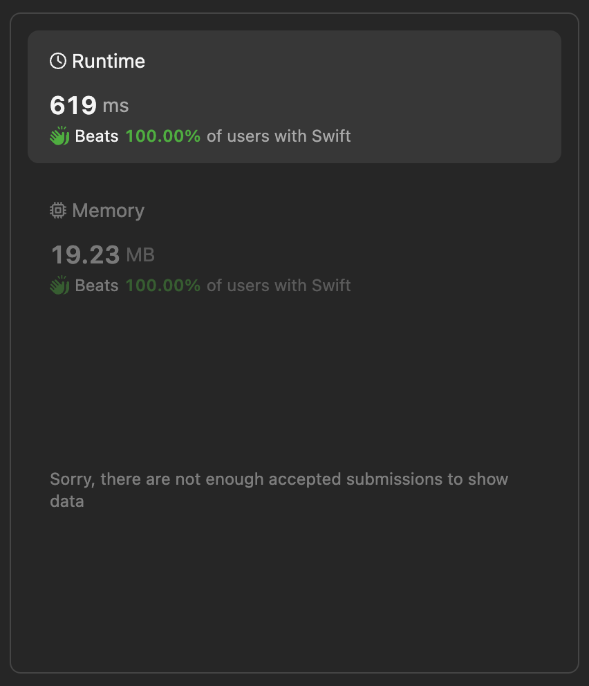

# Array Permutation 🚦 Optimal implementation in Swift

**Author:** lebon
**Votes:** 0
**Link:** [https://leetcode.com/problems/find-the-minimum-cost-array-permutation/solutions/5158762/](https://leetcode.com/problems/find-the-minimum-cost-array-permutation/solutions/5158762/)

---


## Intuition
The problem involves finding a permutation of a given list of numbers such that the sum of the absolute differences between consecutive elements in the permutation is minimized. The challenge can be approached by exploring all possible permutations and evaluating the sum of absolute differences for each. However, a more efficient method involves using **dynamic programming** (**DP**) with memoization to systematically explore and record the optimal solutions for subproblems, thus avoiding redundant computations.

## Approach
1. **Initialization**:
   - We use two 2D arrays, `val` and `dp`, to store intermediate results. `val` keeps track of the next number to visit, and `dp` holds the minimum cost for each state.

2. **Helper Function (`popcount`)**:
   - This function calculates the number of set bits (1s) in the binary representation of an integer, which helps in determining how many numbers have been visited.

3. **Depth-First Search (DFS) with Memoization (`dfs`)**:
   - The `dfs` function explores all possible paths starting from a given mask and position `p`.
   - `mask` is a bitmask where each bit represents whether a corresponding number in `nums` has been visited.
   - If all numbers are visited (`popcount(mask) == nums.count`), it returns the absolute difference between the current number and the first number.
   - For each unvisited number, it calculates the cost of visiting that number and recursively explores further paths. The minimum cost path is stored in `dp[p][mask]`, and the next number to visit is stored in `val[p][mask]`.

4. **Finding the Permutation (`findPermutation`)**:
   - The `findPermutation` function initializes the `dp` array to -1, indicating uncomputed states.
   - It starts the DFS with the initial mask including the first number (`1 << 0`).
   - After completing the DFS, it reconstructs the optimal permutation by following the indices stored in the `val` array.

5. **Reconstruction of the Path**:
   - Starting from the initial number, the optimal path is reconstructed by sequentially appending the next number as indicated by the `val` array.

## Complexity
- **Time complexity**: 
  - The time complexity is $$O(n^2 \	imes 2^n) $$, where $$n$$ is the number of elements in `nums`. This is because there are $$2^n$$ possible states (subsets of `nums`), and for each state, we potentially explore $$n$$ transitions.
  
- **Space complexity**: 
  - The space complexity is $$O(n \	imes 2^n)$$ due to the storage required for the `dp` and `val` arrays. Each array has dimensions corresponding to the number of elements and the number of subsets.




# Code
``` swift []
class Solution {

    var val: [[Int]] = Array(repeating: Array(repeating: 0, count: 16384), count: 14)
    var dp: [[Int]] = Array(repeating: Array(repeating: -1, count: 16384), count: 14)
    
    func popcount(_ x: Int) -> Int {
        return x.nonzeroBitCount
    }
    
    func dfs(_ mask: UInt32, _ p: Int, _ nums: [Int]) -> Int {
        // If all numbers are used, return the distance from the current number to the first number
        if popcount(Int(mask)) == nums.count {
            return abs(p - nums[0])
        }
        
        // If dp[p][mask] is uncomputed (-1), calculate it
        if dp[p][Int(mask)] < 0 {
            dp[p][Int(mask)] = Int.max
            for n in 1..<nums.count {
                if (mask & (1 << n)) == 0 {
                    let newMask = mask | (1 << n)
                    let res_n = abs(p - nums[n]) + dfs(newMask, n, nums)
                    if res_n < dp[p][Int(mask)] {
                        dp[p][Int(mask)] = res_n
                        val[p][Int(mask)] = n
                    }
                }
            }
        }
        return dp[p][Int(mask)]
    }

    func findPermutation(_ nums: [Int]) -> [Int] {
        // Initialize dp array with -1
        dp = Array(repeating: Array(repeating: -1, count: 16384), count: 14)
        
        // Start the dfs with the first number included in the mask (1 << 0)
        dfs(1, 0, nums)
        
        // Build the result permutation from the val table
        var res: [Int] = [0]
        var mask: UInt32 = 1
        while popcount(Int(mask)) < nums.count {
            res.append(val[res.last!][Int(mask)])
            mask |= 1 << res.last!
        }
        
        return res
    }
}
```

This approach ensures that we efficiently find the optimal permutation by systematically exploring and memoizing subproblem solutions, thus reducing the computational overhead compared to a naive approach of evaluating all permutations.


