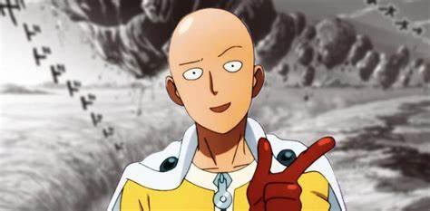

# 100 % Faster || Straightforward + Bitwise XOR

**Author:** gameboey
**Votes:** 45
**Link:** [https://leetcode.com/problems/special-array-i/solutions/5181123/](https://leetcode.com/problems/special-array-i/solutions/5181123/)

---

# Intuition
Check adjacent numbers simultaneously if their parity is same or not.

# Approach: Straightforward
#### Problem states that a special array is one which do not have any consecutive pair with same parity.

- **What is parity**?
It refers to whether a number is even (0) or odd (1).

- Now that we know what parity means, it really becomes a straight forward question:

 We can just traverse through the array from index 1 (so that we can access the element at 0th index while comparison) and compare two consecutive element's parity, which we can do by taking their mods with 2 as we all know. 


# Complexity
- Time complexity: O(n)

- Space complexity: O(1)

# Code
```java []
class Solution {
    public boolean isArraySpecial(int[] nums) {
        for(int i = 1; i < nums.length; ++i) {
            if(nums[i - 1] % 2 == nums[i] % 2) {
                return false;
            }
        }

        return true;
    }
}
```
```C++ []
class Solution {
public:
    bool isArraySpecial(vector<int>& nums) {
        for(int i = 1; i < nums.size(); ++i) {
            if(nums[i - 1] % 2 == nums[i] % 2) {
                return false;
            }
        }    
        
        return true;
    }
};
```
```python []
class Solution:
    def isArraySpecial(self, nums: List[int]) -> bool:
        for i in range(1, len(nums)) :
            if nums[i - 1] % 2 == nums[i] % 2 :
                return False

        return True
```
```javascript []
/**
 * @param {number[]} nums
 * @return {boolean}
 */
var isArraySpecial = function(nums) {
    for(let i = 1; i < nums.length; ++i) {
        if(nums[i - 1] % 2 == nums[i] % 2) {
            return false;
        }
    }

    return true;
};
```
```Go []
func isArraySpecial(nums []int) bool {
    for i := 1; i < len(nums); i++ {
        if nums[i - 1] % 2 == nums[i] % 2 {
            return false;
        }
    }

    return true;
}
```
```Kotlin []
class Solution {
    fun isArraySpecial(nums: IntArray): Boolean {
        for(i in 1 until nums.size) {
            if(nums[i - 1] % 2 == nums[i] % 2) {
                return false;
            }
        }

        return true;
    }
}
```

---


# Approach: Bitwise XOR
##### By performing (element & 1), we can determine the parity of the number, we also know that bitwise xor of same numbers is 0 so we can simply return false if the xor of any two consecutive numbers' parity is 0.


# Complexity
- Time complexity: O(n)

- Space complexity: O(1)

---

# Code:

```c++ []
class Solution {
public:
    bool isArraySpecial(vector<int>& nums) {
        for(int i = 1; i < nums.size(); ++i) {
            if((nums[i - 1] & 1) ^ (nums[i] & 1) == 0) {
                return false;
            }
        }    
        
        return true;
    }
};
```
```java []
class Solution {
    public boolean isArraySpecial(int[] nums) {
        for(int i = 1; i < nums.length; ++i) {
            if(((nums[i - 1] & 1) ^ (nums[i] & 1)) == 0) {
                return false;
            }
        }

        return true;
    }
}
```
```python []
class Solution:
    def isArraySpecial(self, nums: List[int]) -> bool:
        for i in range(1, len(nums)) :
            if (nums[i - 1] & 1) ^ (nums[i] & 1) == 0:
                return False

        return True
```
```javascript []
/**
 * @param {number[]} nums
 * @return {boolean}
 */
var isArraySpecial = function(nums) {
    for(let i = 1; i < nums.length; ++i) {
        if((nums[i - 1] & 1) ^ (nums[i] & 1) == 0) {
            return false;
        }
    }

    return true;
};
```
```Go []
func isArraySpecial(nums []int) bool {
    for i := 1; i < len(nums); i++ {
        if (nums[i - 1] & 1) ^ (nums[i] & 1) == 0 {
            return false;
        }
    }

    return true;
}
```
```kotlin []
class Solution {
    fun isArraySpecial(nums: IntArray): Boolean {
        for(i in 1 until nums.size) {
            if((nums[i - 1] and 1) xor (nums[i] and 1) == 0) {
                return false;
            }
        }

        return true;
    }
}
}
```
---

### In a world full of complexities, sometimes being straightforward is the greatest power.

