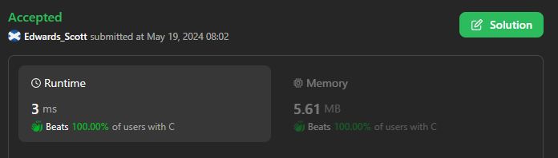
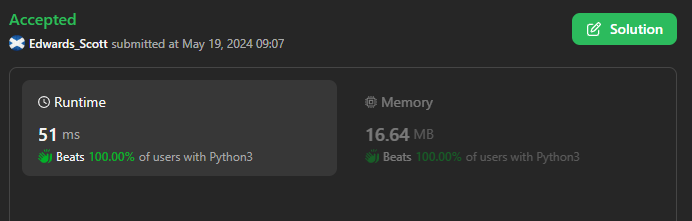
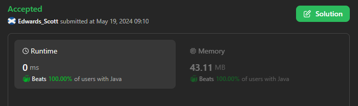

# 🏆💢💯 Faster✅💯 Lesser🧠 🎯 C++✅Python3🐍✅Java✅C✅Python🐍✅Contest 19/5/24💥Explained☠💥🔥Beats 💯

**Author:** Edwards310
**Votes:** 2
**Link:** [https://leetcode.com/problems/special-array-i/solutions/5177162/](https://leetcode.com/problems/special-array-i/solutions/5177162/)

---

# Intuition





```C++ []
class Solution {
public:
    bool isArraySpecial(vector<int>& nums) {
        if(nums.size() == 1)
            return true;
        for(int i = 0; i < nums.size() - 1; i++)
            if(nums[i] % 2 == nums[i + 1] % 2)
                return false;
        return true;
    }
};
```
```python3 []
class Solution:
    def isArraySpecial(self, nums: List[int]) -> bool:
        n = len(nums)
        if n == 1:
            return True
        for i in range(n - 1):
            if nums[i] % 2 == nums[i + 1] % 2:
                return False
        return True
```
```Java []
class Solution {
    public boolean isArraySpecial(int[] nums) {
        if(nums.length == 1)
            return true;
        for(int i = 0; i < nums.length - 1; i++)
            if(nums[i] % 2 == nums[i + 1] % 2)
                return false;
        return true;
    }
}
```
```C []
bool isArraySpecial(int* nums, int numsSize) {
    if(numsSize == 1)
        return true;
    for(int i = 0; i < numsSize - 1; i++)
        if(nums[i] % 2 == nums[i + 1] % 2)
            return false;
    return true;
}
```
<!-- Describe your first thoughts on how to solve this problem. -->

# Approach
<!-- Describe your approach to solving the problem. -->

# Complexity
- Time complexity:
<!-- Add your time complexity here, e.g. $$O(n)$$ -->
      O(n)
- Space complexity:
<!-- Add your space complexity here, e.g. $$O(n)$$ -->
      O(1)
# Code
```
class Solution {
    public boolean isArraySpecial(int[] nums) {
        if(nums.length == 1)
            return true;
        for(int i = 0; i < nums.length - 1; i++)
            if(nums[i] % 2 == nums[i + 1] % 2)
                return false;
        return true;
    }
}
```
***Plese upvote if it's useful for you***

