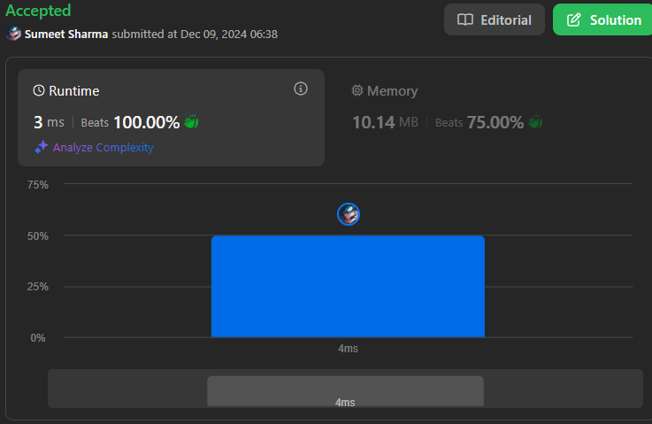

# Simple Prefix Solution 100% Beats

**Author:** Sumeet_Sharma-1
**Votes:** 85
**Link:** [https://leetcode.com/problems/special-array-ii/solutions/6127355/](https://leetcode.com/problems/special-array-ii/solutions/6127355/)

---

# \uD83E\uDDE0 Intuition
Imagine you\u2019re looking at a lineup of numbers \uD83E\uDDEE, and your job is to find pairs of neighbors that have the same "team":
- Team \uD83D\uDFE2: Both numbers are **even** (e.g., 4, 6).
- Team \uD83D\uDD34: Both numbers are **odd** (e.g., 3, 1).

These are called **special pairs**. For example:
- In `[4, 3, 1, 6]`, `(3, 1)` is a special pair because they\u2019re both odd \uD83D\uDD34.
- `(4, 3)` isn\u2019t special since one is even \uD83D\uDFE2 and the other is odd \uD83D\uDD34.

Now, we\u2019re asked to check for each query `[left, right]` if there are **no special pairs** between those indices. Instead of counting from scratch every time, we can use a clever trick \u2014 **prefix sums**! \u2728

---

# \uD83D\uDEE0\uFE0F Approach
### Step 1: Build the Prefix Array
We use a `prefix` array to count special pairs as we move through `nums`:
- If two consecutive numbers have the same "team" (both \uD83D\uDFE2 or both \uD83D\uDD34), we increase the count.
- Otherwise, the count stays the same.

For example, in `[4, 3, 1, 6]`:
- At index `0`: No pairs yet \u2192 `prefix[0] = 0`.
- At index `1`: `(4, 3)` isn\u2019t special \u2192 `prefix[1] = 0`.
- At index `2`: `(3, 1)` is special \u2192 `prefix[2] = 1`.
- At index `3`: `(1, 6)` isn\u2019t special \u2192 `prefix[3] = 1`.

Final prefix array: `[0, 0, 1, 1]`.

### Step 2: Process Queries
For each query `[left, right]`:
- Calculate the number of special pairs in the range using the prefix array:
- specialCount = prefix[right] - (left > 0 ? prefix[left - 1] : 0);

### \u23F1\uFE0F Complexity
Time Complexity:
- Building the prefix array: O(n) (where n is the size of nums).
Answering queries: O(q) (where q is the number of queries).
- Total: O(n + q).




### Space Complexity:
- Storing the prefix array: O(n).
- Total: O(n).


# Code
```cpp []
class Solution {
public:
    vector<bool> isArraySpecial(vector<int>& nums, vector<vector<int>>& queries) {
        int n = nums.size();
        vector<int> prefix(n, 0); // Initialize prefix array with size n
        
        // Calculate the prefix array
        for (int i = 1; i < n; i++) {
            prefix[i] = prefix[i - 1];
            if ((nums[i - 1] % 2 == 0 && nums[i] % 2 == 0) || (nums[i - 1] % 2 != 0 && nums[i] % 2 != 0)) {
                prefix[i]++;
            }
        }

        vector<bool> ans; // Result vector
        
        // Process the queries
        for (auto& q : queries) {
            int left = q[0], right = q[1];
            int specialCount = prefix[right] - (left > 0 ? prefix[left] : 0);
            ans.push_back(specialCount == 0);
        }

        return ans; // Return the result
    }
};

```
```javascript []
/**
 * @param {number[]} nums
 * @param {number[][]} queries
 * @return {boolean[]}
 */
var isArraySpecial = function(nums, queries) {
    const n = nums.length;
    const prefix = Array(n).fill(0);  // Initialize prefix array

    // Build the prefix array to count special pairs
    for (let i = 1; i < n; i++) {
        prefix[i] = prefix[i - 1];
        if ((nums[i - 1] % 2 === 0 && nums[i] % 2 === 0) || 
            (nums[i - 1] % 2 !== 0 && nums[i] % 2 !== 0)) {
            prefix[i]++;
        }
    }

    const result = [];

    // Process each query
    for (let i = 0; i < queries.length; i++) {
        const [left, right] = queries[i];
        const specialCount = prefix[right] - (left > 0 ? prefix[left] : 0);
        result.push(specialCount === 0);
    }

    return result;
};

```
```java []
class Solution {
    public boolean[] isArraySpecial(int[] nums, int[][] queries) {
        int n = nums.length;
        int[] prefix = new int[n]; // Prefix array to count special pairs
        boolean[] result = new boolean[queries.length]; // Result array
        
        // Step 1: Build the prefix array
        for (int i = 1; i < n; i++) {
            prefix[i] = prefix[i - 1];
            if ((nums[i - 1] % 2 == 0 && nums[i] % 2 == 0) || 
                (nums[i - 1] % 2 != 0 && nums[i] % 2 != 0)) {
                prefix[i]++;
            }
        }

        // Step 2: Process each query
        for (int i = 0; i < queries.length; i++) {
            int left = queries[i][0];
            int right = queries[i][1];
            
            // Calculate the number of special pairs in the range
            int specialCount = prefix[right] - (left > 0 ? prefix[left] : 0);
            
            // If no special pairs, the result is true; otherwise, false
            result[i] = (specialCount == 0);
        }

        return result;
    }
}

```
```python3 []
class Solution:
    def isArraySpecial(self, nums: List[int], queries: List[List[int]]) -> List[bool]:
        n = len(nums)
        prefix = [0] * n  # Prefix array to count special pairs

        # Build the prefix array
        for i in range(1, n):
            prefix[i] = prefix[i - 1]
            if (nums[i - 1] % 2 == 0 and nums[i] % 2 == 0) or (nums[i - 1] % 2 != 0 and nums[i] % 2 != 0):
                prefix[i] += 1

        result = []  # Result list

        # Process each query
        for left, right in queries:
            special_count = prefix[right] - (prefix[left] if left > 0 else 0)
            result.append(special_count == 0)

        return result

```
```Ruby []
# @param {Integer[]} nums
# @param {Integer[][]} queries
# @return {Boolean[]}
def is_array_special(nums, queries)
    n = nums.length
    prefix = Array.new(n, 0)  # Initialize prefix array
    
    # Build the prefix array to count special pairs
    for i in 1...n
        prefix[i] = prefix[i - 1]
        if (nums[i - 1] % 2 == 0 && nums[i] % 2 == 0) || (nums[i - 1] % 2 != 0 && nums[i] % 2 != 0)
            prefix[i] += 1
        end
    end

    result = []  # Result array

    # Process each query
    queries.each do |query|
        left, right = query
        special_count = prefix[right] - (left > 0 ? prefix[left] : 0)
        result << (special_count == 0)
    end

    result  # Return the result array
end

```
```C# []
public class Solution {
    public bool[] IsArraySpecial(int[] nums, int[][] queries) {
        int n = nums.Length;
        int[] prefix = new int[n]; // Prefix array to count special pairs
        bool[] result = new bool[queries.Length]; // Result array

        // Build the prefix array
        for (int i = 1; i < n; i++) {
            prefix[i] = prefix[i - 1];
            if ((nums[i - 1] % 2 == 0 && nums[i] % 2 == 0) || 
                (nums[i - 1] % 2 != 0 && nums[i] % 2 != 0)) {
                prefix[i]++;
            }
        }

        // Process each query
        for (int i = 0; i < queries.Length; i++) {
            int left = queries[i][0];
            int right = queries[i][1];
            
            // Calculate the number of special pairs in the range
            int specialCount = prefix[right] - (left > 0 ? prefix[left] : 0);
            
            // If no special pairs, the result is true; otherwise, false
            result[i] = (specialCount == 0);
        }

        return result;
    }
}

```
```C []
#include <stdlib.h>
#include <stdbool.h>

bool* isArraySpecial(int* nums, int numsSize, int** queries, int queriesSize, int* queriesColSize, int* returnSize) {
    // Allocate memory for the result array
    bool* result = (bool*)malloc(queriesSize * sizeof(bool));
    *returnSize = queriesSize;

    // Create the prefix array
    int* prefix = (int*)malloc(numsSize * sizeof(int));
    prefix[0] = 0;

    for (int i = 1; i < numsSize; i++) {
        prefix[i] = prefix[i - 1];
        if ((nums[i - 1] % 2 == 0 && nums[i] % 2 == 0) || (nums[i - 1] % 2 != 0 && nums[i] % 2 != 0)) {
            prefix[i]++;
        }
    }

    // Process each query
    for (int i = 0; i < queriesSize; i++) {
        int left = queries[i][0];
        int right = queries[i][1];
        int specialCount = prefix[right] - (left > 0 ? prefix[left] : 0);
        result[i] = (specialCount == 0);
    }

    // Free allocated memory for prefix array
    free(prefix);

    return result;
}

```
```Rust []
impl Solution {
    pub fn is_array_special(nums: Vec<i32>, queries: Vec<Vec<i32>>) -> Vec<bool> {
        let n = nums.len();
        let mut prefix = vec![0; n]; // Initialize prefix array

        // Build the prefix array to count special pairs
        for i in 1..n {
            prefix[i] = prefix[i - 1];
            if (nums[i - 1] % 2 == 0 && nums[i] % 2 == 0) || (nums[i - 1] % 2 != 0 && nums[i] % 2 != 0) {
                prefix[i] += 1;
            }
        }

        let mut result = Vec::new(); // Result vector

        // Process each query
        for q in queries {
            let left = q[0] as usize;
            let right = q[1] as usize;
            let special_count = prefix[right] - (if left > 0 { prefix[left] } else { 0 });
            result.push(special_count == 0);
        }

        result // Return the result
    }
}

```