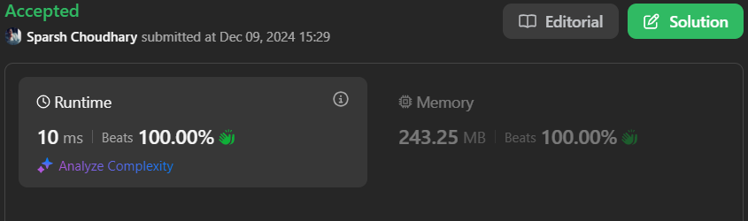
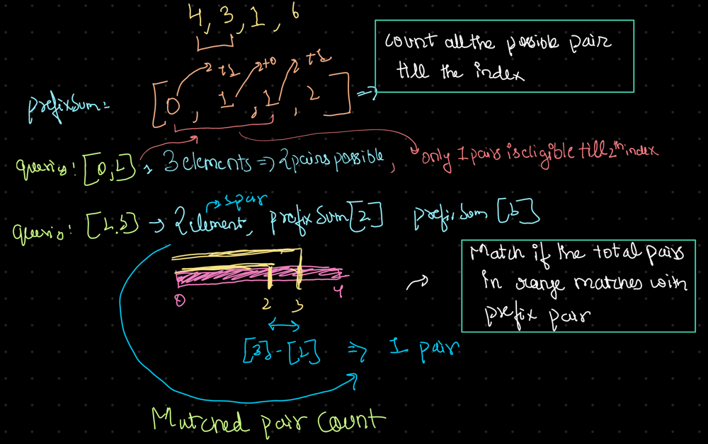

# 🔥BEATS 💯 % 🎯 |✨SUPER EASY BEGINNERS 👏

**Author:** CodeWithSparsh
**Votes:** 2
**Link:** [https://leetcode.com/problems/special-array-ii/solutions/6128620/](https://leetcode.com/problems/special-array-ii/solutions/6128620/)

---



---




---

# Intuition
To determine if a subarray is "special," we need to evaluate if adjacent numbers within the range alternate between even and odd. Instead of checking each query from scratch, we use a **prefix sum** approach to efficiently count the valid adjacent pairs.

---

# Approach
1. **Compute a Prefix Sum Array**:
   - Create a `prefixSum` array where each index `i` keeps track of the number of valid alternating (even-odd or odd-even) adjacent pairs up to that index.
   - Increment the prefix sum at index `i` when the adjacent numbers alternate.
2. **Process Queries**:
   - For each query, calculate the total number of pairs in the range `[left, right]` as `right - left`.
   - Calculate the valid pairs using the prefix sum array: `prefixSum[right] - prefixSum[left]`.
   - If the number of valid pairs equals the total number of pairs, the subarray is "special."

---

# Complexity
- **Time Complexity**:
  - Prefix sum computation: $$O(n)$$
  - Processing queries: $$O(q)$$ (where `q` is the number of queries)
  - Total: $$O(n + q)$$

- **Space Complexity**:
  $$O(n)$$ for the prefix sum array.

---


```python []
class Solution:
    def isArraySpecial(self, nums, queries):
        # Step 1: Compute prefixSum
        prefixSum = [0] * len(nums)
        for i in range(1, len(nums)):
            prefixSum[i] = prefixSum[i - 1]
            if (nums[i] % 2 == 0 and nums[i - 1] % 2 != 0) or (nums[i] % 2 != 0 and nums[i - 1] % 2 == 0):
                prefixSum[i] += 1

        # Step 2: Process queries
        solution = []
        for left, right in queries:
            totalPairs = right - left
            validPairs = prefixSum[right] - prefixSum[left]
            solution.append(validPairs == totalPairs)
        
        return solution
```


```cpp []
#include <vector>
using namespace std;

class Solution {
public:
    vector<bool> isArraySpecial(vector<int>& nums, vector<vector<int>>& queries) {
        int n = nums.size();
        vector<int> prefixSum(n, 0);

        // Step 1: Compute prefixSum
        for (int i = 1; i < n; i++) {
            prefixSum[i] = prefixSum[i - 1];
            if ((nums[i] % 2 == 0 && nums[i - 1] % 2 != 0) || (nums[i] % 2 != 0 && nums[i - 1] % 2 == 0)) {
                prefixSum[i]++;
            }
        }

        // Step 2: Process queries
        vector<bool> solution;
        for (auto& query : queries) {
            int left = query[0], right = query[1];
            int totalPairs = right - left;
            int validPairs = prefixSum[right] - prefixSum[left];
            solution.push_back(validPairs == totalPairs);
        }

        return solution;
    }
};
```


```java []
import java.util.*;

class Solution {
    public List<Boolean> isArraySpecial(int[] nums, int[][] queries) {
        int n = nums.length;
        int[] prefixSum = new int[n];

        // Step 1: Compute prefixSum
        for (int i = 1; i < n; i++) {
            prefixSum[i] = prefixSum[i - 1];
            if ((nums[i] % 2 == 0 && nums[i - 1] % 2 != 0) || (nums[i] % 2 != 0 && nums[i - 1] % 2 == 0)) {
                prefixSum[i]++;
            }
        }

        // Step 2: Process queries
        List<Boolean> solution = new ArrayList<>();
        for (int[] query : queries) {
            int left = query[0];
            int right = query[1];
            int totalPairs = right - left;
            int validPairs = prefixSum[right] - prefixSum[left];
            solution.add(validPairs == totalPairs);
        }

        return solution;
    }
}
```


```go []
func isArraySpecial(nums []int, queries [][]int) []bool {
    n := len(nums)
    prefixSum := make([]int, n)

    // Step 1: Compute prefixSum
    for i := 1; i < n; i++ {
        prefixSum[i] = prefixSum[i-1]
        if (nums[i]%2 == 0 && nums[i-1]%2 != 0) || (nums[i]%2 != 0 && nums[i-1]%2 == 0) {
            prefixSum[i]++
        }
    }

    // Step 2: Process queries
    result := []bool{}
    for _, query := range queries {
        left, right := query[0], query[1]
        totalPairs := right - left
        validPairs := prefixSum[right] - prefixSum[left]
        result = append(result, validPairs == totalPairs)
    }

    return result
}
```


```javascript []
var isArraySpecial = function(nums, queries) {
    let n = nums.length;
    let prefixSum = new Array(n).fill(0);

    // Step 1: Compute prefixSum
    for (let i = 1; i < n; i++) {
        prefixSum[i] = prefixSum[i - 1];
        if ((nums[i] % 2 === 0 && nums[i - 1] % 2 !== 0) || (nums[i] % 2 !== 0 && nums[i - 1] % 2 === 0)) {
            prefixSum[i]++;
        }
    }

    // Step 2: Process queries
    let solution = [];
    for (let query of queries) {
        let [left, right] = query;
        let totalPairs = right - left;
        let validPairs = prefixSum[right] - prefixSum[left];
        solution.push(validPairs === totalPairs);
    }

    return solution;
};
```


```dart []
class Solution {
  List<bool> isArraySpecial(List<int> nums, List<List<int>> queries) {
    // Step 1: Compute prefixSum
    List<int> prefixSum = List.filled(nums.length, 0);
    for (int i = 1; i < nums.length; i++) {
      prefixSum[i] = prefixSum[i - 1];
      if ((nums[i] % 2 == 0 && nums[i - 1] % 2 != 0) ||
          (nums[i] % 2 != 0 && nums[i - 1] % 2 == 0)) {
        prefixSum[i] += 1;
      }
    }

    // Step 2: Process queries
    List<bool> solution = [];
    for (List<int> query in queries) {
      int left = query[0];
      int right = query[1];

      int totalPairs = right - left;
      int validPairs = prefixSum[right] - prefixSum[left];

      solution.add(validPairs == totalPairs);
    }

    return solution;
  }
}
```

---

 {:style='width:250px'}