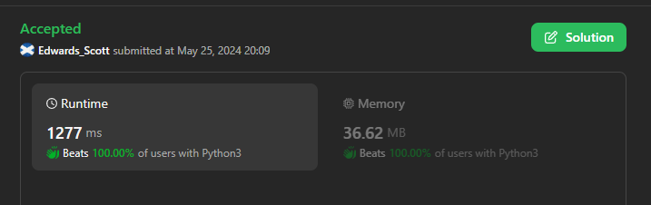
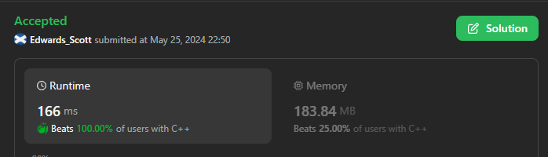
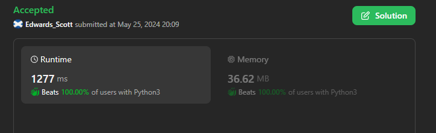

# ☠💀💯 Faster✅💯 Lesser🧠 🎯 C++✅Python3✅Java✅C✅Python✅💥🔥💫Explained☠💥🔥 Beats 💯

**Author:** Edwards310
**Votes:** 2
**Link:** [https://leetcode.com/problems/find-occurrences-of-an-element-in-an-array/solutions/5207070/](https://leetcode.com/problems/find-occurrences-of-an-element-in-an-array/solutions/5207070/)

---

# Intuition






```C++ []
class Solution {
public:
    vector<int> occurrencesOfElement(vector<int>& nums, vector<int>& queries, int x) {
        vector<int> v, ans;
        for (int i = 0; i < nums.size(); i++) {
            if (nums[i] == x) {
                v.push_back(i);
            }
        }
        for (auto& x : queries) {
            if (v.size() < x) {
                ans.push_back(-1);
            } else {
                ans.push_back(v[x - 1]);
            }
        }

        return ans;
    }
};
```
```python3 []
class Solution:
    def occurrencesOfElement(self, nums: List[int], queries: List[int], x: int) -> List[int]:
        num_indices = {}
        for i, num in enumerate(nums):
            if num in num_indices:
                num_indices[num].append(i)
            else:
                num_indices[num] = [i]

        # Process queries
        answer = []
        for query in queries:
            if x not in num_indices or query > len(num_indices[x]):
                answer.append(-1)
            else:
                answer.append(num_indices[x][query - 1])
        return answer
```
```Java []
class Solution {
    public int[] occurrencesOfElement(int[] nums, int[] queries, int x) {
        int len = nums.length;
        List<Integer> nm = new ArrayList<Integer>();
        for (int i = 0; i < len; i++) {
            if (x == nums[i]) {
                nm.add(i);
            }
        }
        len = queries.length;
        int ans[] = new int[len];
        for (int i = 0; i < len; i++) {
            int val = queries[i];
            ans[i] = val > nm.size() ? -1 : nm.get(val - 1);
        }
        return ans;
    }
}
```
``` C []
/**
 * Note: The returned array must be malloced, assume caller calls free().
 */
int* occurrencesOfElement(int* nums, int numsSize, int* queries, int queriesSize, int x, int* returnSize) {
    int* x_idx = (int*)malloc(sizeof(int) * numsSize);
    int x_len = 0;
    int* ans = (int*)malloc(sizeof(int) * queriesSize);
    *returnSize = queriesSize;
    for (int i = 0; i < numsSize; i++) {
        if (nums[i] == x)
            x_idx[x_len++] = i;
    }

    for (int i = 0; i < queriesSize; i++) {
        if (queries[i] <= x_len)
            ans[i] = x_idx[queries[i] - 1];
         else 
            ans[i] = -1;
        
    }
    free(x_idx);
    return ans;
}
```
```Python []
class Solution(object):
    def occurrencesOfElement(self, nums, queries, x):
        """
        :type nums: List[int]
        :type queries: List[int]
        :type x: int
        :rtype: List[int]
        """
        num_indices = {}
        for i, num in enumerate(nums):
            if num in num_indices:
                num_indices[num].append(i)
            else:
                num_indices[num] = [i]

        
        answer = []
        for query in queries:
            if x not in num_indices or query > len(num_indices[x]):
                answer.append(-1)
            else:
                answer.append(num_indices[x][query - 1])
        return answer
```
<!-- Describe your first thoughts on how to solve this problem. -->

# Approach
<!-- Describe your approach to solving the problem. -->

# Complexity
- Time complexity:
<!-- Add your time complexity here, e.g. $$O(n)$$ -->
     O(n)
- Space complexity:
<!-- Add your space complexity here, e.g. $$O(n)$$ -->
     O(h)
# Code
```
class Solution:
    def occurrencesOfElement(self, nums: List[int], queries: List[int], x: int) -> List[int]:
        num_indices = {}
        for i, num in enumerate(nums):
            if num in num_indices:
                num_indices[num].append(i)
            else:
                num_indices[num] = [i]

        # Process queries
        answer = []
        for query in queries:
            if x not in num_indices or query > len(num_indices[x]):
                answer.append(-1)
            else:
                answer.append(num_indices[x][query - 1])
        return answer
```