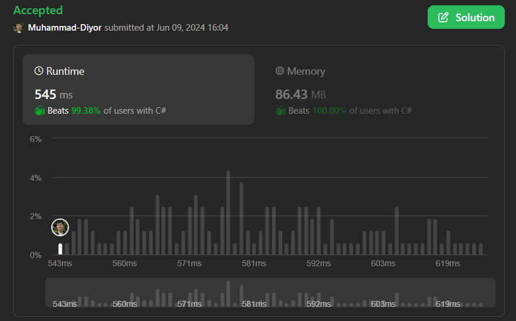

# ✅Beats 99% | Java/C# solution using HashMap | Easy to understand

**Author:** Muhammad-Diyor
**Votes:** 4
**Link:** [https://leetcode.com/problems/find-occurrences-of-an-element-in-an-array/solutions/5284338/](https://leetcode.com/problems/find-occurrences-of-an-element-in-an-array/solutions/5284338/)

---

# Intuition / Approach
So, the problem is asking us to return the indexes of `queries[i]`th occurence of `x` in `nums` array.

So, we are going to search for occurences of `x` in `nums` array and put every occurence in a HashMap where every pair is consisted of the occurence count and index of the occurance. 

Then we'll iterate over queries and get the `queries[i]`th occurence from the HashMap and put it in the queries[i] back. And if there's no `queries[i]` key in our HashMap, we put -1. That's all.

# Complexity
- Time complexity:
O(n + m), where `n` is the length of `nums` and `m` is the length of `queries`.

- Space complexity:
O(n), where `n` is the length of `nums`.


# Code
```C# []
public class Solution {
    public int[] OccurrencesOfElement(int[] nums, int[] queries, int x) {
        Dictionary<int, int> map = new Dictionary<int, int>();
        int counter = 1;
        for(int i = 0; i < nums.Length; i++){
            if(nums[i] == x){
                map.Add(counter, i);
                counter++;
            }            
        }
        for(int  i = 0; i < queries.Length; i++){
            if(!map.ContainsKey(queries[i])) queries[i] = -1;
            else queries[i] = map[queries[i]];
        }
        return queries;
    }
}
```
```Java []
class Solution {
    public int[] occurrencesOfElement(int[] nums, int[] queries, int x) {
        HashMap<Integer, Integer> map = new HashMap<>();
        int counter = 1;
        for(int i = 0; i < nums.length; i++){
            if(nums[i] == x){
                map.put(counter, i);
                counter++;
            }            
        }
        for(int  i = 0; i < queries.length; i++){
            if(!map.containsKey(queries[i])) queries[i] = -1;
            else queries[i] = map.get(queries[i]);
        }
        return queries;
    }
}
```

# Upvote if helped
## 1 upvote = 10 pushups


