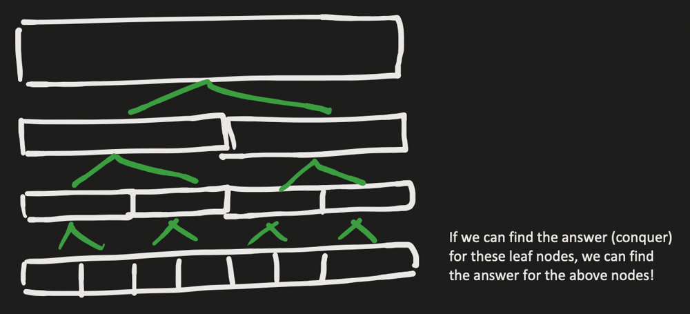
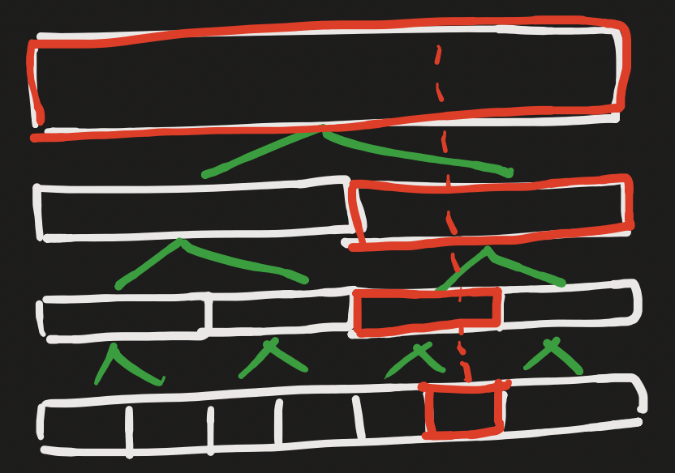
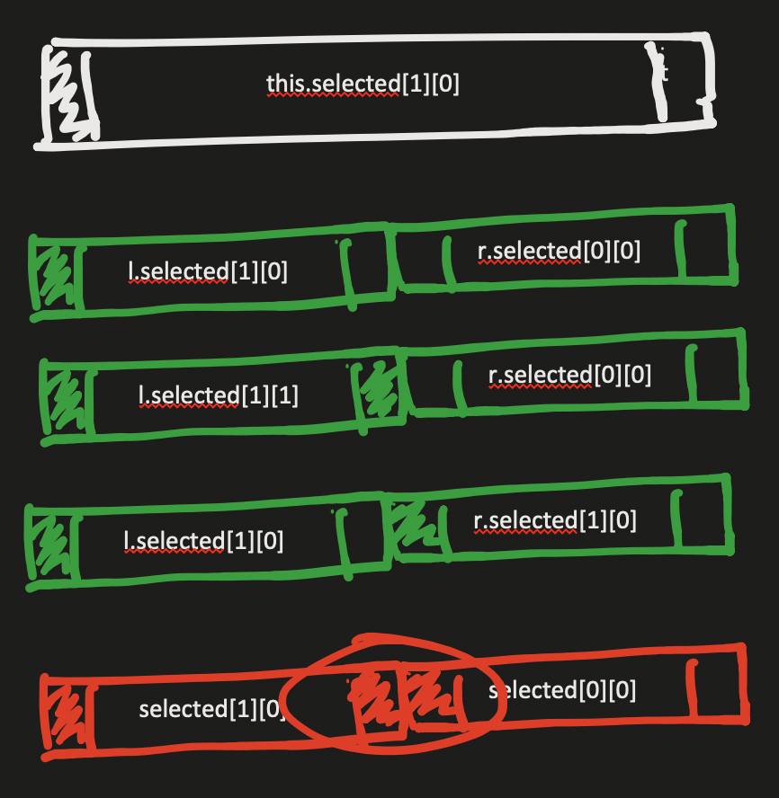

# Segment Tree

**Author:** jeffreyhu8
**Votes:** 74
**Link:** [https://leetcode.com/problems/maximum-sum-of-subsequence-with-non-adjacent-elements/solutions/5208917/](https://leetcode.com/problems/maximum-sum-of-subsequence-with-non-adjacent-elements/solutions/5208917/)

---

# Intuition
Let $$n = \	extrm{nums.length}, q=\	extrm{queries.length}$$.

We can use dynamic programming to solve a query for any instance of `nums` in $$O(n)$$ time, yielding a total runtime of $$O(nq)$$. This is too slow. The problem is that for every query, we use $$O(n)$$ time to recalculate the entire answer despite just one element being modified. It would be nice if there was a way to update the answer faster.

We can update the answer in $$O(\\lg n)$$ time per query using a data structure known as a segment tree, which uses a divide and conquer strategy to quickly update an array and answer queries.

I will give a brief explanation of how a segment tree works for this problem, but I recommend first solving the [Point Update Range Sum](https://usaco.guide/gold/PURS) problem:
1. Keep an array `nums`, doing $$O(n)$$ preprocessing.
2. Update an element in $$O(\\lg n)$$ time.
3. Query the sum `nums[l] + nums[l + 1] + ... + nums[r]` in $$O(\\lg n)$$ time.

See the link above for a resource.

## Segment Tree
A segment tree answers queries on an array/segment/range by dividing the array into two roughly equally sized subarrays, solving/conquering the answer for each of the two subarrays, then "merging" the two subarrays' answers to get the answer for the whole array.


Moreover, there is something special about the way we divide this array. If we want to update an individual element, the answers to only $$O(\\lg n)$$ of the ranges will be changed!


So, we can query the answer to the whole array in $$O(1)$$ time by looking at the answer associated with topmost segment in the image, and we can update an element in the array by updating the answers to the $$O(\\lg n)$$ corresponding nodes. Note that if combining the answers from each of the two subarray children takes $$O(1)$$ time, then updating is $$O(\\lg n)$$ time.

# Approach
Keep a segment tree, where each node represents a range in `nums`, storing the bounds of the range `unsigned int lo, hi` as well as some values `long long selected[2][2]`, where `selected[i][j]` indicates the answer where the leftmost element in the range is selected iff `i = 1` and similarly for the rightmost element iff `j = 1`.

If we know `selected` for the left and right halves of the current segment, we can calculated `selected` for the current segment. For example, here is how to calculate `selected[1][0]`.



The outer endpoints of the two subarrays are fixed to be `1` and `0` since we are calculating `selected[1][0]`. The inner endpoints can be any values as long as they are not both `1`, as that would break the condition that no two adjacent elements are selected.

Thus, we can combine two segments by doing
```cpp
selected[1][0] = max(
    l->selected[1][0] + r->selected[0][0], max(
    l->selected[1][1] + r->selected[0][0], 
    l->selected[1][0] + r->selected[1][0]
));
```
and similarly for the other `selected` elements.

So, the solution is to initialize the segment tree, combining segments as shown above, then update each of the $$O(\\lg n)$$ segments associated with each query, again updating by combining segments as shown above. For each query, return the answer in the topmost node.

# Complexity
- Time complexity: $$O(n + q\\lg n)$$

- Space complexity: $$O(n + q)$$

# Code
```cpp
const long long inf = 1e18;
const long long mod = 1e9 + 7;

// Modified from https://github.com/kth-competitive-programming/kactl/blob/main/content/data-structures/LazySegmentTree.h
struct Node {
    Node *l = nullptr, *r = nullptr;
    unsigned int lo, hi;
    long long selected[2][2];

    Node(const vector<int> &nums, unsigned int lo, unsigned int hi) : lo(lo), hi(hi) {
        if (lo < hi) {
            unsigned int mid = (lo + hi) / 2;
            l = new Node(nums, lo, mid);
            r = new Node(nums, mid + 1, hi);

            combine();
        } else {
            selected[0][0] = 0;
            selected[0][1] = -inf;
            selected[1][0] = -inf;
            selected[1][1] = nums[lo];
        }
    }

    void combine() {
        selected[0][0] = max(l->selected[0][0] + r->selected[0][0], max(l->selected[0][1] + r->selected[0][0], l->selected[0][0] + r->selected[1][0]));
        selected[0][1] = max(l->selected[0][0] + r->selected[0][1], max(l->selected[0][1] + r->selected[0][1], l->selected[0][0] + r->selected[1][1]));
        selected[1][0] = max(l->selected[1][0] + r->selected[0][0], max(l->selected[1][1] + r->selected[0][0], l->selected[1][0] + r->selected[1][0]));
        selected[1][1] = max(l->selected[1][0] + r->selected[0][1], max(l->selected[1][1] + r->selected[0][1], l->selected[1][0] + r->selected[1][1]));
    }

    void update(int i, long long x) {
        if (i < lo || hi < i) {
            return;
        }

        if (lo == hi) {
            selected[0][0] = 0;
            selected[1][1] = x;
            return;
        }

        l->update(i, x);
        r->update(i, x);

        combine();
    }
};

class Solution {
  public:
    int maximumSumSubsequence(vector<int> &nums, vector<vector<int>> &queries) {
        Node segmentTree(nums, 0, nums.size() - 1);

        long long res = 0;
        for (auto &query : queries) {
            segmentTree.update(query[0], query[1]);
            res += max(segmentTree.selected[0][0], max(segmentTree.selected[0][1], max(segmentTree.selected[1][0], segmentTree.selected[1][1])));
            res %= mod;
        }
        return static_cast<int>(res);
    }
};
```